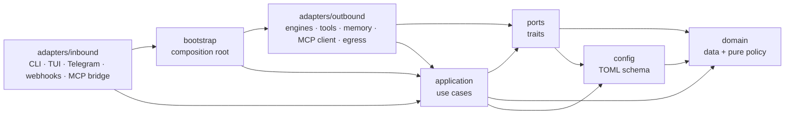

# Code map — where everything lives and how to extend it

> Index into the codebase. Interactive knowledge graph: [`code-map.html`](code-map.html) (open in a browser).
> Freshness is enforced: `tests/code_map.rs` fails if a source file is missing below or the graph in the `.html` is stale
> (regenerate: `TENGU_REGEN_CODE_MAP=1 cargo test --test code_map`). Deeper reads: [`architecture-2026-04-27.md`](architecture-2026-04-27.md) (per-turn flow), [`tools.md`](tools.md), [`context-management-2026-04-27.md`](context-management-2026-04-27.md).

## 1. Layers

| Layer | Path | May import | Enforced by |
|---|---|---|---|
| domain | `src/domain/` | `domain` only, no IO crates | `tests/layering_lint.rs` `RULES` |
| ports | `src/ports/` | domain, config | `RULES` |
| config | `src/config/` | domain | `RULES` |
| application | `src/application/` | domain, ports, config (std IO allowed) | `RULES` |
| outbound | `src/adapters/outbound/` | all but `adapters::inbound`, `bootstrap` | `FORBIDDEN` |
| bootstrap | `src/bootstrap/` | all but `adapters::inbound` | `FORBIDDEN` |
| inbound | `src/adapters/inbound/` | everything | — |

A use case needs something outside? Add a trait in `src/ports/`, implement it in `src/adapters/outbound/`, inject it in `src/bootstrap/`.

## 2. Where does X live

| Concern | File(s) |
|---|---|
| CLI subcommands (`chat status doctor telegram webhooks run decide a2a studio sandbox trace history backtest ranking evidence lineage soe sources risk eval secret keys prune mcp-bridge agentic-memory-server skill` + hidden `run-agent`, `tool`) | `src/adapters/inbound/cli/mod.rs` (`Commands` + `run`), bodies in `cli/{run_agent,skill,doctor,a2a,decide,studio,sandbox,trace,history,backtest,ranking,evidence,lineage,soe,sources,risk,keys,tool}.rs` + `cli/soe/weekly.rs` (the weekly `soe` commands); channel / server bodies `inbound/{tui/,telegram/,webhooks.rs,run.rs,a2a.rs,eval/,evolve.rs,mcp_bridge.rs,studio/}`; `a2a` / `decide` / `doctor` / `studio` / `history` / `risk` / `backtest` / `sources` / `ranking` log to stderr (`stdout_is_data`) |
| Hidden test commands `tengu tool list` (catalog names) · `tengu tool call` (one or a `--batch` of calls through the executor a `run-agent` child builds, `--transcript` = the conversation: bridge conformance; `--from-trace <run_id>:<seq>` = a traced call again) · `tengu tool turn` (one engine turn as any agent, private exec agents included — the `@<agent>` chat path; Claude Code tools through the real bridge: engine-matrix xm legs) | `src/adapters/inbound/cli/tool.rs` |
| Config schema, defaults, validation, loading | `src/config/mod.rs` (`Config`, `impl Default for Config`) · `agent.rs` (`AgentConfig`, `ENGINES`, engine blocks, `[orchestrator]`, `[[mcp_servers]]`) · `channels.rs` · `memory.rs` · `load.rs` (`Config::load`, `validation_errors`, `validate_agent`, `fold_default_scopes`); `default_*` fns beside their struct |
| `[egress]` schema / runtime policy | `src/config/egress.rs` / `src/adapters/outbound/egress.rs` |
| A2A — agents talk to other agent harnesses (`docs/a2a-2026-10-10.md`) | protocol (pure: v1.0 types, JSON-RPC, 0.3 dialect, card, text) `src/domain/a2a/` · `[a2a]` `src/config/a2a.rs` · client `src/adapters/outbound/a2a/mod.rs` (egress `peer_client`) + tool `src/adapters/outbound/tools/a2a/mod.rs` · server: port `src/ports/a2a.rs`, use case `src/application/a2a/` (methods, task store), runner + cards `src/bootstrap/a2a.rs`, HTTP `src/adapters/inbound/a2a.rs` (feature `a2a`) · CLI `src/adapters/inbound/cli/a2a.rs` · tests `tests/a2a_e2e.rs` |
| Config file resolution + `TENGU_HOME` | `src/config/paths.rs`, `src/bootstrap/sandbox.rs`, `cli/mod.rs::run` |
| Tool trait, contexts | `src/ports/tool.rs` (`Tool`, `ToolPlugin`, `ToolCtx`, `PluginCtx`, `ToolDirectory`) |
| Tool catalog (every built-in tool) | `src/adapters/outbound/tools/mod.rs` (`catalog`, `register_catalog`, `advertised_defs`) |
| Tool permissions | `src/domain/scope.rs` (`ToolScope`, `resolve_path`, `protected_write` — what writers refuse, `shell_command_binary` — what `shell_bins` gates; `protected_write_in` — plus the system-prompt files in a hardened sandbox, `AgentConfig::hardened`), `src/bootstrap/tools.rs` (`resolve_tool_scopes`, `permissive_scope` — the fallback: workspace, any host, any binary, no env var; deny-all when hardened; `fallback_scoped_tools`, `grant_workspace_root`, `compose_agent`, `workspace_or_temp` — a step / one-shot turn without `workspace` runs in a temp dir) |
| Opt-in tool names | `src/domain/tools.rs` (`WORKSPACE_TOOLS`) |
| Tool dispatch | `src/application/tools/registry.rs` (`ToolRegistry`, `PluginToolExecutor`) |
| Executor wiring (catalog + skills + MCP + scopes) | `src/bootstrap/tools.rs` (`assemble_executor`: the one assembly for chat, `run-agent` and the MCP bridge; `ToolStack`: redacting by construction) · one agent turn on it `src/bootstrap/turn.rs` |
| Engine trait | `src/ports/engine.rs` (`Engine`, `EngineContext`, `ToolExecutor`) |
| Engines + factory | `src/adapters/outbound/engines/{mod,openrouter,claude_code,codex}.rs` (`build_engine`) + `local.rs` + `cli_run.rs` (what the CLI engines share) |
| Inner tool loop | `src/application/chat/tool_loop.rs` (`collect_engine_response`, `run_single_engine_turn`) |
| One chat turn | `src/application/chat/service.rs` (`ChatRuntimeService::process_user_text`) |
| Planner / plan / DAG / replan | `src/application/orchestrator/{planner,executor,replan,retry}.rs`, `src/domain/plan.rs` |
| Orchestrator wiring | `src/bootstrap/orchestrator.rs` (`build_orchestrator`) |
| Plan-step subprocess | parent `src/adapters/outbound/subprocess_runner.rs` → child `src/adapters/inbound/cli/run_agent.rs` |
| Planner registry file | `src/application/orchestrator/shared_files.rs` → `TENGU_PLANNER_REGISTRY.md` |
| Memory (ports / manager / stores / Postgres) | `src/ports/memory.rs`, `src/application/memory/`, `src/adapters/outbound/memory/`, `src/adapters/outbound/tools/agentic_memory/` |
| MCP client / bridge server | `src/adapters/outbound/mcp_client/` / `src/adapters/inbound/mcp_bridge.rs` (env contract `src/adapters/outbound/bridge_env.rs`) |
| Skills registry / lifecycle | `src/application/skills/registry.rs` / `src/application/skills/lifecycle/` |
| Secrets vault / redaction | `src/adapters/outbound/secrets.rs` / `src/domain/secrets.rs` |
| Metrics records / bus | `src/domain/metrics.rs` / `src/application/metrics.rs` |
| Decision loop (Jev picks, tools execute) | `src/application/decision_loop/` · safe reference run `sandboxes/control-loop-lab/` (runbook `docs/control-loop-lab-2026-10-08.md`) · config `src/config/decision_loop.rs` · execution maps `src/config/execution_map.rs` (skill `skills/execution-map/`) · client `src/adapters/outbound/decisions.rs` · wiring `src/bootstrap/decision.rs` · replay (`SimClock`, terminal-only loop, `Verdict`) + decision cache `src/adapters/outbound/decision_cache.rs` · backtest gate arm `src/application/backtest/gate.rs` + `src/domain/backtest/gate.rs` (`build_gate`; `docs/xlab-2026-10-01.md` § 7) |
| Studio — workflow graph + execution trace + the local server + Play / Stop (`tengu studio [graph]`, `tengu trace`) | graph `src/domain/workflow.rs` + `src/application/studio/graph.rs` (`build_graph`: config + catalog tools + an optional execution map, narrow only) + `src/bootstrap/studio.rs` (catalog inputs, redaction) · goldens `tests/fixtures/studio/` (`TENGU_REGEN_GOLDEN=1`) · event envelope `src/domain/trace.rs` · port `src/ports/trace.rs` · JSONL store `src/adapters/outbound/trace_store.rs` (`<TENGU_HOME>/logs/trace/<sandbox>/<run_id>.jsonl`) · who records `src/bootstrap/trace.rs` (`tengu run`, `tengu decide`, `tengu webhooks`; chat / telegram / eval with `[orchestrator]`) · instrumentation (ST-12): `src/application/trace_exec.rs` (cause + `TracedExecutor` + a `run-agent` step's `child_draft` / `replay_child`; its journal `JournalSink` / `read_journal` in `trace_store.rs`), `trigger.webhook` / `webhook.responded` `src/adapters/inbound/webhooks.rs`, `plan.*` / `step.*` `src/application/orchestrator/trace.rs`, `runtime.*` `src/bootstrap/runtime.rs`, `loop.*` `src/application/runtime/loops.rs`, `feed.*` `feeds.rs`, `observation.* / jev.* / action.*` `src/application/decision_loop/mod.rs`, `trigger.*` `cli/decide.rs`; coverage table `docs/runtime-2026-09-30.md` § Trace · CLI `src/adapters/inbound/cli/{studio,trace}.rs` · server (feature `studio`, default; ST-20): `src/adapters/inbound/studio/` (routes `api.rs`, guard `guard.rs`, SSE `sse.rs`, embedded page `assets.rs` ← `web/studio/`) + delivery `src/application/studio/stream.rs` + `StudioContext` in `src/bootstrap/studio.rs` + the `--live` verdict `bootstrap::runtime::read_live` · page (ST-21 / ST-22): the board fold `src/application/studio/board.rs` (tones, highlighted edges, grey legal set, header facts), the inspector's config slice `src/application/studio/inspect.rs`, tones `Status::tone` in `src/domain/trace.rs`, routes `runs/:run_id/board` + `nodes/:node_id`, drawing in `web/studio/` · control (ST-30 / ST-31): `[studio] control` + `control_policy` `src/config/studio.rs`, rules `src/application/studio/control.rs`, Play / Stop / event on `inbound::run::start_session` + `studio.*` events `src/adapters/inbound/studio/control.rs`, CSRF + body cap `guard.rs` · `config_hash` = `Config::source_sha256` · plan `docs/plans/TENGU_STUDIO_PLAN.md` · operator doc `docs/studio-2026-10-08.md` · editor (design ST-40 `docs/studio-editor-design-2026-10-08.md`) built as the builder: next row |
| Studio builder — drag-and-drop sandbox composer (`tengu sandbox new\|compile\|finalise\|palette`, `tengu studio --allow-edit`) | canvas doc `src/domain/blueprint.rs` · palette + compiler + templates `src/config/builder/` · use cases `src/application/builder.rs` · port `src/ports/builder.rs` · files `src/adapters/outbound/builder_store.rs` · wiring `src/bootstrap/builder.rs` · routes `src/adapters/inbound/studio/builder.rs` · CLI `src/adapters/inbound/cli/sandbox.rs` · page `web/studio/builder.{html,css,js}` · operator doc `docs/studio-builder-2026-10-10.md` |
| Typed tool observations + TTL cache | `src/domain/observation.rs` (`Observation`, `Observed`, `Field`, `CachePolicy`) · port `src/ports/observation.rs` · `src/application/observe.rs` (`observe`) · store `src/adapters/outbound/observations.rs` (`<workspace>/.tengu/observations.db`) · loop `world` `src/application/decision_loop/world.rs` |
| Solana LP tools (`sol_price` … `lp_swap_plan` … `lp_decide`; live-capable writes `solana_close_token_accounts` …) | interfaces `src/adapters/outbound/tools/solana/defs.rs` · plugin + families `src/adapters/outbound/tools/solana/` · RPC / accounts / send pipeline `src/adapters/outbound/solana/` (signer: the `[solana] privy_wallet_id` Privy wallet through the seal proxy, `privy.rs`) · pure types + policy `src/domain/solana.rs`, `src/domain/lp/` · tx wire format `src/domain/solana_tx.rs` |
| `tengu run` (loops, feeds, lease, heartbeat, `doctor --live`) | `src/adapters/inbound/run.rs` · `src/bootstrap/runtime.rs` · `src/application/runtime/{mod,loops,health,feeds}.rs` · `src/domain/runtime.rs` · fire times `src/domain/schedule.rs` · lease `src/adapters/outbound/runtime_store.rs` · `[runtime]` `src/config/runtime.rs` · `[feeds.<n>]` `src/config/feeds.rs` · doc `docs/runtime-2026-09-30.md` |
| Sandbox sections tools read (`[xmarket]`, `[risk]`, `[paper]`, calendars, `[rate_limits]`, `[recorder]`, `[xmarket.weekend_fade]`, `[backtest]`, `[generation]`, `[sources]`, `[soe]`, `[strategy_ranking]`, `[a2a]`, `[solana] privy_wallet_id`) | `src/config/sections.rs` (`SandboxSections`, `AgentConfig::sandbox`) · `src/config/{xmarket,risk,rate_limits,recorder,hardening,backtest,lineage,sources,soe,strategy_ranking,a2a,solana}.rs` |
| Hyperliquid tools (`hl_ctx`, `hl_book`) + market rows + costs + ledger math | interfaces `src/adapters/outbound/tools/hyperliquid/defs.rs` · plugin + tools `src/adapters/outbound/tools/hyperliquid/` · decoders `src/domain/hl/` · `/info` client `src/adapters/outbound/hyperliquid/info.rs` · `src/domain/market.rs` · `src/domain/book.rs` · `src/domain/xm/{cost,ledger}.rs` |
| Risk gate + paper fills + ledger + kill switch (`[risk]` limits → `RiskVerdict` → `ledger.db`) | gate `src/domain/xm/risk.rs` (`evaluate`) · halts `src/domain/xm/risk_state.rs` · limits + load rules `src/config/risk.rs` (`RiskConfig::limits`), `src/config/hardening.rs` · fill engine `src/domain/xm/paper.rs` + latency and the ledger closure `src/application/paper.rs` · exec orders `src/domain/xm/exec.rs` + `src/adapters/outbound/tools/xm/exec_common.rs` (`run_exec`) · ledger math `src/domain/xm/ledger.rs` · ledger port `src/ports/paper.rs` + store `src/adapters/outbound/paper_store.rs` · tools `src/adapters/outbound/tools/xm/` (`risk_status`, `paper_positions`, exec tools `paper_order` / `paper_close` / `xm_exits` / `xm_weekend_fade`) · exit rules `src/domain/xm/exits.rs` + `tools/xm/exits.rs` · shadow gate `evaluate_shadow` (`src/domain/xm/risk.rs`) · CLI `src/adapters/inbound/cli/risk.rs` · doc `docs/xmarket-risk-paper-2026-09-30.md` |
| Weekend fade (rule W: window, signals, capped + shadow ledgers, replay) | pure rule + rows `src/domain/xm/weekend_fade.rs` · exec tool `src/adapters/outbound/tools/xm/weekend_fade.rs` · knobs + load rules `src/config/xmarket.rs` (`WeekendFadeConfig`) · golden `tests/fixtures/xmarket/weekend_2026-09-26_*.json` (test helpers `weekend_fade::golden`) · the weekend run `sandboxes/xmarket-weekend/config.toml` (runbook at its top; its replay test `config::xmarket::tests::weekend_sandbox_replays_the_golden`) · doc `docs/xmarket-risk-paper-2026-09-30.md` § Weekend fade, `docs/runtime-2026-09-30.md` § Weekend run |
| History recorder, budgets, backoff, time | `src/adapters/outbound/history_sqlite.rs` + `open_observation_store` (`outbound/observations.rs`) · `src/adapters/outbound/rate_limit.rs` · `src/domain/backoff.rs` · `src/adapters/outbound/http_class.rs` · `src/domain/{tz,calendar,time}.rs` · `src/ports/clock.rs` |
| Sealed keys (no provider key on this machine: keys are Cloudflare Worker secrets; a route-scoped session calls `<proxy>/<route>`, the Worker puts the key at the route's one header / path / query spot, forwards, masks the reply) | formats `crates/tengu-seal/` (`route` · `session` · `ssh` · `target` · `mask`: fail-closed streaming reply masker) · Worker `cloudflare/seal-worker/` (`src/lib.rs`; `wrangler.toml` `ROUTES` / `CLIENTS`) · config `src/config/keys.rs` · client `src/adapters/outbound/keys/` · CLI `src/adapters/inbound/cli/keys.rs` · hook `src/bootstrap/sandbox.rs` (`load_sandbox_or`) · doc `docs/sealed-keys-2026-10-09.md` · operator walkthrough `docs/cloudflare-secrets-setup.html` · proof sandbox `sandboxes/sealed-check` (`docs/sealed-check-2026-10-09.md`) |
| Market-data warehouse + backfill (xlab: `tengu history backfill / events / import-hl-archive / import-json / coverage`) | types `src/domain/marketdata.rs` · decoders `src/domain/marketdata_decode.rs` (SEC EDGAR: `src/domain/sec.rs`) · port `src/ports/market_data.rs` · store `src/adapters/outbound/market_data.rs` (`<state dir>/market.db`) · fetchers + importers `src/adapters/outbound/backfill/` · CLI `src/adapters/inbound/cli/history.rs` · `[backtest]` universes `src/config/backtest.rs` · doc `docs/xlab-2026-10-01.md` § 4, § 10 |
| Backtests (xlab: `tengu backtest`, strategy specs, arms, run dirs) | engine (pure) `src/domain/backtest/` (`spec`, `kinds`, `labels`, `engine`, `fills`, `costs`, `features`, `stats`, `report`, `ranking`) · share splits `StockSplit` in `src/domain/marketdata.rs` · use case `src/application/backtest/mod.rs` (`resolve` → `prepare` → [gate: `run_gate` → `evaluate_gated`] → `evaluate`) + run dir `run_dir.rs` (`<state dir>/backtests/<run id>/`) · spec hash `src/domain/canonical.rs` · `[backtest]` (+ `splits`) + strategy-library load rules `src/config/backtest.rs` · CLI `src/adapters/inbound/cli/backtest.rs` (`--gate`, `--max-decisions`, `--concurrency`, `--offline`) · library `sandboxes/xlab/config.toml` · doc `docs/xlab-2026-10-01.md` § 5–7, § 10 |
| Engine matrix (every engine × model runs tool sets; every catalog tool, a shell skill and an `[[mcp_servers]]` proxy in a set) | live legs `tests/engine_matrix.rs` + fixtures `tests/fixtures/engine_matrix/` (hardened, `[risk]`) and `tests/fixtures/engine_matrix/open/` (memory, shell, `token_mcp_server.sh`), fixture skill `tests/fixtures/skills/matrix_cat` (exec tools on private `xm_*` agents via `tengu tool turn`, `src/adapters/inbound/cli/tool.rs`) · `tengu doctor --engines` `src/adapters/inbound/cli/doctor.rs` (`doctor_engines`) + `src/domain/engine_smoke.rs` · activity: `StreamEvent::ToolRan` → `EngineResponse.tool_runs` / IPC `AgentIpcOutput.tools` · doc `docs/engine-backends.md` § Engine matrix |
| Source records (O2: facts from approved sources — SEC EDGAR, EU TED — with full provenance) | types (pure) `src/domain/source/record.rs` (`SourceRecord` `source_record/1`, `Fact` incl. `withdrawn`, `NativeAmount`, `Place`, `Origin`, `Inference`, `SourceClass`, `Trust`; `validate`, `with_identity`, `withdrawal`) · per-class rules + registry policy `src/domain/source/rules.rs` · two-clock as-of view `src/domain/source/asof.rs` · evidence packet `source_asof/1` + untrusted-text fence `src/domain/source/packet.rs` · split-world checks `src/domain/source/checks.rs` (+ `testkit.rs`) · 12 dated replay cases (O2 exit) `src/domain/source/eval.rs` (`tests/fixtures/sources/eval/cases.json`) · module table `src/domain/source/mod.rs` · SEC filing → record `src/domain/source/sec_records.rs` · store port `src/ports/source_store.rs` (`SourceStore`) · store `src/adapters/outbound/sources/store.rs` (`sources.db`) · SEC fetch `src/adapters/outbound/sources/sec.rs` (+ `mod.rs`: `fetch_gate`) · TED notice → record `src/domain/source/ted.rs` · TED fetch + import `src/adapters/outbound/sources/ted.rs` (fixtures `tests/fixtures/ted/`) · as-of use case + retention `src/application/sources.rs` · CLI `tengu sources` `src/adapters/inbound/cli/sources.rs` (list, fetch, import, asof, terms, purge, disable / enable) · read-only tool `source_evidence` `src/adapters/outbound/tools/sources/` (capability `lineage/capabilities/intel.source_evidence.toml`) · registry `[sources]` `src/config/sources.rs` · sandbox `sandboxes/soe/config.toml` (rows disabled, closed world) · content hash `src/domain/canonical.rs` · page `docs/tutorial/source-evidence.html` · doc `docs/source-evidence-2026-10-08.md` |
| Strategy ranking (a sealed contract's runs → one ranking per date, weakest first per cohort) | contract (pure) `src/domain/lineage/ranking.rs` (`lineage/rankings/`) · ranker (pure) `src/domain/backtest/ranking.rs` (`select` → `rank` → `ranking.md`, `content_sha256`) · cohort identity in `report.json` + retention `src/application/backtest/mod.rs` · `[strategy_ranking]` `src/config/strategy_ranking.rs` · coordinator `src/application/ranking/` (`run_ranking`: seal check, date + DST cutoff, lease, manifest resume, freshness → backtest → rank → publish `<state dir>/strategy-rankings/<contract>/<date>/` + `latest`) · CLI `src/adapters/inbound/cli/ranking.rs` (`tengu ranking run\|show`) · tool `strategy_ranking` `src/adapters/outbound/tools/xlab/rank.rs` (`run` \| `latest`; xlab-w2's `[feeds.strategy_ranking_*]`) · capability `lineage/capabilities/intel.strategy_ranking.toml` · tests `tests/strategy_ranking.rs` (binary, fixture `tests/fixtures/strategy_ranking/`) · doc `docs/strategy-ranking-automation-2026-10-08.md` |
| Lineage registry (`tengu lineage`: experiments, variants, episodes, capabilities, generations, ranking contracts, `[generation]` binding) | records `lineage/` (README) · types + checks + queries (pure) `src/domain/lineage/` · loader + `[generation]` `src/config/lineage.rs` · ports `src/ports/lineage.rs` · verify `src/application/lineage/` · probe / resolver / run dirs `src/adapters/outbound/lineage/` · CLI `src/adapters/inbound/cli/lineage.rs` · fixture `tests/fixtures/lineage/` · doc `docs/lineage-2026-10-06.md` |
| Software Opportunity Engine (SOE, offline: O0 + O1 values, records, economics, gates, ranking, eval set, `tengu soe`; O3 / O4 pure domain: observe, proposals, challenges, allocation, memo, forecast log, review packet, ops; O3 weekly cycle + its infrastructure (`[soe]`, adapters, the weekly job) + its stage tools, sandbox, skills and the SOE-G0 generation; O4 replay, grades, forecast resolution, Review #2 packet) | values (pure) `src/domain/soe/value.rs` · records (pure) `src/domain/soe/{record,profile,opportunity,risk,experiment,episode,portfolio}.rs` · economics (three scenarios) `src/domain/soe/economics.rs` · PRD § 7.2 hard gates `src/domain/soe/gates.rs` · capability fit `src/domain/soe/matching.rs` · ranking primitives + the `HOLD` week `src/domain/soe/rank.rs` · eval cases `src/domain/soe/eval.rs` + `tests/fixtures/soe/` (synthetic profile, 16 cases, example week) · O3 observe (O2 packet → views + evidence index) `src/domain/soe/observe.rs` · Architect proposal `src/domain/soe/proposal.rs` · Critic challenge `src/domain/soe/challenge.rs` · allocation — the one portfolio builder — + `decide_week` `src/domain/soe/allocate.rs` · memo `src/domain/soe/memo.rs` · O4 forecast log `src/domain/soe/forecast.rs` · Review #2 packet + stop flags `src/domain/soe/review.rs` · cycle ops `src/domain/soe/ops.rs` · O4 replay set + scoring `src/domain/soe/replay.rs` · module rules `src/domain/soe/mod.rs` · cycle ports (stage runner, cycle store) `src/ports/soe.rs` · O3 weekly cycle `src/application/soe/cycle.rs` (+ stage window `submit.rs`, `freeze.rs` incl. `verify_state`, tests `tests.rs` + synthetic cycle cases `tests/fixtures/soe/cycles/`) · O4 replay `src/application/soe/replay.rs` · grades + forecast resolution `src/application/soe/grade.rs` · Operator Review #2 packet `src/application/soe/review.rs` · private profile + record-dir + cited-views loader + the `[soe]` section and its closed-world load rules `src/config/soe.rs` · cycle adapters `src/adapters/outbound/soe/` (`FsCycleStore`, `SubprocessStageRunner`, `CachedStageRunner`) · the `soe_cycle` job `src/application/soe/job.rs` (feed kind `job`, `src/config/feeds.rs`) + its composition `src/bootstrap/soe.rs` · stage tools `soe_view` / `soe_propose` / `soe_challenge` `src/adapters/outbound/tools/soe/` (fixture state root `tests/fixtures/soe/state/` + `drafts/`) · sandbox `sandboxes/soe/config.toml` (`[soe]`, `soe_architect` / `soe_critic` on `claude_code` with built-ins off, `[feeds.soe_week]`, deny-all side-effect scopes, bound to SOE-G0) · skills `skills/soe-architect/`, `skills/soe-critic/` · public hash-only lineage `lineage/generations/SOE-G0.toml`, `lineage/capabilities/intel.soe_{view,propose,challenge}.toml`, `lineage/families/soe.toml` · CLI `tengu soe init\|check\|portfolio\|sensitivity\|eval` `src/adapters/inbound/cli/soe.rs` + weekly `tengu soe cycle\|replay\|grade\|resolve\|review\|verify\|show` `src/adapters/inbound/cli/soe/weekly.rs` + `tests/soe_cli.rs` (+ synthetic replay set `tests/fixtures/soe/replay.synthetic.toml`) · doc `docs/soe-2026-10-08.md` (gates, operator-contract field names, sources, threat model, ranking, eval set, the cycle, replay, grades, review packet, stage tools, sandbox, guards, the commands, the operator's steps to Review #2) · tutorial `docs/tutorial/soe.html` |
| Channels | `src/adapters/inbound/{tui/,telegram/,webhooks.rs}` + shared `channel.rs` |

## 3. Config — where it lives, how it resolves

| # | Source | Used when |
|---|---|---|
| 1 | `sandboxes/<name>/config.toml` | `--sandbox <name>` (cwd-relative) on `chat`, `doctor`, `telegram`, `webhooks`, `run`, `decide`, `studio`, `history`, `backtest`, `ranking`, `risk`, `sources`, the weekly `soe` commands (`cycle` and `replay` need one), `tool call` / `tool turn`, `skill evolve`, `skill doctor` — replaces the base config wholesale (`bootstrap/sandbox.rs::load_sandbox_or`). `eval --sandbox` overrides the skill's `evals/config.toml`; `prune --sandbox` prunes only that sandbox (its traces, workspaces, own memory store); `trace --sandbox` only names `<TENGU_HOME>/logs/trace/<s>/` (no config) |
| 2 | `-c/--config <path>` | given |
| 3 | `$TENGU_CONFIG` | set (the CLI pins it to the file actually used, so children see the same one) |
| 4 | `<TENGU_HOME>/config.toml` | default; `TENGU_HOME` defaults to `~/.tengu` (`config/paths.rs`) |
| 5 | `Config::default()` | no file found — one `main` agent, `openrouter`, `anthropic/claude-sonnet-4.6` |

| Also loaded | Where |
|---|---|
| `.env` in the cwd or the nearest parent dir | first thing in `cli/mod.rs::run` (dotenvy; never overrides an exported var — a worktree under `.claude/worktrees/` reads the main checkout's `.env`, so export `TENGU_HOME` first) |
| Secrets vault `<TENGU_HOME>/secrets.vault` → env | `outbound/secrets.rs::load_secrets_into_env` (`tengu secret …`; password `TENGU_MASTER_PASSWORD` or prompt) |
| `${VAR}` in any config value | `Config::load` substitutes before parsing |
| `$VAR` in `[[mcp_servers]]` `env` / `auth.token` | resolved when the server is spawned (`mcp_client/client.rs`) |
| Documented example (never loaded) | `config.example.toml` |

`Config::load` = read → `${VAR}` substitution (an unset one warns, stays literal) → TOML parse → errors listed at once: `validation_errors`, `hardening::config_file_errors`, `lineage::binding_errors` (`[generation]`), `strategy_ranking::section_errors` → warnings → `fold_default_scopes()` (default scopes, `no_shell_fallback`, `SandboxSections` incl. the Privy wallet id). `run-agent` children get the sandbox name over IPC and the resolved egress policy as `TENGU_EGRESS`.

| Section | Struct (`src/config/`) | Read by | Unknown keys |
|---|---|---|---|
| top level | `Config` | — | **error** (`deny_unknown_fields`) |
| `[agents.<name>]` | `AgentConfig` (+ `LimitsConfig`, `FlowConfig`, `IdentityConfig`, `PromptBudgetConfig`, `AgentClaudeCodeConfig`, `AgentLocalConfig`, `AgentCodexConfig`) | `outbound/engines/mod.rs` (engine, model, limits), `bootstrap/tools.rs` (tools, scopes, workspace_tools), `outbound/subprocess_runner.rs` (limits), `application/orchestrator/shared_files.rs` (description) | **error** (`deny_unknown_fields`) |
| `[orchestrator]` | `OrchestratorConfig` | `bootstrap/orchestrator.rs` | **error** |
| `[memory]` | `MemoryConfig` | `bootstrap/memory.rs`, `application/orchestrator/planner.rs`, `bootstrap/tools.rs` | ignored |
| `[egress]` | `EgressConfig` (`config/egress.rs`) | `outbound/egress.rs` | **error** |
| `[[mcp_servers]]` | `McpServerConfig` | `outbound/mcp_client/`, `bootstrap/tools.rs`, `outbound/engines/{claude_code,codex}.rs`, `inbound/mcp_bridge.rs` | ignored |
| `[default_scopes.<tool>]` | `ToolScope` (`domain/scope.rs`) | folded into every agent by `Config::fold_default_scopes` | ignored |
| `[claude_code]` | `ClaudeCodeConfig` | `outbound/engines/mod.rs` | ignored |
| `[solana]` | `SolanaConfig` (`config/solana.rs`) | `Config::fold_default_scopes` → `AgentConfig::sandbox` (`privy_wallet_id`) → the Solana write tools (`tools/solana/mod.rs` `SignerSource::Privy` → `outbound/solana/privy.rs`); hardens the sandbox (`config/hardening.rs`) | **error** |
| `[keys]` (+ `[keys.env]`) | `KeysConfig` (`config/keys.rs`) | `bootstrap/sandbox.rs::load_sandbox_or` → `outbound/keys::install` (also in `run-agent`, `mcp-bridge`, `eval` processes); `tengu keys` (`cli/keys.rs`); RPC / Privy clients via `keys::auth_header_for`, Telegram via `header_mode`; the builder's Cloudflare store | **error** |
| `[telegram]` / `[webhooks]` | `TelegramConfig` / `WebhookConfig` | `inbound/telegram/` / `inbound/webhooks.rs` (`[telegram]` refuses unknown keys: the removed `tool_approvals` / `approve_only` fail the load) | **error** (unknown `[telegram]` key) |
| `[decision_loops.<n>]` | `DecisionLoopConfig` (`config/decision_loop.rs`) | `bootstrap/decision.rs`, `inbound/webhooks.rs` (`loop = "<n>"`), `cli/decide.rs` | **error** |
| `[scaffold]` | `ScaffoldConfig` | `outbound/scaffold.rs` | ignored |
| `[xmarket]` | `XmarketConfig` (`config/xmarket.rs`) | `Config::fold_default_scopes` → `AgentConfig::sandbox` (`config/sections.rs`) | **error** |
| `[risk]` / `[paper]` | `RiskConfig` / `PaperConfig` (`config/risk.rs`) | `AgentConfig::sandbox` → the exec tools' gate and fill engine | **error** |
| `[rate_limits.<name>]` | `RateLimitConfig` (`config/rate_limits.rs`) | `outbound/rate_limit.rs` (feeds, `hl-info-client`, `info-fetch`, backfill: `hyperliquid`, `geckoterminal`, `sec`; `[sources]` rows: `sec`, `ted`) | **error** |
| `[backtest]` | `BacktestConfig` (`config/backtest.rs`) | `AgentConfig::sandbox` → `application/backtest/` (`tengu backtest`, tools `backtest` / `market_history`, a strategy ranking) | **error** |
| `[a2a]` (`remotes.<name>`, `server`) | `A2aConfig` (`config/a2a.rs`) | `AgentConfig::sandbox` (`a2a`) → `tools/a2a/`; `bootstrap/a2a.rs` (`tengu a2a serve`), `cli/a2a.rs` | **error** |
| `[generation]` | `GenerationBinding` (`config/lineage.rs`) | `Config::load` (`binding_errors`: tools, strategy kinds, pins) → `AgentConfig::sandbox` (`generation`) → `bootstrap/tools.rs`, `application/backtest/`; Studio control refused (`config/studio.rs`) | **error** |
| `[strategy_ranking]` | `StrategyRankingConfig` → `RankingSection` (`config/strategy_ranking.rs`) | `Config::load` (`section_errors`) → `AgentConfig::sandbox` (`ranking`) → `application/ranking/` (`tengu ranking`, tool `strategy_ranking`), run-dir retention (`application/backtest/mod.rs::cited_runs`) | **error** |
| `[runtime]` | `RuntimeConfig` (`config/runtime.rs`) | `bootstrap/runtime.rs`, `inbound/run.rs` | **error** |
| `[feeds.<n>]` | `FeedConfig` (`config/feeds.rs`) | `bootstrap/runtime.rs::start_feeds` → `application/runtime/feeds.rs` (`tengu run`) | **error** |
| `[recorder]` | `RecorderConfig` (`config/recorder.rs`) | `outbound/observations.rs::open_observation_store` (every typed-tool store) | **error** |
| `[sources]` | `SourcesConfig` + `[sources.registry.<id>]` `SourceEntry` (`config/sources.rs`) | `Config::fold_default_scopes` → `AgentConfig::sandbox` (`sources`, `sources_state_dir`); `SourceEntry::policy` → `domain/source/asof.rs`; `SourceEntry::fetch_stamp` → the source fetchers (`outbound/sources/{sec,ted}.rs`, through `outbound/sources::fetch_gate`); `sources_state_dir` → `outbound/sources::open_source_store`; `tengu sources` (`cli/sources.rs`) reads every row and the read-only `source_evidence` tool (`tools/sources/`) reads the store | **error** |
| `[soe]` | `SoeConfig` (`config/soe.rs`) | `Config::fold_default_scopes` → `AgentConfig::sandbox` (`soe`); a `kind = "job"` `soe_cycle` feed → `bootstrap/soe.rs::soe_cycle_job` → `application/soe/job.rs`; `bootstrap/runtime.rs::LeasePlan` (`state:<[sources] state>`); hardens the sandbox (`config/hardening.rs`) | **error** |
| `[skill_lifecycle]` | `SkillLifecycleConfig` (`config/skill_lifecycle.rs`) | `inbound/evolve.rs`, `inbound/eval/row.rs` | ignored |

| `[studio]` | `StudioConfig` (`config/studio.rs`) | `inbound/studio/mod.rs` (`control_policy`: Play / Stop / send-event; never `[generation]`-bound or hardened) | **error** |

## 4. Recipes

### Add a tool (Rust)

| Step | Where |
|---|---|
| 1. `impl Tool` + a `ToolPlugin` + `tool_defs()`; first line of `execute` is `ctx.scope.check_*` or `// scope: pure-compute` | `src/adapters/outbound/tools/<name>/mod.rs` |
| 2. `pub(crate) mod <name>;` + one `ToolEntry` row in `catalog()` | `src/adapters/outbound/tools/mod.rs` |
| 3. Opt-in only: add the name | `src/domain/tools.rs::WORKSPACE_TOOLS` |
| 4. Give it to an agent: `tools = ["<name>"]` (+ `[agents.<a>.scopes.<name>]`) | `sandboxes/<sandbox>/config.toml` |
| 5. Every engine (operator rule 2026-09-30): a bridge conformance case (`tests/bridge_conformance.rs::cases()`) + the tool in an engine-matrix set (`tests/engine_matrix.rs`) and its fixture agents | [`tools.md`](tools.md) § Add a Rust tool step 5 |
| 6. Test | `cargo test --lib -- catalog schema_lint && cargo test --test scope_lint --test bridge_conformance --test engine_matrix` |

No Rust: HTTP API → a skill that teaches `http_request`; existing tool server → `[[mcp_servers]]` (tools appear as `<server>__<tool>`). Details: [`tools.md`](tools.md).

### Add an inference engine (new provider / backend)

| Step | Where |
|---|---|
| 1. `impl Engine` — `id`, `context_window`, `supports_tool_use`, `manages_own_workspace`, `available_models`, `run` → stream of `StreamEvent` (`TextDelta`, `ToolCallStart/Delta/End`, `Usage`, `Done`/`Error`; `ToolRan` for a tool the engine ran itself, e.g. Claude Code through the bridge). The engine only streams tool calls; `application/chat/tool_loop.rs` executes them | `src/adapters/outbound/engines/<name>.rs` |
| 2. HTTP only through `egress::policy().llm_api_client(..)` (Tor / allowlist / audit); a subprocess engine follows `claude_code.rs` / `codex.rs` (`claude_cli_env`; shared parts in `cli_run.rs`) | `src/adapters/outbound/egress.rs` |
| 3. `pub(crate) mod <name>;` + a match arm in `build_step_engine` (`build_engine` delegates to it; the planner runs on its `[orchestrator] agent`'s engine). Unknown names fall through to OpenRouter — validation is what rejects them | `src/adapters/outbound/engines/mod.rs` |
| 4. Allow the name: add it to `config::ENGINES` (`validate_agent` reads it) and describe it in `config/builder/palette.rs::engines` (the builder lists it; a test keeps the two equal) | `src/config/agent.rs`, `src/config/builder/palette.rs` |
| 5. Heavy deps → a cargo feature + `#[cfg(feature = …)]` on the module and match arm | `Cargo.toml` `[features]` |
| 6. Tests: mock HTTP server like `openrouter.rs` tests; `tengu doctor` shows `diagnostics()`; live: a fixture + legs in `tests/engine_matrix.rs`, `tengu doctor --engines` | engine file |
| 7. Docs | `docs/engine-backends.md`, `config.example.toml` |

### Adjust inference (no code)

| Knob | Where | Default |
|---|---|---|
| Backend / model | `[agents.<a>] engine` (`openrouter` \| `local` \| `claude_code` \| `codex`), `model` (OpenRouter slug `anthropic/claude-sonnet-4-6`; Claude Code bare `claude-sonnet-4-6`; Codex bare OpenAI id `gpt-5.5`; local = server's id) | `openrouter` |
| Local model server | `[agents.<a>.local] base_url`, `api_key_env` | `http://127.0.0.1:8888` (Unsloth), `UNSLOTH_API_KEY` |
| OpenAI-compatible endpoint | env `OPENROUTER_BASE_URL` (+ `OPENROUTER_API_KEY`) | `https://openrouter.ai/api` |
| Context / output / timeouts | `[agents.<a>.limits] context_window`, `max_output_tokens_per_turn`, `request_timeout_secs`, `stream_event_timeout_secs` | 1_000_000 / derived / 600 / 120 |
| Tool loop | `limits.max_tool_rounds`, `max_tool_result_chars`, `compact_result_limit`, `max_mcp_result_chars` | 70 / 300_000 / 200 / 50_000 |
| Flow budget | `limits.max_tokens_per_flow`, `[agents.<a>.flow]` compaction | 100_000 |
| Subagent step | `limits.max_tool_rounds`, `limits.step_timeout_secs` | 70 / 600 |
| Claude Code | `[claude_code] cli_path`, `timeout_secs`; `[agents.<a>.claude_code] builtin_tools_profile` (`none`/`read_only`/`research`/`editor`/`editor_shell`, `config::CLAUDE_CODE_PROFILES`) | `claude` / 120 / `editor_shell` |
| Codex (ChatGPT subscription) | `[agents.<a>.codex] sandbox` (`read-only` / `workspace-write`), `web_search` (`disabled` / `cached` / `live`), `cli_path`; `codex login` first; refused in a hardened sandbox | `read-only` / `disabled` / `codex` |
| Planner | `[orchestrator] agent`, `max_attempts_per_step`, `max_replans` (use an OpenRouter agent) | — / 3 / 2 |
| LLM traffic over Tor | `[egress] route_llm_api` | true under `network = "tor"` |
| Embeddings | `[memory] embedding_model` — pinned: Postgres column is `vector(1536)` | `text-embedding-3-small` |

### Extend config

| Change | Steps |
|---|---|
| New field in an existing section | Add `pub <field>: T` with a doc comment and `#[serde(default)]` or `#[serde(default = "default_<field>")]` + `fn default_<field>()`; update that struct's `impl Default`; add checks in `validation_errors` / `validate_agent` (`ValidationErrors::require*`); read it in the consuming adapter / bootstrap |
| New agent key | Same, on `AgentConfig` — it is `deny_unknown_fields`, so configs using the key fail to load until the field exists; update `impl Default for Config`'s `main` agent literal |
| New top-level section | `#[derive(Debug, Clone, Serialize, Deserialize, Default)] pub struct XConfig` (consider `deny_unknown_fields`), `#[serde(default)] pub x: XConfig` on `Config`, add to `impl Default for Config` |
| Always | Update `config.example.toml` and every `sandboxes/*/config.toml` that should use it; add a `validate_*` test in `src/config/tests.rs`; `cargo test --lib config` |

### Other recipes

| Task | Steps |
|---|---|
| Add a port | Trait in `src/ports/<area>.rs` → impl in `src/adapters/outbound/` → construct + inject in `src/bootstrap/` → use from `src/application/` via `Arc<dyn Trait>` |
| Add a channel (Slack, …) | `src/adapters/inbound/<name>.rs`; build executor / memory / orchestrator through `src/bootstrap/{tools,memory,orchestrator}.rs`; share `inbound/channel.rs`; add a `Commands` variant in `cli/mod.rs`; feature-gate in `Cargo.toml` |
| Add a CLI subcommand | `Commands` variant + match arm in `src/adapters/inbound/cli/mod.rs`; body in `cli/<name>.rs` |
| Add a memory backend | `impl VectorStore` / `RecallStore` (`src/ports/memory.rs`) in `src/adapters/outbound/memory/`; select it in `src/bootstrap/memory.rs` (or `planner_recall_store` in `bootstrap/orchestrator.rs`) |
| Add a skill-eval metric kind | `src/application/skills/lifecycle/metric_kinds/<kind>.rs` implementing `MetricKind` (`lifecycle/metrics.rs`) |
| Add an agent / skill | TOML / SKILL.md only — `CLAUDE.md` § How to add a new agent / skill |

## 5. Runtime files and environment

`tengu paths --sandbox <s> [--json]` prints these for one sandbox, sized, with where `TENGU_HOME` came from.

| File | Written by | Purpose |
|---|---|---|
| `<TENGU_HOME>/config.toml` | you | base config |
| `<TENGU_HOME>/secrets.vault` | `tengu secret` | AES-GCM vault, loaded into env at start |
| `<TENGU_HOME>/logs/egress.jsonl` | `outbound/egress.rs` | network audit; `agent` / `session` / `call_id` of the call (a `tengu run` feed or loop call: `AttributedExecutor`) |
| `<TENGU_HOME>/logs/decisions.jsonl` | `application/decision_loop/mod.rs` | one line per Jev decisions call — failed calls too (`outcome = "error"`); one `write_all` per line; `ts_ms`, `latency_ms`, `sandbox`, `act_at`, `call_id` of a tool step (`outcome = "refused"` when the risk gate denied it); `runtime_id` + `run_id` of the trace recording (`tengu run`, `tengu decide`) |
| `<TENGU_HOME>/logs/trace/<sandbox>/<run_id>.jsonl` | `outbound/trace_store.rs` (`tengu run`, `tengu decide`, `tengu webhooks`, chat / telegram / eval with `[orchestrator]`, `tengu studio` with control on: its own `kind = "studio"` run) | one file per recording: versioned `ExecutionEvent` lines in `seq` order (first `run.opened`, then `runtime.* / feed.* / loop.* / trigger.* / observation.* / jev.* / action.* / tool.*`, each naming its node and parent), payload redacted (secrets, URLs) and ≤ 4096 bytes; read with `tengu trace runs\|show` (`domain/trace.rs`) |
| `<state dir>/backtests/<YYYYMMDDTHHMMSSZ>-<strategy>[-N]/` | `application/backtest/run_dir.rs` (`tengu backtest`, a strategy ranking) | one run: `report.json` (`backtest/1:<run id>`, cohort identity), `report.md`, `trades-<arm>.jsonl`, `candidates.jsonl`, `skips.json`, the gate's `decisions.jsonl`; the id claimed with `create_dir`; pruned past `[backtest] keep_runs` except cited runs (a lineage registry, a ranking's `latest.json`) |
| `<state dir>/strategy-rankings/<contract id>/<YYYY-MM-DD>/{manifest.json, ranking.json, ranking.md}`, `<contract id>/latest.{md,json}` | `application/ranking/store.rs` (`tengu ranking run`, tool `strategy_ranking`) | one ranking date of a sealed contract (manifest `RUNNING` → `COMPLETE` · `INCOMPLETE`, `FAILED` resumes; never rewritten once published); `latest` = the newest COMPLETE date, `latest.json` written last (`docs/strategy-ranking-automation-2026-10-08.md`) |
| `<state dir>/backtests/holdout-reads.jsonl` | `outbound/tools/xlab/holdout.rs` (tool `backtest` `holdout: true`; `tengu backtest --split`, `via = "cli"`) | append-only holdout-read ledger (`holdout read #n for this spec`); a strategy ranking never writes one |
| `<state dir>/backtests/decision-cache.db` | `outbound/decision_cache.rs` | replay-deterministic Jev answers (key = sha256 hex of the canonical `{model, state, questions}`); only misses call Jev. A replay's audit lines go to the run's `decisions.jsonl` (`trigger = "backtest"`, `ts_ms` = the simulated decision time), never `logs/decisions.jsonl` |
| `<TENGU_HOME>/logs/risk.jsonl` | `outbound/paper_store.rs` | one line per risk verdict — mirror of `ledger.db` `risk_decisions` (canonical); joins `decisions.jsonl` by `call_id` (`docs/xmarket-risk-paper-2026-09-30.md` § Audit) |
| `<TENGU_HOME>/state/<xmarket.state>/` | `tengu run` + xmarket stores | `runtime.db` (leases `runtime:<sandbox>` + `state:<dir>`, a ranking's `ranking:<contract id>`), `run-<sandbox>.json` (heartbeat), `history/<YYYYMMDD>.db` (`[recorder]`), `ledger.db` (paper ledger, `outbound/paper_store.rs`), `market.db` (market-data warehouse, `outbound/market_data.rs`); `catalog` / `events` / `audit` / `spend` `.db` reserved — layout + load rules in `config/xmarket.rs`, `docs/runtime-2026-09-30.md` § State layout; `tengu prune` never deletes it; `<TENGU_HOME>/state/` without `[xmarket]` |
| `<TENGU_HOME>/state/<sources.state>/sources.db` | the source store (`outbound/sources/store.rs`, O2) | append-only (0600): raw snapshots by sha256 (+ the reviewed terms pages, `tengu sources terms`), source records, coverage, cursors, purge tombstones, runtime switches (`tengu sources disable` / `enable`) — never `market.db`; the dir outside every fs root and workspace (`config/sources.rs`) |
| `<TENGU_HOME>/state/<sources.state>/` (SOE state root, with `[soe]`; `sandboxes/soe`: `state/soe/`, also what `tengu soe` reads without a config — `config/soe.rs::default_profile_path`) | the SOE cycle (`outbound/soe/`, `application/soe/`) | `operator.toml` (the signed profile, 0600), `cycles/<ISO week>/` (live, frozen read-only), `replays/<run id>/`, `stage-cache/<key>.jsonl` (recorded stages), state logs `candidates.jsonl` · `episodes.jsonl` · `forecast-log.jsonl` · `grades.jsonl` · `holdout-reads.jsonl`, `runtime.db` + `run-<sandbox>.json` under `tengu run` (lease `state:<dir>`) |
| `<TENGU_HOME>/skills/`, `<workspace>/.tengu/skills/`, `skills/` | you / `tengu skill install` | three skill tiers (`config/paths.rs::skill_tiers`) |
| `<workspace>/.tengu/memory/vectors.bin` (no workspace: `[memory] store_path`, default `<TENGU_HOME>/memory/`), `<workspace>/.tengu/storage/`, `<workspace>/.tengu/cache.db` | memory tools (`bootstrap/memory.rs::resolve_memory_store_path`) / `persistent_store` / `shared_cache` | disk vector store / stored files / SQLite cache |
| `<workspace>/.tengu/attachments/` | `tengu telegram` (`telegram/turn.rs`) | files a Telegram user sent; an old workspace's `memory/vectors.bin` and `.tengu-attachments/` move under `.tengu/` on first use (`config/paths.rs::WorkspaceDir`) |
| `TENGU_PLANNER_REGISTRY.md` (repo root) | `application/orchestrator/shared_files.rs` | planner registry |
| Postgres `agentic_memory` | `outbound/tools/agentic_memory/` | Open Brain (feature `postgres_memory`) |

| Env var | Meaning |
|---|---|
| `TENGU_HOME`, `TENGU_CONFIG` | config home / config file (see §3) |
| `OPENROUTER_API_KEY`, `OPENROUTER_BASE_URL`, `OPENROUTER_REFERER`, `OPENROUTER_TITLE` | OpenRouter engine + embedder |
| `TENGU_MEMORY_DATABASE_URL`, `TENGU_WIKI_COMPILER_MODEL` | Postgres Open Brain / wiki compiler model |
| `TENGU_MASTER_PASSWORD` | secrets vault password |
| `TENGU_TOR_PROXY` | Tor proxy when `[egress].proxy` unset |
| `TENGU_EGRESS` | resolved egress policy handed to children (wins over their config) |
| `TENGU_SESSION_ID`, `TENGU_AGENT_NAME`, `TENGU_AGENT_IPC`, `TENGU_AGENT_SKILL_SHA256` | set for `run-agent` children (session key, agent, IPC mode, the step's skill identity — stamped by the `soe_*` tools, `outbound/soe/runner.rs`) |
| `TENGU_SECRETS_LOADED` | names of the vault vars an ancestor `tengu` loaded: children never prompt, register the values for redaction (`outbound/secrets.rs`) |
| `TENGU_BRIDGE_WORKSPACE`, `TENGU_BRIDGE_TOOLS`, `TENGU_BRIDGE_MAX_RESULT_CHARS`, `TENGU_BRIDGE_SCOPES`, `TENGU_BRIDGE_MCP_SERVERS` (server names), `TENGU_BRIDGE_AGENT`, `TENGU_BRIDGE_GRANT_WORKSPACE`, `TENGU_BRIDGE_SUMMARY_FILE`, `TENGU_BRIDGE_TRANSCRIPT_FILE` (the run's conversation) (+ `TENGU_CONFIG`, absolute) | CLI engines (Claude Code, Codex) → `tengu mcp-bridge` contract (`src/adapters/outbound/bridge_env.rs`) |
| `TENGU_PERSISTENT_STORE_CHUNK_SIZE`, `TENGU_PERSISTENT_STORE_CHUNK_OVERLAP` | forwarded to the bridge |
| `TELEGRAM_BOT_TOKEN`, `TENGU_TELEGRAM_ALLOWED_USERS` | Telegram channel |
| `PRIVY_APP_ID`, `PRIVY_APP_SECRET`, `PRIVY_WALLET_ID`, `PRIVY_API_URL` | crypto tools (`PRIVY_API_URL` = the seal proxy's `privy` route: the Worker adds the app secret, `strip` removes the local one) |
| `TENGU_KEYS_PROXY`, `TENGU_KEYS_SESSION_TOKEN`, `TENGU_KEYS_SESSION_EXP_MS` · `SSH_AUTH_SOCK` | the seal-proxy session children reuse (`outbound/keys/`; the token is redacted, never in an agent's `env_reads` with a Privy signer) · the ssh-agent that signs it (or `[keys] agent_socket`) |
| `TELEGRAM_API_URL` | a `[keys.env]` route: Telegram through the seal proxy (no local `TELEGRAM_BOT_TOKEN`; no session ⇒ `tengu telegram` refuses to start) |
| `HL_API_URL`, `GECKO_API_URL`, `SOLANA_RPC_URL` | Hyperliquid info / GeckoTerminal / Solana RPC base URL overrides (a tool reads one only when its scope lists it in `env_reads`; the CLI backfill grants its own; the RPC URL is never rendered) |
| `SEC_USER_AGENT` | the `User-Agent` of every SEC EDGAR request (`tengu history events`, `outbound/backfill/sec.rs`; a `[sources]` `sec_edgar` row names its variable in `auth = "user_agent_env:<VAR>"`, `outbound/sources/sec.rs`; required — "Name email"; never logged or stored) |
| `UNSLOTH_API_KEY` | default `api_key_env` of `engine = "local"` (`[agents.<n>.local]`) |
| `TENGU_RISK_RESUME_SECRET_FILE` | 0600 file whose content `tengu risk resume` asks for |
| `TENGU_TUI_METRICS`, `RUST_LOG` | TUI panels / logging |
| `ANTHROPIC_API_KEY` | removed from the Claude CLI child env (it uses its own login) |
| `OPENAI_API_KEY`, `CODEX_*` (but `CODEX_HOME`, `CODEX_CA_CERTIFICATE`) | removed from the Codex CLI child env (it bills the ChatGPT login, `engines/codex.rs::stripped_env`) |

## 6. Tests and lints

| Test | Guards |
|---|---|
| `cargo test --lib` | unit tests (`#[cfg(test)]` modules: in the file, or a sibling `<stem>_tests.rs` behind `#[path]` / `tests.rs` under a `mod.rs` once a file's tests outgrow it; all in the `tengu` lib — `src/lib.rs`, the bin has none) |
| `tests/layering_lint.rs` | layer dependency rules (§1) + subtree rows (`domain/soe` ↔ `domain/xm` / the backtest engine / `config::risk`, `domain/source` → never `domain/soe`, `application/soe` ↔ `application/backtest`); core never names a vertical (`VERTICALS`; `COMPOSITION` files, `bootstrap/`, `adapters/inbound/` exempt; `super::` paths resolved); grouped and multi-line `use` statements expanded leaf by leaf; test code is exempt — inline `#[cfg(test)]` blocks and the files built only in tests (`tests/support/test_files.rs`, shared with `code_map.rs`) |
| `tests/scope_lint.rs` | every `Tool::execute` calls a scope check within its first 30 lines (or says `// scope: pure-compute`) |
| `tests/code_map.rs` | this file lists every source file; `code-map.html` graph is current (edges from non-test code only) |
| `tests/tutorial_map.rs` | the visual tutorial `docs/tutorial/`: every `src/` file is explained by a page in `sources.toml` (or `[glue]`), no dead paths, `nav.js` = `sources.toml`, pages well-formed (`docs/tutorial/AUTHORING.md`) |
| `tests/language_policy.rs` | non-Rust source only where `CLAUDE.md` allows it: web files under `docs/` + `web/studio/` (the Studio page), `.sh` under `deploy/` + `tests/fixtures/`, no `.py` / TypeScript; `web/studio/` loads nothing remote |
| `tests/run_agent_ipc.rs` | `tengu run-agent` IPC boundary |
| `tests/a2a_e2e.rs` | A2A end to end: `tengu a2a serve` + a second `tengu` over loopback (local engine → a scripted mock): v1.0 + 0.3 sends, context follow-up, the planner front door, the `a2a` tool, a wrong token (401), no token (refused) |
| `tests/lineage_cli.rs` | `tengu lineage` on the fixture registry + the repo `lineage/`: `verify` (`frozen_manifest_changed`, `seal_mismatch`, `ranking_unsealed`), `seal`, `report rule_w`, `trace`, `verify --pins` |
| `tests/strategy_ranking.rs` | `tengu ranking` end to end on the fixture contract `rank.test.v1`: a published rerun is a no-op, a crash resumes one strategy, INCOMPLETE keeps `latest`, no holdout read, an unsealed / changed contract refused |
| `tests/soe_cli.rs` | `tengu soe` on the synthetic fixtures: `eval`, `check`, `init`, `portfolio`, `sensitivity`, an offline `cycle` → `verify` / `show`, `grade` / `resolve` / `review`, `replay` (holdout counted) |
| `tests/mcp_bridge_external.rs` | bridge proxies `[[mcp_servers]]` (fixture `tests/fixtures/fake_mcp_server.sh`) |
| `tests/bridge_conformance.rs` | every catalog tool gives the same text + store rows in-process (`tengu tool call`) and through a real `tengu mcp-bridge`; fails for a catalog tool without a case (convention 20); also a shell skill (+ none under `[risk]`), `[[mcp_servers]]` tools in / out of `tools`, the Privy egress gate; two bridge sessions never replay each other's paper order |
| `tests/engine_matrix.rs` | `#[ignore]` live: one scripted turn per engine × model × tool set (19 sets: workspace, hyperliquid, xlab, xlab_holdout, xlab_rank, sources, soe, shell, memory, skills, util, privy_off, privy, solana_read / decide / write, agentic_memory, a2a via `tengu run-agent`; xm — exec tools — via `tengu tool turn` on a private agent) on `tests/fixtures/engine_matrix/` + `open/` — OpenRouter, the Claude CLI, the Codex CLI (open sets only), local over the LAN (`TENGU_MATRIX_LOCAL_BASE_URL`); not ignored: the local path against a scripted mock server (workspace, shell, xm, xlab, xlab_holdout, xlab_rank, sources, soe, a2a), fixture checks, every catalog tool in a set (`x-engine-matrix-smoke`, `x-engine-parity-audit`) |

## 7. Every source file

Generated by `tests/code_map.rs` — each file's line count and the first paragraph of its `//!` doc. Edit the module doc, never this table; regenerate with `TENGU_REGEN_CODE_MAP=1 cargo test --test code_map` (the test fails while it is stale).

<!-- GENERATED:BEGIN — tests/code_map.rs, do not edit by hand -->

### Entry (3 files)

| File | Lines | What it is |
|---|---:|---|
| `src/adapters/mod.rs` | 11 | Adapters — everything that talks to the outside world. |
| `src/lib.rs` | 18 | The `tengu` library — every module; the binary (`src/main.rs`) only calls [`run`]. Layers: `domain` ← `ports` ← `application` ← `adapters`, wired by `bootstrap` (see `docs/hexagonal-plan-2026-09-23.md`). Modules stay private, so dead-code analysis sees what `run` reaches; unit tests run with `cargo test --lib`. |
| `src/main.rs` | 6 | Tengu binary entry point: the CLI is the `tengu` lib (`src/lib.rs`). |

### domain — data + pure policy (143 files)

| File | Lines | What it is |
|---|---:|---|
| `src/domain/a2a/card.rs` | 162 | tengu's own Agent Card (spec § 8): one per served endpoint — the planner front door (`/a2a`, a skill per routable agent) or one exposed agent (`/a2a/agents/<name>`, its one skill). |
| `src/domain/a2a/mod.rs` | 47 | A2A (Agent2Agent, spec 1.0.1 — `a2aproject/A2A`, Linux Foundation) — the protocol tengu agents use to talk to other agent harnesses: the `a2a` tool calls remote agents (`outbound/a2a/`), `tengu a2a serve` serves tengu's agents (`inbound/a2a.rs`, `application/a2a/`). Pure: wire types, JSON-RPC rules, the 0.3 dialect, card building, text. |
| `src/domain/a2a/model.rs` | 854 | A2A v1.0 data model — the JSON form of `a2a.proto` (`lf.a2a.v1`, spec 1.0.1): camelCase fields, enums as their proto names (`TASK_STATE_COMPLETED`, `ROLE_USER`), each `oneof` as one key (`{"task": …}`; a [`Part`] holds exactly one of `text` / `raw` / `url` / `data`). |
| `src/domain/a2a/render.rs` | 191 | Text a model (the `a2a` tool) or the operator (`tengu a2a`) reads for a card, a task or a message. Ids are always whole (task, context, message, artifact); only content text is cut, at `max_chars`, with the count of what was cut. |
| `src/domain/a2a/rpc.rs` | 525 | JSON-RPC 2.0 binding of A2A (spec § 9): method names of both dialects, the error codes (§ 5.4), envelopes, and `A2A-Version` negotiation (§ 3.6). |
| `src/domain/a2a/v03.rs` | 575 | A2A 0.3 dialect ↔ the v1.0 model (`model.rs`), on JSON values. tengu serves 0.3 clients and calls 0.3 agents through these; every other file sees v1.0 types only. |
| `src/domain/backoff.rs` | 396 | Shared retry + request-budget policy. Pure: time (`now_ms`, any monotonic origin) and randomness (`rand01`) are inputs; nothing here reads a clock. |
| `src/domain/backtest/checks.rs` | 1074 | Cross-kind checks of the backtest engine (compiled for tests only). |
| `src/domain/backtest/costs.rs` | 232 | Cost model of a backtest (`docs/xlab-2026-10-01.md` § 6): what one side of a fill costs in bps of its notional, and whether funding is booked. Set per instrument-id prefix in `[backtest.costs."<prefix>"]` (longest prefix wins) and overridable per strategy spec (`costs = { … }`). |
| `src/domain/backtest/engine.rs` | 1643 | Backtest engine (`docs/xlab-2026-10-01.md` § 5–6), pure, in two steps so the application can put Jev between them: [`candidates`] — every decision a spec takes in `[from, to)`, before caps (per-kind logic: `kinds.rs`) — then [`simulate`] — one arm's trades, refusals and `Summary`. Fills, costs and exits: `fills.rs`. |
| `src/domain/backtest/evaluation.rs` | 629 | Decision evaluation (roadmap Phase 6, gate G6; `docs/w1-review-2026-10-06.md` § 16): one row per candidate of a gated backtest run — the rule's choice (take every candidate), Jev's (its class, p(take), latency, cost) and HOLD (take none) — joined with the candidate's outcome, then the three policies scored on the same candidates. Pure; the run-dir reader is `adapters/outbound/evidence/run_dir.rs`, the command `tengu evidence evaluate`. |
| `src/domain/backtest/features.rs` | 326 | Features as-of t (`docs/xlab-2026-10-01.md` § 7): what the Jev gate and the report see of an instrument at a decision. Only rows observable at t are read — a bar from its close, funding and ctx rows from their `t_ms` (§ 39). A missing input leaves its key out, never 0. |
| `src/domain/backtest/fills.rs` | 646 | Fills, costs and exits of the backtest engine (`docs/xlab-2026-10-01.md` § 6), pure. A side is filled at the close of the bar ending at its instant; everything here reads only rows observable at the instant it judges. |
| `src/domain/backtest/gate.rs` | 857 | The Jev gate arm's pure half (`docs/xlab-2026-10-01.md` § 7; PRD § 38 baseline C, § 37 calibration): what Jev sees of a candidate, how its verdict classifies, p(take), and the gate summary for `report.md` and the `backtest/1` row. The loops, the cache and the workers: `application/backtest/gate.rs`. |
| `src/domain/backtest/kinds.rs` | 912 | Decisions per strategy kind — the first step of the backtest engine (`engine::candidates`, `docs/xlab-2026-10-01.md` § 5; the per-kind table is `engine.rs`'s). Pure, and as-of: each decision reads only rows observable at its instant. |
| `src/domain/backtest/kinds_tests.rs` | 911 | Tests of `src/domain/backtest/kinds.rs`. |
| `src/domain/backtest/labels.rs` | 584 | Point-in-time information labels of `weekend_window` candidates (roadmap Phase 7, `docs/xlab-2026-10-01.md` § 5–6): was there news about the name between the weekend anchor and the decision, or is its move noise? Pure; the application loads [`InfoData`] (`market.db` events + event coverage, the earliest stored bar, `[backtest.splits]`) only for a spec with `labels`, and `kinds.rs` labels each name before `top_n` ranking. |
| `src/domain/backtest/mod.rs` | 39 | Backtests — history-first research (xlab, `docs/xlab-2026-10-01.md` § 5–7). Pure: series come in (`domain/marketdata.rs`), trades, statistics and the report go out; the store, the run dir and Jev are outside (`application/backtest/`). Flow: `spec::StrategySpec::from_value` → `engine::candidates` (→ the Jev gate, outside) → `engine::simulate` per arm → `report::BacktestReport`. |
| `src/domain/backtest/ranking.rs` | 1813 | Strategy ranking (`docs/strategy-ranking-automation-2026-10-08.md` SR-2 / SR-3): the runs of one ranking date under a ranking contract (`domain/lineage/ranking.rs`) in, one ranking out — per cohort, weakest to strongest. Pure: the coordinator (`application/ranking/`, SR-5) reads the run dirs, the registry and the clock, and writes the files. |
| `src/domain/backtest/report.rs` | 1002 | Backtest report (`docs/xlab-2026-10-01.md` § 6–8, PRD § 33): one run — the spec, each arm's summary and split halves, refusals and skips by reason, data notes — as `report.json` / `report.md` in the run dir and the typed row `backtest/1:<run id>` the `backtest` tool returns. The application fills the run id, the spec's JSON and its sha256. |
| `src/domain/backtest/spec.rs` | 1431 | Strategy specs — the Architect's level-2 capabilities (`docs/xlab-2026-10-01.md` § 5): a kind and its parameters, never code. JSON (tool `spec`, `tengu backtest --spec`) or a `[backtest.strategies.<name>]` table (TOML → `serde_json::Value`); unknown fields are refused and [`StrategySpec::from_value`] validates before any run. `@<name>` universes are resolved by the application. |
| `src/domain/backtest/stats.rs` | 894 | Backtest statistics (`docs/xlab-2026-10-01.md` § 6–7): one arm's trades → [`Summary`]; two arms → [`paired_diff_ci`]; Jev's p(take) → [`calibration`]. Pure and deterministic: the bootstrap draws from a hand-rolled splitmix64 seeded by `[backtest] seed`, so a rerun prints the same numbers. |
| `src/domain/backtest/testkit.rs` | 380 | Test fixtures of the backtest modules (compiled for tests only). |
| `src/domain/base58.rs` | 70 | base58 (the Bitcoin alphabet, as Solana uses it) — hand-rolled, no crate. Core: `secrets` uses it to tell a public on-chain id from a secret, the Solana family (`domain::solana`, `lp`, the write tools) for every `Pubkey` / `Signature`. Identifiers are always rendered in full. |
| `src/domain/blueprint.rs` | 425 | Blueprint — the Studio builder's canvas document (`docs/studio-builder-2026-10-10.md`): cards (`nodes`) and the wires between them (`edges`), saved as `sandboxes/<name>/builder.json`. Pure data: the palette, the compiler to `config.toml` and the load check live in `config/builder/`; the page only draws what they answer ([`Status`]). |
| `src/domain/book.rs` | 849 | Venue-neutral L2 order book: levels, the depth walk (VWAP, worst price, slippage vs mid and vs touch) and depth within N bps of mid. The one source for `hl_book` (`hl-book-tool`), the paper fill engine (`risk-paper-fill-engine`) and the cost model (`domain/xm/cost.rs`). Pure; no IO. |
| `src/domain/calendar.rs` | 621 | Market-session calendars (`kg-calendars`, tracker convention 18) — one pure evaluator. Data: `[xmarket.calendars.<id>]` (`config/xmarket.rs`); civil time and DST: `domain/tz.rs`; `utc_ms` is always an input. |
| `src/domain/canonical.rs` | 139 | Canonical JSON — one text per value, whatever the map insertion order — and its sha256: the identity of a strategy spec (a backtest run's `spec_sha256`, `application/backtest/`), of a decisions request (the decision cache key, `outbound/decision_cache.rs`) and of a TOML file ([`toml_digest`]: a loaded config's `source_sha256`, lineage records, the SOE profile) — comments and layout do not count. |
| `src/domain/decision.rs` | 283 | Decision-model data: the questions a System One model (TypeSafe Jev via OpenRouter `/api/alpha/decisions`) answers, its typed answers, the action history a decision loop feeds back into the next call's state, and the `Verdict` of a terminal-only loop (the backtest gate arm). |
| `src/domain/engine_smoke.rs` | 228 | Engine smoke turn (`x-engine-matrix-smoke`): the fixed turn `tengu doctor --engines` runs on every agent's own engine + model, and its verdict. Pure — the doctor makes the temp workspace and the token, runs the turn, and hands the activity here. The live `#[ignore]` matrix (`tests/engine_matrix.rs`) applies the same rules to a larger tool set. |
| `src/domain/evidence.rs` | 367 | Evidence — what an experiment's figures rest on (`docs/lineage-2026-10-06.md` § 1, § 3): the class of a piece of evidence, where it came from, and the snapshot record (`lineage/evidence/<id>.toml`) that pins a read-only vault copy (`<TENGU_HOME>/state/evidence/<vault>/`) by sha256. Pure: the copy, the hashing of files and the vault live in `adapters/outbound/evidence/`. |
| `src/domain/evidence_coverage.rs` | 521 | Evidence coverage (`tengu evidence coverage`, `docs/lineage-2026-10-06.md` § 3): which cadence slots of a window a recorded stream holds, its gaps, and which gaps a second source (backfilled 1 m bars) covers — every interval labelled [`Provenance`] `LIVE_RECORDED` / `BACKFILLED` / `MISSING`. Pure: instants and bars are inputs (`application/evidence.rs` reads them from recorder day files and `market.db`, read-only). |
| `src/domain/hl/book.rs` | 608 | `hl_book` — `l2Book {coin}` (+ `recentTrades {coin}`) → the `hl_book/1:hyperliquid:<coin>` row. Walks and depth come from `domain/book.rs` (never re-implemented here); `data` keeps the levels (≤ 20 per side, full precision, HL's `time`) so the paper fill engine and replay re-walk the same book. |
| `src/domain/hl/ctx.rs` | 1424 | `hl_ctx` — HL context replies → `mkt_ctx/1` + `mkt_instrument/1` rows, the side rows they copy facts from, and the `hl_sweep/1` summary. |
| `src/domain/hl/mod.rs` | 246 | Hyperliquid wire decoders — pure maps from `POST /info` replies to the cross-venue rows of `domain/market.rs` (`mkt_ctx/1`, `mkt_instrument/1`) and the book of `domain/book.rs`. No IO; the read time is an input. The `hl_*` tools (`adapters/outbound/tools/hyperliquid/`) fetch, cache and store. |
| `src/domain/lineage/acceptance.rs` | 821 | Rule-W acceptance (handoff § 57, `docs/lineage-2026-10-06.md` § 5): the 21 questions answered from record fields only — each answer names the fields it read; one with nothing to say is `UNKNOWN` with the reason. |
| `src/domain/lineage/capability.rs` | 68 | Capability — `lineage/capabilities/<id>.toml` (`docs/lineage-2026-10-06.md` § 2, handoff § 31–32; roadmap P5): a decision-relevant capability, never a helper and never a parameter variant (that is a variant). |
| `src/domain/lineage/episode.rs` | 280 | Experience episode — `lineage/episodes/<id>.toml` (`docs/lineage-2026-10-06.md` § 2, handoff § 22–24, § 37, § 71; roadmap P4): context + hypothesis + information + decision + action + outcome + quality. Decision quality and outcome are stored apart, so a lucky bad decision and a good unlucky one are both representable ([`Quadrant`], derived, never stored). |
| `src/domain/lineage/experiment.rs` | 201 | Experiment — `lineage/experiments/<id>.toml` (`docs/lineage-2026-10-06.md` § 2, roadmap P2): hypothesis → configuration → evidence → result → verdict, referencing the original artifacts, never copying them. |
| `src/domain/lineage/family.rs` | 75 | Hypothesis family — `lineage/families/<id>.toml` (`docs/lineage-2026-10-06.md` § 2, roadmap P3): one idea (Rule W, its placebo, each rejected idea) and how much searching happened outside the registry. |
| `src/domain/lineage/generation.rs` | 255 | Generation — `lineage/generations/<id>.toml` (`docs/lineage-2026-10-06.md` § 2, § 4, handoff § 33–34; roadmap P1 / P5): a frozen, measurable configuration of Tengu (W1, W2-CANDIDATE …), and the scope a sandbox bound to it may use ([`GenerationScope`]). |
| `src/domain/lineage/incident.rs` | 79 | Incident — `lineage/incidents/<id>.toml` (`docs/lineage-2026-10-06.md` § 2, roadmap P0 / P4): an operational or data incident, kept apart from strategy failure. |
| `src/domain/lineage/locks.rs` | 46 | `lineage/locks.toml` (`docs/lineage-2026-10-06.md` § 2): frozen generations and sealed preregistrations — append-only rows. |
| `src/domain/lineage/mod.rs` | 117 | Lineage registry — experiments, variants, Experience, capabilities, generations (`docs/lineage-2026-10-06.md`, `docs/plans/TENGU_ROADMAP.md` P2–P5). Pure: the record types, the [`Registry`] of every record with its checks ([`Registry::validate`]), the queries (`trace`, `family_report`, `acceptance`) and the pin hashes. The files are read by `config/lineage.rs`; pins, evidence and run dirs are resolved through `ports/lineage.rs`. |
| `src/domain/lineage/pins.rs` | 130 | Pin hashes, pure (`docs/lineage-2026-10-06.md` § 2): what a generation's `[[pins]]`, a frozen manifest and a seal hash. The adapters read the files (`adapters/outbound/lineage/probe.rs`, `config/lineage.rs`) and hand the text here. |
| `src/domain/lineage/query.rs` | 969 | Registry queries (`docs/lineage-2026-10-06.md` § 5): answered from record fields only, `UNKNOWN` where nothing says — never a guess. |
| `src/domain/lineage/ranking.rs` | 416 | Ranking contract — `lineage/rankings/<id>.toml` (`docs/strategy-ranking-automation-2026-10-08.md` SR-1): the preregistered policy a strategy ranking follows — which strategies, which runs compare (cohort), who is eligible, how rows are rated and ordered (ascending: weakest first). Sealed with `tengu lineage seal ranking:<id>` before any ranked outcome is seen; the publisher runs only a sealed, unchanged contract. Unsealed = Warn `ranking_unsealed` (never an Error: a draft can sit in the registry until the operator reviews it). |
| `src/domain/lineage/registry.rs` | 873 | The registry: every record of `lineage/` by kind and id, `locks.toml`, and each record file's digest — and its checks ([`Registry::validate`], the code table in `lineage/mod.rs`). Built by `config/lineage.rs::load_registry` (or in code by tests); never written back. |
| `src/domain/lineage/validate.rs` | 1079 | The registry's checks — `Registry::validate` (`docs/lineage-2026-10-06.md` § 2): every code of the table in `lineage/mod.rs`, from record fields and file digests only (pins, evidence and run dirs: `application/lineage/verify.rs`). |
| `src/domain/lineage/value.rs` | 882 | Shared values of lineage records (`docs/lineage-2026-10-06.md` § 1): ids, times, counts, locators, evidence refs, pin targets, capability bindings. Every value parses from the record's TOML string and prints back as written; a missing fact is the string `"UNKNOWN"`, never a guess. |
| `src/domain/lineage/variant.rs` | 108 | Variant — `lineage/variants/<id>.toml` (`docs/lineage-2026-10-06.md` § 2, roadmap P3): one materially different version of a family's strategy (Sunday vs Saturday entry, top-4, a liquidity cut …) — what was searched. |
| `src/domain/lp/dlmm.rs` | 2523 | Meteora DLMM — `LbPair` / `PositionV2` / `BinArray` decoders, the `dlmm_pool/1` + `dlmm_positions/1` typed outputs, and the share / fee math (U256). Pure: bytes and an [`AccountSet`] in, typed structs out. PDA derivation, RPC and caching live in the glue (`tools/solana/dlmm.rs`). |
| `src/domain/lp/dlmm_ix.rs` | 514 | Meteora DLMM (lb_clmm 0.11.0, program `ids::DLMM`) instructions the write tools send — hand-encoded Anchor/borsh, account lists in IDL order. Pure. |
| `src/domain/lp/gates.rs` | 1904 | LP gates — pure policy ported from `delta_neutral_bot` (each item names the bot file:line it ports). Plain structs in, plain structs out; no clocks (`now_ms` / `now_s` are inputs), no IO. |
| `src/domain/lp/hedge.rs` | 521 | Hedge controller — the pure decision core of the perps hedge. Behaviour port of `delta_neutral_bot/simulator/src/hedge.rs:1-303`, itself a port of the production `delta_neutral_bot/src/modules/hedgeController.ts:94-375` (ADR-017/018/019/021/022/025, BUG-012/013). TypeScript is the source of truth — it trades real money; where the simulator and TS differ this file follows TS: |
| `src/domain/lp/hedge_tests.rs` | 691 | Tests of `src/domain/lp/hedge.rs`. |
| `src/domain/lp/market.rs` | 1835 | Market typed outputs — `sol_price` oracle price (`price_oracle/1`) and the `dlmm_pools` pool list (`dlmm_pools/1`). Pure parsers over already-fetched JSON; the tool glue (`tools/solana/{price,pools}.rs`) does the HTTP and turns transport failures into `Field::Error` / `ReadError`. |
| `src/domain/lp/mod.rs` | 15 | Solana LP policy + typed outputs — pure, no IO. One file per family: DLMM (`dlmm`), Jupiter perps (`perps`), wallet/tx (`wallet`), price and pool list (`market`), hedge controller (`hedge`), LP gates (`gates`), the composed snapshot + decision envelopes (`snapshot`), and the write-path instruction encoders (`dlmm_ix`, `perps_ix`). |
| `src/domain/lp/perps.rs` | 2271 | Jupiter perps — raw decoders (Position, Custody, JLP Pool, PositionRequest), the borrow-rate / accrued-fee / liquidation math ported from `delta_neutral_bot/src/utils/jupiterPerps.ts:204-318`, and the typed `jup_perps/1` observation ([`PerpsState`]) built from one [`AccountSet`]. Pure: no IO, no clocks (`now_s` is an input). PDAs are inputs — derivation lives in `domain/solana.rs`. |
| `src/domain/lp/perps_ix.rs` | 301 | Jupiter perpetuals keeper-request instructions (program `ids::JUP_PERPS`, IDL `perpetuals` 0.1.0 as used by delta_neutral_bot) — hand-encoded Anchor/borsh. Pure. |
| `src/domain/lp/snapshot/compose.rs` | 684 | `lp_snapshot/1`: [`compose_snapshot`] builds one wallet × DLMM pool snapshot from the family builders + the `price_oracle/1` row. |
| `src/domain/lp/snapshot/hedge_decide.rs` | 1159 | `hedge_decide/1`: [`decide_hedge`] — the gates, then `hedge::decide` unchanged. |
| `src/domain/lp/snapshot/knobs.rs` | 271 | `hedge_decide` / `lp_decide` knobs: every field required (no serde defaults, no hidden code defaults). |
| `src/domain/lp/snapshot/lp_decide.rs` | 637 | `lp_decide/1`: [`decide_lp`] — storm, trend confirm, recenter / re-entry wait, open. |
| `src/domain/lp/snapshot/mod.rs` | 88 | `lp_snapshot/1` — one wallet × DLMM pool state composed from the family builders — and the pure decisions on top of it: `hedge_decide/1` ([`decide_hedge`]), `lp_decide/1` ([`decide_lp`]) and the controller state both carry, `lp_state/1:<wallet>:<pool>` ([`LpControllerState`]). Pure: typed structs in, typed structs out; no IO, no clocks (`now_ms` is an input). The glue (`tools/solana/lp.rs`) reads, caches and persists. |
| `src/domain/lp/snapshot/state.rs` | 221 | `lp_state/1:<wallet>:<pool>`: the controller state both decisions carry ([`LpControllerState`]). |
| `src/domain/lp/snapshot/tests.rs` | 1993 | Tests of `src/domain/lp/snapshot/`. |
| `src/domain/lp/wallet.rs` | 1977 | Wallet typed outputs + SPL decoders — pure, no IO. Parsers take RPC JSON or an `AccountSet`; the `solana_wallet` / `solana_tx` glue fetches. |
| `src/domain/market.rs` | 1287 | Cross-venue market rows keyed by the instrument id of tracker convention 1: `<venue>:<native id verbatim>` (`hyperliquid:xyz:TSLA`, `hyperliquid:@151`, `robinhood:0x322F0929c4625eD5bAd873c95208D54E1c003b2d`, `ref:XNAS:TSLA`). Pure data + derived features; venue decoders (`domain/hl/`, CEX, RH) map into these. Order books live in `domain/book.rs`. |
| `src/domain/marketdata.rs` | 812 | Market data for history-first research (xlab, `docs/xlab-2026-10-01.md` § 4): bars, funding and per-minute contexts by full instrument id, and the time-integrity rule every reader follows. Pure — the store is `ports/market_data.rs` (`<state dir>/market.db`), the fetchers `adapters/outbound/backfill/`. |
| `src/domain/marketdata_decode.rs` | 679 | Market-data decoders (xlab, `docs/xlab-2026-10-01.md` § 1, § 4): venue replies and files → the rows of `domain/marketdata.rs`. Pure — the fetchers and importers (`adapters/outbound/backfill/`) hand in the reply or the file text and the fetch time. |
| `src/domain/marketdata_stats.rs` | 663 | Market-history statistics and the `mkt_history/1` row (xlab, `docs/xlab-2026-10-01.md` § 8): pure numbers over the stored bars and funding of one instrument in a window, the bar sample a reader sees, and the typed row the `market_history` tool returns (`adapters/outbound/tools/xlab/history.rs`). No IO: the window, the rows and `now_ms` are inputs. |
| `src/domain/memory.rs` | 60 | Shared types for memory retrieval results. |
| `src/domain/message.rs` | 198 | Messages, tool calls/definitions and stream events — the vocabulary every layer speaks. Pure data, no IO. |
| `src/domain/metrics.rs` | 409 | Metrics — context/token consumption telemetry. |
| `src/domain/mod.rs` | 52 | Domain — plain data and pure policy. Imports nothing from the rest of the crate except `domain` itself, and no IO crates (see `tests/layering_lint.rs`). |
| `src/domain/observation.rs` | 793 | Typed tool observations — one envelope serves LLM text, decision-loop state and the TTL cache (`ports::observation::ObservationStore`). Plain data; no IO. Failed reads never become 0: per-field `Field<T>`, per-row `ObsStatus`. |
| `src/domain/plan.rs` | 363 | Plan types and topology helpers. |
| `src/domain/runtime.rs` | 956 | `tengu run` — pure data of the long-running process: the single-runner leases (one runner per sandbox, one owner per `[xmarket]` state dir), the heartbeat file, the `loop/1` / `feed/1` health rows and the `tengu doctor --live` verdict. No IO; `now_ms` is always an input. Composition `bootstrap/runtime.rs`; operator doc `docs/runtime-2026-09-30.md`. |
| `src/domain/schedule.rs` | 336 | Feed schedules (`[feeds.<n>]`, xmarket `rt-scheduler`) — when a feed fires. Pure: `now_ms` is an input; civil time and DST come from `domain/tz.rs`. Config `config/feeds.rs`; runner `application/runtime/feeds.rs`. |
| `src/domain/schedule_tests.rs` | 522 | Tests of `src/domain/schedule.rs`. |
| `src/domain/scope.rs` | 891 | `ToolScope` — default-deny, per-tool access control. Pure policy logic; enforced by every `Tool::execute` (see `tests/scope_lint.rs`). |
| `src/domain/sec.rs` | 836 | SEC EDGAR decoders (Phase 7, `tengu history events`): the ticker map, the submissions JSON (recent + older pages), a filing index page's acceptance time, and the [`MarketEvent`] a filing becomes. Pure — the fetcher is `adapters/outbound/backfill/sec.rs`, the store `market.db` `events`. |
| `src/domain/secrets.rs` | 370 | `SecretRegistry` — secret values to redact from tool output, transcripts and memory. Pure in-memory; the encrypted vault file that feeds it lives in `adapters/outbound/secrets.rs`, which also registers the credentials the process env names ([`is_env_secret`]: `.env` and exported keys). |
| `src/domain/session.rs` | 56 | Chat/flow session state — per-session prompt assembly and loop state. Pure data, no IO. |
| `src/domain/skill.rs` | 126 | SKILL.md frontmatter — the one split every reader uses (the registry, the planner registry, `view_skill`, `manage_skill`, the lifecycle tools, `tengu skill` / `eval` / `evolve`, `run-agent`), so a skill is either visible to all of them or to none. |
| `src/domain/soe/allocate.rs` | 1399 | Allocate (O3 stage "Allocate"; PRD § 7.2, § 8 step 7; roadmap O3): the one portfolio builder (C4). The week's candidates — each through the O1 gates and economics (`rank::assess`), a Critic's challenges merged (`challenge::apply`) — become a validated `WeeklyPortfolio` under the signed profile's weekly owner hours and validation tranche. Pure and deterministic: the same inputs give the same bytes. No `LAUNCH` action exists; one or zero new tests is a normal week. |
| `src/domain/soe/challenge.rs` | 765 | Critic challenge (O3 stage "Challenge"; PRD § 8 step 6): disconfirming evidence, hidden labour, dependency failure, base rates, legal access, transferability, duplicated sources — as data a separate model writes about one proposal. Pure. A challenge merges only toward the conservative side: it can widen an input against the candidate, make it unknown or hold the candidate on a gate; it can never improve an input, make an unknown known or lift a gate. |
| `src/domain/soe/economics.rs` | 1604 | Deterministic economics (PRD § 7.1; `docs/soe-2026-10-08.md` § 5): the downside, base and upside of one opportunity from its input ranges, in the profile's currency. Integer arithmetic only (`i128` inside, [`Minor`] out) — no `f64`, no `powi`; every division rounds against the candidate (`value::Flow`). An unknown input makes each figure that needs it [`Metric::Unknown`] naming the input's field — never 0. |
| `src/domain/soe/episode.rs` | 243 | Opportunity episode — the outcome and lesson of one decided candidate (PRD § 6 `OpportunityEpisode`, § 8 step 10: append, never erase a failure). Private: stored under `<TENGU_HOME>/state/soe/`, never in the public `lineage/` registry. Reuses the lineage Experience semantics: `[quality]` and `[lesson]` are `lineage::episode::{Quality, Lesson}`, and the quadrant is `lineage::episode::quadrant_of` — one rule for both. |
| `src/domain/soe/eval.rs` | 550 | O0 evaluation set (roadmap O0 "≥ 12 dated cases"; `docs/soe-2026-10-08.md` § 7): one case = one dated decision — the views of the source records, the candidates, and what the gates and the ranking must answer — replayed against the profile it was written for. Pure; the cases are `tests/fixtures/soe/cases/<id>.toml`, read by `config/soe.rs` (`load_record_dir`). |
| `src/domain/soe/experiment.rs` | 207 | Experiment spec — the cheapest decisive test of one opportunity (PRD § 6 `ExperimentSpec`, § 9): a metric with a threshold, a deadline, an owner-time cap, a stop rule, the approvals each step needs and staged cash. It lives inside the opportunity in O1; O5 registers a live one as a lineage experiment (environment `EXTERNAL`) — not here. |
| `src/domain/soe/forecast.rs` | 645 | Forecast log (roadmap O4 "assumptions frozen before later outcomes are observed"; PRD § 8 step 10): what each proposal predicts, frozen with the week's portfolio, chained by hash, resolved only by evidence that came later, scored by calibration. Pure; the files (`<state>/soe/cycles/<cycle>/forecast.json`, `forecast-log.jsonl`) are the application's. |
| `src/domain/soe/gates.rs` | 1577 | PRD § 7.2 hard gates — run before any ranking (`docs/soe-2026-10-08.md` § 5). Pure: an opportunity, the source records it cites (as the O2 as-of view classes them), the signed profile and the decision time in; a verdict with every failed gate out. Amounts are the profile currency's (`economics::scenarios`); a boundary is the profile's value, and a figure exactly at it passes. |
| `src/domain/soe/matching.rs` | 205 | Capability fit (PRD § 8 step 4 "Match"; `docs/soe-2026-10-08.md` § 5): how the operator's capabilities in the signed profile cover the skills an opportunity requires, at the decision time. Pure; the one fit rule — ranking (`rank.rs`, `CAPABILITY_FIT`) and the O3 allocation reuse it. |
| `src/domain/soe/memo.rs` | 615 | Weekly memo (O3 stage "Report"; roadmap O3 "private memo with facts / inference split, uncertainty and next information value"; PRD § 10 internal evidence): one Markdown page per decided week. Pure: the decided week, its proposals and challenges in, text out. Private — it lives with the cycle under `<TENGU_HOME>/state/soe/`, never published. |
| `src/domain/soe/mod.rs` | 66 | Software Opportunity Engine (SOE) — pure domain: no IO, clock, network or LLM (`docs/soe-2026-10-08.md`). Grows per phase: O1 holds the values, records, economics, gates, capability fit and the ranking primitives; O0 the eval-case format; O3 the typed Architect / Critic data, the allocation (the one portfolio builder), the memo, the forecast log, the Operator Review #2 packet and the cycle's ops. The operator's parameters never live in the repo; they come from the signed private profile at run time (loaded by `config/soe.rs`). |
| `src/domain/soe/observe.rs` | 369 | Observe (O3 step 1; PRD § 8 steps 1–2; roadmap O3 "read only O2 evidence packets"): the cycle's only fact input is one O2 evidence packet (`domain::source::EvidencePacket`) at the decision time. Pure: the packet in, what the later stages read out — never a store, a fetch or a model. |
| `src/domain/soe/opportunity.rs` | 997 | Opportunity — a testable profit hypothesis (PRD § 3, § 6, § 7.1): customer, pain, mechanism, the source records it rests on, economic inputs as ranges with evidence, risk, an experiment, a deal review. The economics (O1 W3) and gates (O1 W4) read it; nothing here decides. |
| `src/domain/soe/ops.rs` | 250 | Cycle operations (roadmap O4 "source failures, latency, cost, tokens and manual correction time measured"): what one weekly cycle cost to run. Pure; the stage runner reports each stage, the cycle writes `ops.json`. The operator's correction minutes come from the grade (`review.rs`). |
| `src/domain/soe/portfolio.rs` | 599 | Weekly portfolio and public brief (PRD § 6, § 8 step 7, § 10). The portfolio is the week's allocation decision — ranked, held and rejected candidates, each with an action; an empty ranked list is a valid `HOLD` week. The public brief is the only shape that may leave the private state: allow-listed keys, `url:` facts only. Types only: the rows, the `HOLD` week and the next information come from `rank.rs`; the allocated week is `allocate.rs` (O3), the brief's sanitizer O7. |
| `src/domain/soe/profile.rs` | 448 | Operator profile — `<TENGU_HOME>/state/soe/operator.toml`, private and signed (`docs/soe-2026-10-08.md` § 2; PRD § 4, § 7.2, § 14). The operator's parameters live only here: no field has a serde default and the code has no built-in value. The loader (`config/soe.rs`) refuses a missing, unsigned, group/world-readable or in-repo profile. |
| `src/domain/soe/proposal.rs` | 657 | Architect proposal (O3 stage "Architect"; PRD § 8 step 3): one mechanism for one candidate as data — the `soe.opportunity/1` hypothesis, the basis of every input, a novelty claim and what it predicts. Pure. The model writes a [`ProposalDraft`]; the tool stamps it into a [`MechanismProposal`] (id, cycle, provenance). Nothing computed is ever written by a model: economics, gates, rank keys, confirmations and the action are the engine's (`economics.rs`, `gates.rs`, `rank.rs`, `allocate.rs`). |
| `src/domain/soe/rank.rs` | 1315 | Ranking primitives (PRD § 7.2 "remaining candidates are ranked by …", § 11 rank stability; `docs/soe-2026-10-08.md` § 5): each candidate's eight rank-key values, the order the signed profile's `rank_order` gives them, why one ranks above another and how sensitive a verdict is to one input — plus the pieces of a `WeeklyPortfolio`. Pure and deterministic. The allocation (who gets a test within the weekly hours and the tranche) is `allocate.rs` (O3), the one portfolio builder (`tengu soe portfolio` and the weekly cycle use it); here only the `HOLD` week (nothing passes) is assembled. |
| `src/domain/soe/record.rs` | 327 | What every SOE record shares (`docs/soe-2026-10-08.md` § 5): the header, the parse entry points, the problem list and the small closed values more than one record uses. Pure: text in, record or problems out; the files are read by `config/soe.rs`. |
| `src/domain/soe/replay.rs` | 566 | O4 historical replay set (roadmap O4 "evaluation set plus at least 8 older dated cases unseen during prompt / policy drafting"): the operator's labelled decision dates and the pure scoring of what a replayed week answered. Pure; the set file is private (`<state>/eval/<set>.toml`, read by the CLI) and the replay runs in `application/soe/replay.rs`. |
| `src/domain/soe/review.rs` | 743 | Operator Review #2 packet (roadmap O4 "Operator Review #2 packet", § 14 stop conditions, § 15; PRD § 11): what the shadow weeks showed, built from the cycles' records and the operator's grades. Pure. The packet enables a decision; it never makes one — the operator chooses `STOP`, `REWORK` or authorises O5 (out of scope here: a hard stop). |
| `src/domain/soe/risk.rs` | 244 | Risk assessment of one opportunity (PRD § 6 `RiskAssessment`, § 7.1, § 7.2): the maximum loss, each risk with a probability range and an impact range, concentration and what bounds owner time, support, payment access and scope. An unknown is written `"UNKNOWN"` and stays one — the gates (O1 W4) hold on it, never read it as safe. |
| `src/domain/soe/value.rs` | 1336 | SOE values (`docs/soe-2026-10-08.md` § 5): exact money, currencies, FX, basis points, unknown-safe three-point estimates and schema tags. Money is integer minor units parsed from decimal text — never `f64` — so a threshold rule (`≤ cap`, `≥ target`) holds exactly at its boundary (the trading desk's `f64` + tolerance, `domain/xm/risk.rs`, does not). |
| `src/domain/solana.rs` | 825 | Solana primitives — `Pubkey` / `Signature` (base58: `domain::base58`), program ids, raw account reads (`AccountRead`, cached as `acct/1:<pubkey>`) and the `AccountSet` a typed builder decodes. Pure: no IO. PDA derivation lives here too (`find_program_address`, `ata`). |
| `src/domain/solana_tx.rs` | 725 | Solana transaction wire format, hand-rolled (no solana-sdk): instructions, legacy message compile + serialize, parsing of a transaction built elsewhere (legacy or v0 — e.g. a Jupiter Ultra order) to find and fill our signature slot, and the small System / SPL Token / ATA / ComputeBudget instructions the write tools need. Pure: no IO, no signing (the `SolanaSigner` port signs [`LegacyMessage::serialize`] / the parsed message bytes). |
| `src/domain/solana_write.rs` | 509 | Solana write path — typed results and send policy (phase 6b). Pure. |
| `src/domain/source/asof.rs` | 876 | As-of view (O2): what the source records said at an instant t — the current version of each item, corrections applied, per-class rules checked (`rules.rs`), events graded, disagreements listed. Pure: the store hands in what it holds (a pre-filter `min(published, observed) ≤ t` is safe), this module makes the final cut. `packet.rs` turns a view into the evidence packet. |
| `src/domain/source/checks.rs` | 614 | Split-world no-lookahead checks of the source layer (compiled for tests only), modelled on `domain/backtest/checks.rs`. |
| `src/domain/source/eval.rs` | 1144 | Evaluation set of the source layer (O2 exit; compiled for tests only): 12 dated source-level cases, replayed from `tests/fixtures/sources/eval/cases.json` alone — each case's records, coverage, tombstones, policies, instant t, mode and query, its expected packet (canonical JSON) and a hand-written summary of what it must show. Opportunity-level (O0) cases join later in their own set; this harness does not change for them. |
| `src/domain/source/mod.rs` | 53 | Source layer (O2) — pure provenance types for facts read from approved external sources (SEC EDGAR, EU TED), and the as-of evidence view over them. Cross-domain: the Software Opportunity Engine (`domain/soe/`) and later xmarket `info-*` reuse it; imports go soe → source, never back. The fetch, the raw snapshots and the append-only store live outside `domain`; the registry rows are `[sources]` (`config/sources.rs`). |
| `src/domain/source/packet.rs` | 1567 | Evidence packet `source_asof/1` (O2): one as-of view (`asof.rs`) as a typed document, filtered to a query, with the health of every source it rests on. Facts, analysis and source text stay apart: `inferences` is its own list (the builder leaves it empty) and [`EvidencePacket::render_text`] puts every free text inside one fence. Pure; observation `source_asof/1`. |
| `src/domain/source/record.rs` | 1496 | Source records (O2): one row per thing an approved source published, as a parser read it — the [`Fact`] plus every PRD §5.2 provenance field, lossless (ids, hashes and amounts as written, never shortened, never a float). Pure: fetch, raw snapshots and the append-only store are adapters. |
| `src/domain/source/rules.rs` | 274 | Per-class evidence rules (PRD §5.1) and what the as-of view needs from a `[sources.registry]` row ([`SourcePolicy`], built by `config/sources.rs`). Pure. A broken rule never drops a record: it becomes an [`Issue`] on it, listed in the packet, and the record then confirms nothing. |
| `src/domain/source/sec_records.rs` | 324 | SEC EDGAR filings → source records (O2): one record per kept filing of a CIK, built from its submissions row and its index page's acceptance (the `domain/sec.rs` decoders). Pure; the fetch and the store are `adapters/outbound/sources/sec.rs`. |
| `src/domain/source/ted.rs` | 1208 | EU TED Search API notices → source records (O2): the body of a one-day search page, the decoder of its reply and one record per notice. An allow-list of fields: contact data (persons, emails, phones, addresses) is never asked for and never read. Pure; the POST and the store are `adapters/outbound/sources/ted.rs`. Field names and shapes pinned from replies captured 2026-10-08 (`tests/fixtures/ted/`). |
| `src/domain/source/testkit.rs` | 823 | Source-record fixtures for the as-of, packet and split-world tests (compiled for tests only). Synthetic: round ids, amounts and names — no real filing, notice or listing. |
| `src/domain/time.rs` | 72 | Time helpers every layer shares — core, no vertical owns them: the CLI's `--from` / `--to`, feed schedules, calendars, reports, source records. Instants are epoch ms; reports print RFC 3339 UTC. |
| `src/domain/token.rs` | 101 | Shared token-estimation helpers. |
| `src/domain/tools.rs` | 218 | Names of the opt-in workspace tools — the values `[agents.<name>]` `workspace_tools` (or `tools`) may use to switch one on. Config validation checks against `WORKSPACE_TOOLS`; the tool catalog (`adapters/outbound/tools/mod.rs`) gates registration on the same names, and its tests fail if the two drift. |
| `src/domain/trace.rs` | 1379 | Execution trace — the versioned, correlated event envelope every runtime component writes once (`docs/plans/TENGU_STUDIO_PLAN.md` § 5) and Studio / `tengu trace` read back. Pure data + ordering / bounding rules; the JSONL store is `adapters/outbound/trace_store.rs`, the port `ports/trace.rs`. |
| `src/domain/trace_stats.rs` | 282 | Run statistics — one recorded run's events (`domain/trace.rs`) folded into counts, error rates, latencies, tokens and Jev cost: `tengu trace stats` and the Studio board header. Pure: events in, numbers out; every rate and percentile is computed here, the page only draws them. |
| `src/domain/tz.rs` | 277 | Civil time in the zones xmarket schedules against, DST rules hand-rolled (no tz database). Pure; `chrono` only for calendar arithmetic. |
| `src/domain/untrusted.rs` | 222 | One fence for text tengu did not write (audit S6): web bodies, A2A replies, MCP results, recalled memory, webhook payloads, upstream step output, a failed step's error, a decision loop's state. A label for the model, not enforcement — what stops a hostile text is the scope and tool rules (`docs/tools.md` § Untrusted input). Pure. |
| `src/domain/usage.rs` | 34 | Token-usage bookkeeping from engine `StreamEvent::Usage` frames: per-turn snapshots folded into session totals. |
| `src/domain/workflow.rs` | 382 | Workflow graph — the read model Tengu Studio draws (`docs/plans/TENGU_STUDIO_PLAN.md` § 5): one sandbox's validated config + tool catalog (+ an optional execution map) as nodes and edges. Pure data: built by `application/studio/graph.rs`, printed by `tengu studio graph`. Layout columns (`layer`) and the order inside a column (`order`) are computed here in Rust, so a browser only draws. |
| `src/domain/xm/cost.rs` | 920 | Execution costs (`risk-calc-costs`, absorbs `hl-fee-model`): HL tick / lot rounding, fee schedules, funding carry, EVM gas, the taker cost of a depth walk and edge after costs. Pure. Every rate is a documented constant below or an input (knob / market row) — nothing is guessed. |
| `src/domain/xm/exec.rs` | 882 | Exec-tool orders (`risk-gate-enforcement`): the pure parts of `adapters/outbound/tools/xm/exec_common.rs::run_exec` — the idempotency key, the venue facts the fill engine needs from the market rows, and the typed results `paper_fill/1:<account>:<client_order_id>` and `paper_close/1:<account>:<client_order_id>`. No IO; the gate is `risk.rs`, the fill `paper.rs`, the ledger closure `application/paper.rs::decide`. |
| `src/domain/xm/exits.rs` | 956 | Exit rules (`x-exit-rules`, PRD §25 §28 §30): when an open paper position is due to close. Pure — marks and times are inputs; the exec tool `xm_exits` (`adapters/outbound/tools/xm/exits.rs`) closes what [`exit_due`] names through the `[risk]` gate and returns [`XmExits`] (`xm_exits/1:<account>`). Knobs: `[risk.exits]` (`config/risk.rs`). |
| `src/domain/xm/grade.rs` | 1377 | Forward grade (`tengu evidence grade`, `docs/lineage-2026-10-06.md` § 3): a paper ledger's raw rows ([`LedgerRows`], read-only, any schema since binary 6fcb455) → per account the trades, totals, risk verdicts and the reconciliation checks ([`grade_account`]). Pure; the reader is `adapters/outbound/evidence/ledger_reader.rs`. A future `ledger:<account>` lineage result source calls [`grade_account`] and reads `totals` (`n`, `mean_net_bps`, `net_usd`). Ids in full. |
| `src/domain/xm/ledger.rs` | 1663 | Paper ledger math (`risk-paper-ledger-domain`): positions, cash, average-cost P&L, mark-to-market, exposure, leverage, Hyperliquid funding, and the `paper_positions/1:<account>` observation. Pure; times and marks are inputs. `risk-paper-ledger-store` persists these values, `risk-gate-domain` reads them. |
| `src/domain/xm/mod.rs` | 29 | xmarket domain — pure policy for the paper slice. No IO; times are inputs. Ids are `<venue>:<native id>` verbatim (`hyperliquid:xyz:TSLA`) — never shortened. |
| `src/domain/xm/paper.rs` | 767 | Paper fill engine (`risk-paper-fill-engine`): a Hyperliquid market / IOC order against an L2 book — the depth walk of `domain/book.rs`, HL tick / lot rounding and the taker fee of `xm/cost.rs`, HL's documented rejection codes. Pure: the book, its age, the position and the market state are inputs. `application/paper.rs` adds the latency (sleep on the `Clock`, THEN a fresh book from the `BookSource` — tracker convention 16); [`FillResult::ledger_fill`] feeds `xm/ledger.rs`. Not here: ALO / resting orders (P1), AMM / RFQ venues (`rh-paper-fill`, M6). |
| `src/domain/xm/paper_tests.rs` | 793 | Tests of `src/domain/xm/paper.rs`. |
| `src/domain/xm/regrade.rs` | 1201 | Book replay (`tengu evidence regrade`, `docs/lineage-2026-10-06.md` § 3): rule W — or a variant — re-graded from recorded rows: signals from `mkt_ctx/1` prices ([`ctx_price`], [`signal_of`]), the selection ([`select_capped`]), fills by a depth walk of the recorded `hl_book/1` books (`domain/book.rs`), fees, funding. Pure: the rows are inputs (`application/evidence.rs` reads them, read-only). The independent check of the paper fills and the grader of rules nobody traded (a prereg). |
| `src/domain/xm/risk.rs` | 3530 | Pre-trade risk gate (`risk-gate-domain`, PRD §28, tracker conventions 9–10): every rule is a [`Check`], any missing input fails closed. Pure — the exec tool (`risk-gate-enforcement`) builds the [`RiskContext`] inside the ledger transaction (`ports/paper.rs`), calls [`evaluate`] and writes the verdict. Limits come from `[risk]` through `RiskConfig::limits` (`config/risk.rs`). |
| `src/domain/xm/risk_state.rs` | 671 | Account risk state (`risk-kill-switch`, tracker § 7 #7 #8): the stored halt and the UTC day's starting equity, with pure transitions. The ledger keeps one per account (`risk_state` table, `outbound/paper_store.rs`); every gate call and every `risk_status` read advance it inside a ledger transaction; `tengu risk` shows and changes it. The `risk_state/1:<account>` row is [`RiskStatus`]. |
| `src/domain/xm/weekend_fade.rs` | 1980 | Weekend-fade rule W (`x-weekend-fade-strategy`; fixed before the data in `docs/xmarket-feasibility-2026-09-30.md`): at the entry instant fade every name's move since the anchor, exit at 09:00 on the next trading day. Pure — prices, times, ledgers and the calendar are inputs; the exec tool `xm_weekend_fade` (`adapters/outbound/tools/xm/weekend_fade.rs`) reads them, places the orders and returns [`WeekendFade`] (`xm_weekend/1:<anchor date>`). Knobs: `[xmarket.weekend_fade]` (`config/xmarket.rs`). Ids in full everywhere. |

### ports — traits (25 files)

| File | Lines | What it is |
|---|---:|---|
| `src/ports/a2a.rs` | 43 | A2A server port: who answers a message another harness sends to tengu (`application/a2a/`). Impl: `bootstrap/a2a.rs` (`A2aTurnRunner` — the planner front door or one exposed agent, in-process). |
| `src/ports/book.rs` | 188 | `BookSource` — the L2 book the paper fill engine fills against, read AFTER the simulated latency (`application/paper.rs`, tracker convention 16). One engine, three sources: |
| `src/ports/builder.rs` | 56 | `SandboxDrafts` — where the Studio builder reads and writes a sandbox (`application/builder.rs`; adapter `adapters/outbound/builder_store.rs`: `sandboxes/<name>/` under the working directory, like `--sandbox`; it refuses a bad name or a path that leaves `sandboxes/`). |
| `src/ports/clock.rs` | 93 | `Clock` — wall time and sleeping behind a port, so feeds, the paper fill engine's latency and replay (tracker convention 16) run on a fake clock in tests and on simulated time in replay. |
| `src/ports/decision.rs` | 52 | Ports for the decision loop (`application::decision_loop`). |
| `src/ports/engine.rs` | 148 | Engine port — the AI backend powering an agent (OpenRouter, Claude Code, noop) and the `ToolExecutor` the engine's tool loop calls back into. |
| `src/ports/evidence.rs` | 164 | Evidence IO (`tengu evidence`, `docs/lineage-2026-10-06.md` § 3) — what the use cases in `application/evidence.rs` read and write. Every reader is read-only by construction (SQLite `immutable=1` + read-only flags; no store adapter that migrates or purges on open). Synchronous: CLI batch work. Impls: `adapters/outbound/evidence/`. |
| `src/ports/history.rs` | 73 | History store port (`ops-history-recorder`, tracker convention 5) — the append-only time series of observations behind research, replay and the weekend clock. Fed by `RecordingObservationStore` (`adapters/outbound/observations.rs`): rows `put` writes plus every live result `observe()` passes to `ObservationStore::record`. Impl: `adapters::outbound::history_sqlite::SqliteHistoryStore` (`<TENGU_HOME>/state/<xmarket.state>/history/<YYYYMMDD>.db`). |
| `src/ports/lineage.rs` | 87 | Lineage ports (`docs/lineage-2026-10-06.md` § 2, § 5): what `tengu lineage verify --pins / --evidence`, `family` and `attempts` need from outside the registry. Impls: `adapters/outbound/lineage/`. |
| `src/ports/market_data.rs` | 97 | `MarketDataStore` — the market-data warehouse behind history-first research (xlab, `docs/xlab-2026-10-01.md` § 4): bars, funding and asset contexts per full instrument id. Impl: `SqliteMarketData` (`adapters/outbound/market_data.rs`, `<state dir>/market.db`); fed by the backfill fetchers (`adapters/outbound/backfill/`), read by the backtest use case (`application/backtest/`) and the `market_history` tool. Phase 7 adds dated information events (`events`, `event_coverage`: SEC filings first). |
| `src/ports/memory.rs` | 110 | Memory ports — `VectorStore` (embedding store behind the workspace memory tools; impl: `DiskVectorStore`), `Embedding`, `MemoryService` and `RecallStore`. |
| `src/ports/mod.rs` | 29 | Ports — traits the application layer depends on; adapters implement them. Imports only `domain` and `config` (see `tests/layering_lint.rs`). |
| `src/ports/observation.rs` | 45 | Observation store port — the TTL cache typed tools read through (`application::observe`) and decision loops read `state.world` from. Impl: `adapters::outbound::observations::SqliteObservationStore` (`<workspace>/.tengu/observations.db`), wrapped by `RecordingObservationStore` when `[recorder]` is on (`ports::history`). |
| `src/ports/orchestration.rs` | 89 | Orchestration ports — what the orchestrator needs from the outside world: a `Planner` that emits plan JSON, a `WorkerHandle` that runs a plan step (impl: `SubprocessRunner`), and a `ChatServiceFactory` that runs one agent turn for a CLI command (the skill improver). The planner's own LLM call is `application::orchestrator::planner::PlannerLlm` (an engine, no port). |
| `src/ports/paper.rs` | 293 | `PaperLedger` — the paper accounts of an xmarket install (`risk-paper-ledger-store`, tracker conventions 3 + 9): cash, positions, orders, fills, funding and every gate verdict; several accounts per ledger (the weekend run keeps a capped and a shadow account). Impl: `adapters/outbound/paper_store.rs` (`<xm_state_dir>/ledger.db`, outside every workspace and fs root); no `[xmarket]` ⇒ no ledger ⇒ the exec tools refuse. |
| `src/ports/runtime.rs` | 110 | Runtime ports. [`RuntimeStore`] — what `tengu run` keeps in its state dir (the `[xmarket]` state dir, else the `[sources]` one, else `<TENGU_HOME>/state`): the single-runner leases in `runtime.db` and the heartbeat file `run-<sandbox>.json`. Impl: `adapters::outbound::runtime_store`. Later waves add feed cursors, the ingest seen-set and timers (tracker convention 3). [`RuntimeJob`] — one named application job a `kind = "job"` feed runs (`config/feeds.rs` `JOBS`; built by `bootstrap/runtime.rs::job_for`). [`Ownership`] — the leases a use case writes under, asked before every irreversible step (impl: `application::runtime::HeldLeases`, the process's leases; [`Unleased`] for a caller that holds none). |
| `src/ports/shell.rs` | 23 | Port for executing shell commands in a workspace directory. |
| `src/ports/skill_source.rs` | 7 | Port for discovering skill.md files from the workspace. |
| `src/ports/soe.rs` | 255 | SOE cycle ports (O3 / O4; `docs/soe-2026-10-08.md` § 10): what the weekly cycle (`application/soe/`) and its tools read and write besides the source store — `ports::source_store::SourceStore`, the cycle's only fact input, read through `application::sources::evidence_as_of`. Impls: `adapters/outbound/soe/` (wired by `bootstrap/soe.rs`); the application tests use in-memory fakes. |
| `src/ports/solana_signer.rs` | 20 | Solana signer port — who signs the write tools' transactions. |
| `src/ports/solana_writes.rs` | 35 | Solana write-coordination port — one row set per wallet, shared by every process of the install (TUI, `run-agent` children, webhook listener, `tengu decide`): the single-writer lease, the in-flight send record and the write fence. Impl: `adapters::outbound::solana::writes_store` (`<TENGU_HOME>/state/solana-writes.db`). Unavailable ⇒ `send` refused. |
| `src/ports/source_store.rs` | 235 | `SourceStore` — the append-only store of the source layer (O2): raw snapshots (content-addressed by sha256), source records (`domain::source::SourceRecord`), coverage per fetch, cursors and purge tombstones. Impl: `SqliteSourceStore` (`adapters/outbound/sources/store.rs`, `<TENGU_HOME>/state/<sources.state>/sources.db` — never `market.db`). Fed by the source fetchers (`adapters/outbound/sources/`), read by the as-of view (`domain/source/asof.rs`) through `tengu sources` and the `source_evidence` tool. |
| `src/ports/tool.rs` | 149 | Tool port — the per-tool trait, plugin grouping, and the borrowed contexts passed to them. Implementations live in `adapters/outbound/tools/` (listed in its `catalog()`); dispatch lives in `application/tools/registry.rs`. |
| `src/ports/tool_activity.rs` | 8 | Output port for publishing tool activity events to the UI/log layer. |
| `src/ports/trace.rs` | 47 | Execution-trace ports (`domain/trace.rs`, `docs/plans/TENGU_STUDIO_PLAN.md` § 5). Impl: `adapters::outbound::trace_store` (JSONL per run under `<TENGU_HOME>/logs/trace/<sandbox>/`), `adapters::outbound::noop::NoopTrace`. |

### config — TOML schema (38 files)

| File | Lines | What it is |
|---|---:|---|
| `src/config/a2a.rs` | 564 | `[a2a]` — A2A (Agent2Agent, `domain/a2a/`): the remote agents this sandbox's agents may call (`[a2a.remotes.<name>]`, the opt-in `a2a` tool) and the server that exposes its agents to other harnesses (`[a2a.server]`, `tengu a2a serve`). Absent = no A2A. `deny_unknown_fields` throughout. Doc: `docs/a2a-2026-10-10.md`. |
| `src/config/agent.rs` | 537 | `[agents.<a>]` — `AgentConfig` and its blocks (`[limits]`, `[flow]`, `[identity]`, `[claude_code]` / `[local]` / `[codex]`), the engine list, `[orchestrator]`, `[[mcp_servers]]` and the global `[claude_code]`. |
| `src/config/backtest.rs` | 772 | `[backtest]` — history-first research knobs of a sandbox (xlab, `docs/xlab-2026-10-01.md` § 5–9). Read through `SandboxSections.backtest` by `tengu backtest` (`application/backtest/`) and the `backtest` / `market_history` tools. Needs `[xmarket]`: `market.db` and the run dirs live in its state dir. `deny_unknown_fields`. |
| `src/config/builder/compile.rs` | 1168 | Blueprint → `config.toml` (`docs/studio-builder-2026-10-10.md` § Compile). Pure: no file, no env. The real loader (`Config::load` on a temp copy, `adapters/outbound/builder_store.rs`) has the last word; the checks here pin a problem to the card or wire that causes it, so the page can colour it. |
| `src/config/builder/mod.rs` | 145 | The Studio builder's config side (`docs/studio-builder-2026-10-10.md`): the palette the page draws from, the compiler from a blueprint (`domain/blueprint.rs`) to `config.toml`, the starting templates and the load report. Pure but for [`load_report`], which runs the real loader (`Config::load`) on a file the caller wrote. |
| `src/config/builder/palette.rs` | 1021 | The builder palette (`GET /api/v1/builder` → `palette`): every card kind with its fields, the wires each pair of kinds may have, the engines and the secret stores — built here, in Rust, from the config it writes. The page renders forms and drag hints from it and hard-codes none of it. |
| `src/config/builder/template.rs` | 194 | Starting blueprints `tengu sandbox new` offers (`--template`). Each one compiles to a config that loads (`tests::every_template_loads`). |
| `src/config/builder/tests.rs` | 435 | Builder config tests: engines = `ENGINES`, every template compiles clean and loads, every field round-trips through the `deny_unknown_fields` structs, wire states, delegation, the Cloudflare store (offered; needs the proxy card), kept sections, view-only rules, traversal names, a current file that does not parse. |
| `src/config/channels.rs` | 142 | Channel sections: `[telegram]`, `[webhooks]` (+ endpoints) and the workspace `[scaffold]` `tengu telegram` applies. |
| `src/config/decision_loop.rs` | 838 | `[decision_loops.<name>]` — a System One (Jev) control loop over existing tools. Behaviour lives here in TOML; the loop itself is `application::decision_loop`. Design: `docs/decision-loop-plan-2026-09-24.md`. |
| `src/config/egress.rs` | 212 | `[egress]` — network policy schema and validation. The runtime policy (clients, proxy env, audit log) lives in `adapters/egress.rs`; see `docs/egress-2026-09-16.md`. |
| `src/config/execution_map.rs` | 340 | Execution map — a higher-order agent's (the Architect's) run of one `[decision_loops.<name>]` loop, as JSON data, never code. A map can only NARROW the loop the sandbox TOML defines: it never reaches a tool, argument, wallet or `mode` the TOML does not already name, so the sandbox's scopes, signer rules and caps stay the ceiling. Run one with `tengu decide --map <file\|->`; skill `skills/execution-map/SKILL.md` teaches the format. |
| `src/config/feeds.rs` | 447 | `[feeds.<name>]` — scheduled work of `tengu run` (xmarket `rt-scheduler`; fire times `domain/schedule.rs`, runner `application/runtime/feeds.rs`, operator doc `docs/runtime-2026-09-30.md` § Feeds). `deny_unknown_fields`. |
| `src/config/feeds_tests.rs` | 529 | Tests of `src/config/feeds.rs`. |
| `src/config/hardening.rs` | 618 | Hardened sandboxes (tracker convention 12): where signing or money is involved nothing runs outside tengu scopes — a `[solana]` signer or a `[risk]` section (the xmarket paper / live budget) — and where agents read untrusted source text: an `[soe]` section (the Software Opportunity Engine, `config/soe.rs`). One code path for all three (`risk-gate-enforcement`). Doc: `docs/engine-backends.md` § Claude Code, `docs/xmarket-risk-paper-2026-09-30.md` § Load rules. |
| `src/config/keys.rs` | 383 | `[keys]` — the seal proxy (`docs/sealed-keys-2026-10-09.md`). |
| `src/config/lineage.rs` | 427 | The lineage registry loader and `[generation]` — a sandbox bound to one generation (`docs/lineage-2026-10-06.md` § 1, § 4; roadmap P5). Hard enforcement: `Config::load` (every surface) refuses a config that could reach a capability outside its generation. |
| `src/config/lineage_tests.rs` | 492 | `config/lineage.rs` tests: the registry loader on the fixture (`tests/fixtures/lineage/registry`) and on broken temp copies. |
| `src/config/load.rs` | 531 | `Config::load` — `${VAR}` substitution, `fold_default_scopes`, validation (errors fail the load, warnings are logged) — and the scope lookup. |
| `src/config/memory.rs` | 140 | `[memory]` (vector memory, recall lanes, `persistent_store` chunking) and `[prompt_budget]`. |
| `src/config/mod.rs` | 326 | Config layer — the TOML schema (`sandboxes/<name>/config.toml`), its validation, and path resolution. Imports only `domain` (see `tests/layering_lint.rs`). |
| `src/config/paths.rs` | 476 | Filesystem locations the config layer resolves: `TENGU_HOME` and where it came from, the [`Layout`] under it, a workspace's harness dirs ([`WorkspaceDir`]), the default config file, the skill tiers and `~` expansion for configured paths. `tengu paths --sandbox <s>` prints them for one sandbox. |
| `src/config/rate_limits.rs` | 166 | `[rate_limits.<name>]` — request budgets shared process-wide by every feed and tool that names them (`outbound/rate_limit.rs`, tracker convention 14). Weights are the venue's units: Hyperliquid allows 1200 weight / min per IP (`l2Book` 2, most info requests 20). `deny_unknown_fields`. |
| `src/config/readers.rs` | 337 | Readers of outside text vs. side effects (audit S10). The fence (`domain::untrusted`) is a label for the model; what keeps a hostile page, A2A reply or MCP result from steering a write, a shell, a signature or an env read is that the agent reading it holds none. Pure over the loaded config (before `fold_default_scopes`: a tool's scope is its agent entry, else `[default_scopes]`, else none = the permissive fallback). |
| `src/config/recorder.rs` | 209 | `[recorder]` — which observations the history recorder keeps (`ops-history-recorder`, tracker conventions 3 + 5). Rows land in `<TENGU_HOME>/state/<xmarket.state>/history/<YYYYMMDD>.db` (`adapters/outbound/history_sqlite.rs`) through `RecordingObservationStore` (`adapters/outbound/observations.rs`). `deny_unknown_fields`. |
| `src/config/risk.rs` | 1082 | `[risk]` + `[paper]` — the limits of the xmarket paper budget (tracker § 7 #3: $100) and the paper fill engine's knobs. Every field is required (no serde defaults) and every table is `deny_unknown_fields`, so a missing or misspelled limit fails `Config::load` instead of trading without it; `Config` itself rejects unknown top-level keys, so `[rsik]` fails too (convention 6). Tools read both sections through `AgentConfig::sandbox` (`config/sections.rs`); no `[risk]` ⇒ every exec tool refuses (`risk_config_missing`, convention 9). |
| `src/config/runtime.rs` | 190 | `[runtime]` — knobs of the `tengu run` process (`bootstrap/runtime.rs`; operator doc `docs/runtime-2026-09-30.md`). `deny_unknown_fields`; every key has a default, so a sandbox without `[runtime]` runs as-is. |
| `src/config/sections.rs` | 100 | Sandbox-level sections a tool reads at call time. `Config::fold_default_scopes` resolves them once and gives every agent the same `Arc` (`AgentConfig::sandbox`), so each surface — in-process executor, `run-agent` child, decision-loop executor, `tengu run`, and the MCP bridge once it loads the sandbox file — hands a tool identical values (tracker convention 20). A new section a tool needs goes here, not into another `#[serde(skip)]` field on `AgentConfig`. |
| `src/config/skill_lifecycle.rs` | 83 | Config for the skill-lifecycle subsystem. Parses the `[skill_lifecycle]` TOML section of `sandboxes/<name>/config.toml` (or `~/.tengu/config.toml`). |
| `src/config/soe.rs` | 552 | SOE files (`docs/soe-2026-10-08.md` § 2): the private operator profile and the record dirs (opportunities, eval cases). Pure file IO like `config/lineage.rs`, whose dir walk it reuses; the records and their rules are `domain/soe/`. Also the `[soe]` section (O3, [`SoeConfig`]) and its closed-world load rules (below). |
| `src/config/soe_tests.rs` | 663 | Tests of `src/config/soe.rs`. |
| `src/config/solana.rs` | 336 | `[solana]` — who signs the Solana write tools' `mode = "send"` (phase 6b) and the sandbox rules that keep that signer private. Doc: `docs/typed-observations-2026-09-24.md` § Write tools. |
| `src/config/sources.rs` | 960 | `[sources]` — the source registry (O2): one row per approved external source, as data. Fetchers (`tengu sources fetch`) read a row; the as-of view reads its revision and listing age ([`SourceEntry::policy`] → `domain::source::SourcePolicy`). Rows ship `enabled = false`: enabling one needs the operator's reviewed terms and both retention periods. Cross-domain (the SOE sandbox now, xmarket `info-*` later); store `<TENGU_HOME>/state/<state>/sources.db`, never `market.db`. `deny_unknown_fields` at every level. Page: `docs/tutorial/source-evidence.html`. |
| `src/config/strategy_ranking.rs` | 368 | `[strategy_ranking]` — the strategy-ranking contracts a sandbox runs (`lineage/rankings/<id>.toml`, `domain/lineage/ranking.rs`) and the lineage registry they live in. Resolved once at `Config::load` into `SandboxSections::ranking` ([`RankingSection`]); `deny_unknown_fields`. |
| `src/config/studio.rs` | 150 | `[studio]` — Tengu Studio knobs (`tengu studio`, `adapters/inbound/studio`; `docs/plans/TENGU_STUDIO_PLAN.md` § 6). `deny_unknown_fields`; absent = every default. |
| `src/config/tests.rs` | 689 | Tests of `config/{mod,agent,channels,memory,load}.rs`. |
| `src/config/xmarket.rs` | 875 | `[xmarket]` — sandbox-wide settings of the xmarket runtime: the install-wide state directory (tracker convention 3), the session calendars `[xmarket.calendars.<id>]` (convention 18, evaluated by `domain/calendar.rs`) and the weekend fade `[xmarket.weekend_fade]` ([`WeekendFadeConfig`], its own load rules). Later milestones add venues and lifecycle knobs. `deny_unknown_fields`. Operator doc: `docs/runtime-2026-09-30.md` § State layout. |
| `src/config/xmarket_tests.rs` | 942 | Tests of `src/config/xmarket.rs`. |

### application — use cases (84 files)

| File | Lines | What it is |
|---|---:|---|
| `src/application/a2a/mod.rs` | 831 | A2A server use case — what `tengu a2a serve` (`inbound/a2a.rs`) does with one JSON-RPC request to a served endpoint, independent of HTTP. Every message becomes a task run by an `A2aRunner` (`ports/a2a.rs`): the planner or one exposed agent, in this process. |
| `src/application/a2a/tasks.rs` | 578 | The task store of `tengu a2a serve` (in memory, one per process) and the pure helpers the service uses: a message's parts → the turn text, the `historyLength` rule, `ListTasks` filters and pages. |
| `src/application/backtest/gate.rs` | 446 | The Jev gate arm (`docs/xlab-2026-10-01.md` § 7; PRD § 38 baseline C, § 37 calibration): the sandbox's `[decision_loops.<gate>]` decides every rule candidate on history — the real `DecisionLoop` on a `SimClock` set to the decision instant, terminal actions only, Jev behind the decision cache — then the rules arm (every decided candidate) and the jev arm (the taken ones) are simulated side by side. Pure pieces: `domain/backtest/gate.rs`; the cached engine and the loops: `bootstrap::decision::build_gate`. |
| `src/application/backtest/gate_tests.rs` | 686 | Tests of `src/application/backtest/gate.rs`. |
| `src/application/backtest/mod.rs` | 663 | Backtest use case (xlab, `docs/xlab-2026-10-01.md` § 6, § 10): a strategy spec + the sandbox's `[backtest]` → series from the market-data store (`ports::market_data`) → the pure engine (`domain/backtest/`) → a run dir. IO is injected ([`BacktestEnv`]: the store, the sandbox sections, the run-dir root, now), so tests run on a temp store. Callers: `tengu backtest` (`adapters/inbound/cli/backtest.rs`), the `backtest` tool (`adapters/outbound/tools/xlab/run.rs`: the rules arms, no gate). |
| `src/application/backtest/run_dir.rs` | 352 | A backtest's run dir, `<state dir>/backtests/<run id>/` (xlab, `docs/xlab-2026-10-01.md` § 6; `docs/runtime-2026-09-30.md` § State layout): the run id and the files [`write_run_dir`] writes. The files are written in full before the path is returned (the CLI prints it last). |
| `src/application/backtest/tests.rs` | 1349 | Tests of `src/application/backtest/mod.rs`. |
| `src/application/builder.rs` | 681 | Studio builder use cases (`docs/studio-builder-2026-10-10.md`): the page state, autosave + check, preview and Finalise of one sandbox, and the sandbox a template starts (`tengu sandbox new`). Rust decides every verdict; the page draws it. |
| `src/application/chat/flow.rs` | 328 | Flow management: key resolution, history turn limits, compaction policy, and compaction. |
| `src/application/chat/mod.rs` | 7 | Chat use cases — one user turn (`service`), flow/session budgeting (`flow`, `prompt_budget`) and the inner tool loop (`tool_loop`). |
| `src/application/chat/prompt_budget.rs` | 90 | Prompt budgeting helpers for runtime turns. |
| `src/application/chat/service.rs` | 525 | Chat subsystem: types, slash-commands, and per-turn orchestration. |
| `src/application/chat/tool_loop.rs` | 739 | The inner tool loop — run engine rounds, execute the model's tool calls through a `ToolExecutor`, feed results back, until a final answer. See `docs/context-management-2026-04-27.md` Layer 3. |
| `src/application/chat/tool_loop_tests.rs` | 840 | Tests of `src/application/chat/tool_loop.rs`. |
| `src/application/decision_loop/mod.rs` | 1097 | Decision loop — a System One model (Jev) picks the next action and its arguments; existing tools execute it. One `[decision_loops.<name>]` block per loop (`config/decision_loop.rs`); design and probes in `docs/decision-loop-plan-2026-09-24.md`. |
| `src/application/decision_loop/reduce.rs` | 176 | Reducers: shrink raw tool results / events into the compact, normalised shape the decision model reads (`state.history[].result`, `state.event`). |
| `src/application/decision_loop/slots.rs` | 445 | Argument slots: turn a `SlotConfig` into labelled candidates the decision model can choose from, and render the chosen values into tool arguments. |
| `src/application/decision_loop/tests.rs` | 1871 | Tests of `src/application/decision_loop/mod.rs`. |
| `src/application/decision_loop/world.rs` | 294 | `state.world` — the loop's read-only view of the observation store. Each `[decision_loops.<n>] world` alias (→ observation key) renders as one of: |
| `src/application/evidence.rs` | 982 | Evidence use cases (`tengu evidence`, `docs/lineage-2026-10-06.md` § 3, roadmap Phase 0) over the ports of `ports/evidence.rs`; the math is in `domain/{evidence,evidence_coverage}.rs`, `domain/xm/{grade,regrade}.rs`. |
| `src/application/lineage/attempts.rs` | 33 | Search accounting input (`docs/lineage-2026-10-06.md` § 5, handoff § 21): every backtest run dir and holdout read of the scanned state dirs (`<TENGU_HOME>/state/<state>/backtests/`), read through `ports::lineage::AttemptSource` — never written. |
| `src/application/lineage/mod.rs` | 15 | Lineage use cases (`docs/lineage-2026-10-06.md` § 5): `tengu lineage verify` and the views that need more than the registry — pins, evidence files, run dirs — through `ports/lineage.rs`. The registry itself, its checks and its queries are pure (`domain/lineage/`). |
| `src/application/lineage/tests.rs` | 670 | Lineage use-case tests on the fixture registry (`tests/fixtures/lineage/`): the fixture is clean, a broken copy fires each validation code, `verify`'s pin / evidence passes through fake ports, and the queries answer the roadmap gates G2–G4 (Rule W end to end, a rejected idea, an operational incident, all 21 acceptance answers). |
| `src/application/lineage/verify.rs` | 419 | `tengu lineage verify` (`docs/lineage-2026-10-06.md` § 2): is the registry consistent, is W1 unchanged, is the evidence intact. IO through `ports/lineage.rs`; any `Error` finding fails the command. |
| `src/application/memory/fencing.rs` | 60 | The recalled-memory block: one note, then the recall inside one `domain::untrusted` fence (origin `memory`). |
| `src/application/memory/manager.rs` | 198 | `MemoryManager` — the workspace vector backend (embedder + store) behind the memory tools (`remember`, `persistent_store`, `memory_ingest` / `memory_search`). |
| `src/application/memory/mod.rs` | 25 | Harness-owned memory subsystem — the **in-process, file/disk** layer. |
| `src/application/metrics.rs` | 227 | Metrics sink — the process-global broadcast bus every LLM / embedding call reports to (`record`), and the forwarder that hands it on with a barrier ([`forward_sink`] → [`MetricsBarrier`]). Record types live in `domain::metrics`; the doctrine and design notes are there too. |
| `src/application/mod.rs` | 26 | Application — use cases (chat turn, orchestration, memory, skills, tool dispatch). Depends on `domain`, `ports`, `config`; never on `adapters` or `bootstrap` (see `tests/layering_lint.rs`). |
| `src/application/observe.rs` | 239 | `observe()` — cache-or-fetch for typed tools. Serves only fresh rows, never caches `Error` rows, offers every live result to the history recorder (`ObservationStore::record`, `Error` and ttl-0 rows too), and a store failure falls back to a live read (doctrine #4: memory degradation never breaks a call). |
| `src/application/orchestrator/events.rs` | 146 | `OrchestratorEvent` + the event bus: a broadcast channel (TUI, Telegram, eval subscribe) and, on a surface that records, the execution-trace bridge (`orchestrator/trace.rs`) — each event is written to the trace in send order, synchronously, before it is broadcast. |
| `src/application/orchestrator/executor.rs` | 671 | DAG executor: parallel step dispatch with retry escalation. |
| `src/application/orchestrator/mod.rs` | 212 | Harness-owned orchestration. |
| `src/application/orchestrator/planner.rs` | 991 | Planner — runs the orchestrator agent's LLM call, returns Plan or direct response. |
| `src/application/orchestrator/replan.rs` | 300 | Replan outer loop: on step exhaustion, re-invoke the planner. |
| `src/application/orchestrator/retry.rs` | 254 | Per-step retry policy: a failed attempt's class ([`StepFailure`], else `transient`) picks what happens next through `domain::backoff::next_delay`. |
| `src/application/orchestrator/shared_files.rs` | 355 | Planner context shared by planner and subagents. |
| `src/application/orchestrator/trace.rs` | 684 | Orchestration in the execution trace (`domain/trace.rs`, `docs/plans/TENGU_STUDIO_PLAN.md` § 5): the bridge that writes one `ExecutionEvent` per `OrchestratorEvent`, synchronously, when the event is sent (`EventBus::send`) — in send order, before any subscriber sees it. A surface that records hands `bootstrap::orchestrator::build_orchestrator` an [`OrchestratorTrace`] (`tengu chat`, `tengu telegram`, `tengu eval`, webhook agent endpoints and loop escalations under `tengu webhooks` / `tengu run` / Studio Play); `None` = no bridge, nothing written. |
| `src/application/paper.rs` | 527 | Paper fills with latency (`risk-paper-fill-engine`, tracker convention 16): sleep the simulated latency on the `Clock`, THEN read the book from the `BookSource`, THEN `domain::xm::paper::simulate_fill` against that book — the market moves during the latency. The same code runs live (`SystemClock` + a fresh `hl_book` read) and in replay (recorded time + `HistoryStore` as-of books, M7). |
| `src/application/ranking/mod.rs` | 1653 | Strategy ranking coordinator (`docs/strategy-ranking-automation-2026-10-08.md` SR-5): one ranking date of one sealed contract — freshness → backtest → evaluate → rank → publish — under a lease, resumable from its manifest. The contract is `domain/lineage/ranking.rs`, selection and rating `domain/backtest/ranking.rs` (pure), the runs `application/backtest/`, the files [`store`]. IO is injected ([`RankingEnv`]), so tests run on a temp state dir. Callers: `tengu ranking run` (`adapters/inbound/cli/ranking.rs`) and the `strategy_ranking` tool (`adapters/outbound/tools/xlab/rank.rs`, a `[feeds.*]` of `tengu run` too). |
| `src/application/ranking/store.rs` | 241 | A strategy ranking's files under `<state dir>/strategy-rankings/` (`config::xmarket::RANKINGS_DIR`): the per-date manifest, the dated ranking and the `latest` view. Every write goes to a temp file in the same dir, then a rename (readers never see a partial file; pattern of `outbound/runtime_store.rs`). |
| `src/application/runtime/feeds.rs` | 702 | `[feeds.<n>]` runner (xmarket `rt-scheduler`): one supervised task per feed under `tengu run` (wiring `bootstrap/runtime.rs`; config `config/feeds.rs`; fire times `domain/schedule.rs`; operator doc `docs/runtime-2026-09-30.md` § Feeds). |
| `src/application/runtime/feeds_tests.rs` | 1257 | Tests of `src/application/runtime/feeds.rs`. |
| `src/application/runtime/health.rs` | 473 | Runtime health of `tengu run`, written every `[runtime] heartbeat_secs` by [`heartbeat_task`] and read back by `tengu doctor --live` (`domain::runtime::live_verdict`): |
| `src/application/runtime/loops.rs` | 1078 | Loop events of one process (`tengu run`, `tengu webhooks` loop endpoints; `[feeds]` ticks via [`LoopDispatch::submit_tracked`]). Every loop is built once, so its history and state live in this one place. |
| `src/application/runtime/mod.rs` | 561 | `tengu run` use cases, composed by `bootstrap/runtime.rs` (operator doc `docs/runtime-2026-09-30.md`): |
| `src/application/skills/lifecycle/approval_gate.rs` | 155 | Terminal approval gate — prints baseline→best delta + unified diff, reads a single keystroke from stdin. |
| `src/application/skills/lifecycle/audit.rs` | 170 | Append-only audit log for skill lifecycle ops (`install`, `remove`, `export`). |
| `src/application/skills/lifecycle/eval.rs` | 1166 | The eval logic of `tengu eval` / `tengu skill evolve`, no IO: eval rows (the `prompts.md` table, `prompts.yaml` rows or the fixtures file the skill tools write), per-row tool stubs (`StubbedExecutor`), the LLM judge (`judge_row`, `parse_verdict`, `EvalJudgeClient` for metric kinds), the report types, the transcript text and the judge's view of orchestrator events. The runner — files, engines, the agent loop, the orchestrator — is `adapters/inbound/eval/`. |
| `src/application/skills/lifecycle/evolve.rs` | 645 | EvolveSession — bounded rewrite→rescore loop. |
| `src/application/skills/lifecycle/fixtures.rs` | 283 | `evals/prompts.yaml` read/write + mechanical transcript→fixture extraction. |
| `src/application/skills/lifecycle/metric_kinds/description_trigger.rs` | 661 | `description_trigger` — re-expressed Cowork `run_loop.py` pattern. |
| `src/application/skills/lifecycle/metric_kinds/dialog_replay.rs` | 442 | `dialog_replay` — score a skill against the *current* conversation slice `[from_message_index..end]` instead of pre-authored `evals/prompts.yaml` rows. Synthesizes a single in-memory `Fixture` from the slice's last user message and delegates scoring to a sibling metric on the same skill (`llm_judge` or `tool_assertion`). See `docs/skill-research-2026-04-28.md` Batch 8 actions #23 & #25. |
| `src/application/skills/lifecycle/metric_kinds/llm_judge.rs` | 230 | `llm_judge` — LLM-scored rubric evaluation, prefilled to force JSON. |
| `src/application/skills/lifecycle/metric_kinds/mod.rs` | 15 | Metric kind implementations. One file per kind. |
| `src/application/skills/lifecycle/metric_kinds/script.rs` | 231 | `script` — `sh <path>` through the shell port (the `[egress]` wrapper, the shell timeout) in `ctx.workspace`, with `PROMPT`, `TRANSCRIPT` and `EXPECTED_OUTCOME` set; parse stdout JSON `{pass, score, notes?}`. A script that fails to run or exits non-zero is a failed outcome. |
| `src/application/skills/lifecycle/metric_kinds/shell_check.rs` | 207 | `shell_check` metric kind — run a command, match exit code + stdout regex. |
| `src/application/skills/lifecycle/metric_kinds/tool_assertion.rs` | 189 | `tool_assertion` — dispatch a registered workspace tool and assert on its output. |
| `src/application/skills/lifecycle/metrics.rs` | 361 | Metric types shared across kinds. `MetricKind` trait is the dispatch seam. |
| `src/application/skills/lifecycle/mod.rs` | 17 | Skill lifecycle — distillation, metric measurement, and bounded evolution. |
| `src/application/skills/lifecycle/scanner.rs` | 687 | Tengu-scoped threat scanner for skill directories. |
| `src/application/skills/lifecycle/scratch_worktree.rs` | 219 | Scratch git worktree for evolve cycles. Falls back to a plain directory when the workspace isn't a git repo. |
| `src/application/skills/lifecycle/storage.rs` | 504 | Metric storage: rolling `metrics.json`, append-only `history.jsonl`, per-run reports. |
| `src/application/skills/mod.rs` | 5 | Skills — registry + system-prompt assembly (`registry`) and the skill-lifecycle subsystem (`lifecycle`: eval metrics, evolve proposals). |
| `src/application/skills/registry.rs` | 1558 | Skill subsystem — types, parsing, registry, filesystem discovery, command routing, context fragments, and system prompt building. |
| `src/application/soe/cycle.rs` | 1297 | The weekly cycle (O3; PRD § 8 steps 1–7 and 10; roadmap O3, O4): one run of Observe → Architect → Challenge → Allocate → Report over one run dir of the private SOE state, then frozen. The models write data through their tools (`submit.rs`); every figure, gate, rank and action is the pure domain's (`domain::soe::allocate::decide_week`). |
| `src/application/soe/freeze.rs` | 347 | Freeze a run dir (roadmap O4 "assumptions frozen before later outcomes are observed"): the cycle's files become a sealed record. The cycle dir is frozen in place — it already sits in the private SOE state — instead of a copy in an evidence vault; the manifest format is the vault's (`application::evidence::manifest_bytes`). |
| `src/application/soe/grade.rs` | 767 | The operator's answers on a frozen live cycle (O4 "operator grading", "forecast log"): grades and forecast resolutions. Both are append-only state logs — a regrade or a resolution is a new line, an earlier line is never rewritten. |
| `src/application/soe/job.rs` | 352 | The `soe_cycle` job (roadmap O4 cadence): what a `[feeds.<n>] kind = "job"`, `job = "soe_cycle"` feed runs under `tengu run` (`config/feeds.rs`; built by `bootstrap/runtime.rs::job_for`) — the week's live cycle ([`run_cycle`]) over the sandbox's ports. |
| `src/application/soe/mod.rs` | 47 | SOE weekly cycle use cases (O3 / O4; `docs/soe-2026-10-08.md` § 10): one cycle over the ports of `ports/soe.rs` and the source store — observe the as-of packet, run the Architect and the Critic as agents, decide with the pure domain (`domain/soe/`), report, freeze, learn. No contact, spend, publish or deploy exists anywhere in it (O5–O8 wait for Operator Review #2). |
| `src/application/soe/replay.rs` | 1062 | Historical replay (roadmap O4 "evaluation set plus at least 8 older dated cases unseen during prompt / policy drafting"; § 13 generation isolation): every case of a `soe.replay_set/1` (`domain/soe/replay.rs`) re-run as a cycle on its decision date under `replays/` — never `cycles/`, never a live state log — then scored against the operator's labels. A holdout label, outcome or score is shown only after a counted read (the xlab rule, `tools/xlab/holdout.rs`). |
| `src/application/soe/review.rs` | 750 | Operator Review #2 packet (roadmap O4 "Operator Review #2 packet", § 14 stop conditions, § 15; PRD § 11): the frozen live cycles of a period, their grades and resolved forecasts, the replays and the state's integrity, assembled by `domain::soe::review::ReviewPacket::of` and written once under `reviews/<id>/`. The packet enables a decision and makes none; its last line is the STOP ([`STOP_LINE`]): Operator Review #2 decides, and nothing of O5–O8 exists to run. |
| `src/application/soe/submit.rs` | 388 | The stage window of one run dir (O3 Architect / Critic): what the cycle writes before the model stages (`head.json`, `packet.json`, `carried.json`), the phase markers, and the two tool-facing writes — [`submit_proposal`] (`soe_propose`) and [`submit_challenge`] (`soe_challenge`). A tool never writes a file itself: it hands the model's JSON and the stage's [`Provenance`] here. |
| `src/application/soe/tests.rs` | 2359 | Cycle tests (O3 exit; roadmap § 13 invariants) on in-memory fakes of the ports and the synthetic cycle cases `tests/fixtures/soe/cycles/<id>.toml` (`soe.cycle_case/1`, synthetic profile `synthetic-operator`). |
| `src/application/sources.rs` | 264 | Source evidence use cases (O2): the as-of evidence packet of the source store (`tengu sources asof`, the read-only `source_evidence` tool) and a row's retention purge (`tengu sources purge`). Reads through `ports::source_store`, rules from `[sources]`; no network. |
| `src/application/studio/board.rs` | 986 | Studio board — one recorded run folded over the workflow graph: the one place an event becomes a node colour, a highlighted edge, a grey node or a header fact (`docs/plans/TENGU_STUDIO_PLAN.md` § 4). Pure: events in `seq` order + the graph in, a per-event view and the board at a `seq` out; the page draws what this returns and decides nothing (feature `studio`). |
| `src/application/studio/control.rs` | 472 | Studio control rules — Play / Stop / send-event (`docs/plans/TENGU_STUDIO_PLAN.md` § 6, ST-30): which action is allowed now, and why not, from what this Studio process owns ([`Phase`]) and what the heartbeat shows ([`Seen`]). Pure; the IO — starting the runtime (`tengu run`'s `start_session`), the stop signal, the loop dispatch, the `studio.control` events — is `adapters/inbound/studio/control.rs`. The page draws the [`ControlView`] it is served and decides nothing. |
| `src/application/studio/graph.rs` | 1063 | `build_graph` — a validated `Config` + each agent's catalog tools (+ an optional execution map) → the `WorkflowGraph` read model (`domain/workflow.rs`). Facts only from the config structs and the catalog; no legality, confidence or cap rule is re-derived here — the decision loop's own events (trace, ST-12) say what happened. |
| `src/application/studio/inspect.rs` | 412 | Studio inspector — the validated config behind one graph node (`docs/plans/TENGU_STUDIO_PLAN.md` § 4 "Inspector": "selected node's validated config"). Read from the parsed `Config` structs after `Config::load` (defaults filled in, `[default_scopes]` folded, an execution map applied by `ExecutionMap::apply`) — never from the TOML text, so a comment or a key the schema dropped cannot reach the page. The caller redacts the result (`bootstrap::studio`, as the graph's attrs) (feature `studio`). |
| `src/application/studio/mod.rs` | 21 | Tengu Studio use cases (`docs/plans/TENGU_STUDIO_PLAN.md` § 5): read models over the validated config and the execution trace. The browser only draws what these return; it owns no workflow, risk, scope or colour rule. |
| `src/application/studio/stream.rs` | 543 | Studio live delivery (`docs/plans/TENGU_STUDIO_PLAN.md` § 5: "live transport is bounded and may lag; durable evidence remains replayable"): one recorded run, or the run of the runtime that holds the lease now, as a bounded per-client stream of [`StreamItem`]s. The trace file is the source (`TraceReader::follow`); a client that falls behind is told so and reads the rest from the file by `seq`. Transport-free: `adapters/inbound/studio` maps the items to SSE. |
| `src/application/tools/mod.rs` | 4 | Tool dispatch — `ToolRegistry` + `PluginToolExecutor` (the `ToolExecutor` the inner tool loop calls). |
| `src/application/tools/registry.rs` | 327 | Tool registry + `PluginToolExecutor` — dispatches a model's tool call to the registered `Tool`, building the per-call `ToolCtx` with the scope configured for that tool. |
| `src/application/trace_exec.rs` | 647 | Execution-trace plumbing the instrumentation sites share (`docs/plans/TENGU_STUDIO_PLAN.md` ST-12; envelope `domain/trace.rs`, port `ports/trace.rs`): which event caused what a task does now, and the tool-call decorator. |

### bootstrap — composition root (14 files)

| File | Lines | What it is |
|---|---:|---|
| `src/bootstrap/a2a.rs` | 355 | A2A server composition (`tengu a2a serve`, `inbound/a2a.rs`): the `A2aRunner` that answers a message in this process, the service (`application/a2a/`) and each served endpoint's card. |
| `src/bootstrap/builder.rs` | 90 | Studio builder composition (`application/builder.rs`): the palette facts from the tool catalog and the skill tiers, the file store under `sandboxes/`, and the "is its runtime running" probe. |
| `src/bootstrap/decision.rs` | 552 | Composition for `[decision_loops.<name>]`: Jev client + the loop agent's tool executor (same allow-list, scopes and workspace a `run-agent` subprocess of that agent gets; redacting with the caller's `SecretRegistry` by construction (`ToolStack`), then `trace_exec::TracedExecutor` (`tool.*` events into the process recording), then `egress::AttributedExecutor`: egress records name the loop's agent, the event's session and the call id) + the agent workspace's observation store (`open_observation_store`: `<workspace>/.tengu/observations.db`, source of `state.world`, + the history recorder when `[recorder]` is on; fail-soft) → `application::decision_loop::DecisionLoop` (step events: `with_trace`). [`agent_tool_executor`] also builds each `[feeds]` tool feed's executor (`bootstrap/runtime.rs`). Paths: [`audit_path`] / [`audit_file`] (`<home>/logs/decisions.jsonl`), [`maps_dir`] (`<home>/logs/maps/`, the maps `tengu decide --map` kept; Studio's `/api/v1/graph?map=`). |
| `src/bootstrap/memory.rs` | 128 | Memory wiring — builds the `MemoryManager` (disk vector store + embedder) for an agent workspace. |
| `src/bootstrap/mod.rs` | 20 | Bootstrap — the composition root. Builds concrete adapters and hands them to the application as ports: tool executors, memory, the orchestrator, sandbox config resolution. May import every layer; only `main.rs` and inbound adapters import it (see `tests/layering_lint.rs`). |
| `src/bootstrap/one_shot.rs` | 238 | One orchestrator turn for a trigger that is not a chat: a planner-bound webhook endpoint (`inbound/webhooks.rs`) and a decision loop's escalation ([`orchestrator_escalator`], every `tengu run` / Studio session with `[orchestrator]`, any build). |
| `src/bootstrap/orchestrator.rs` | 406 | Orchestrator wiring — `planner_llm` (the planner's engine from `[orchestrator] agent`), `build_orchestrator` (RegistryPlanner + SubprocessRunner), session-id resolution, and the `ChatServiceFactory` a CLI command uses to run one agent turn (`build_cli_chat_factory`). |
| `src/bootstrap/runtime.rs` | 1908 | `tengu run` composition (inbound side: `adapters/inbound/run.rs`; operator doc `docs/runtime-2026-09-30.md`): |
| `src/bootstrap/sandbox.rs` | 54 | Sandbox resolution — picks `sandboxes/<name>/config.toml` over the base config, pins it as `TENGU_CONFIG` and installs its `[egress]` policy. |
| `src/bootstrap/soe.rs` | 304 | SOE composition (O3 / O4; `docs/soe-2026-10-08.md` § 10): the `soe_cycle` job a `[feeds.<n>] kind = "job"` feed runs under `tengu run` (`bootstrap/runtime.rs::job_for`), built over the sandbox's adapters. |
| `src/bootstrap/studio.rs` | 555 | Studio composition (`docs/plans/TENGU_STUDIO_PLAN.md` § 5): the inputs the Studio use cases (`application/studio/`) need from adapters, and their redaction before anything leaves the process. |
| `src/bootstrap/tools.rs` | 1493 | Tool wiring — builds the tool stack an agent runs with ([`ToolStack`]): the tool catalog (`adapters/outbound/tools`), shell skills, `[[mcp_servers]]`, the per-tool scope map, and the secret redaction every surface needs (`SanitizedToolExecutor`, by construction). Also the `run-agent` subagent variant, the Claude Code bridge tool list and a step / one-shot turn's workspace (`workspace_or_temp`). |
| `src/bootstrap/trace.rs` | 164 | Execution-trace composition (`ports/trace.rs`, store `adapters/outbound/trace_store.rs`): which recording a process writes and where readers find it. |
| `src/bootstrap/turn.rs` | 174 | One in-process agent turn ([`run_once`]) — an A2A agent endpoint (`bootstrap/a2a.rs`) and `tengu tool turn` (`cli/tool.rs`): the agent's engine, its workspace (else a temp dir for the turn), its tools, skills, scopes and system prompt, then the tool loop (`collect_engine_response`) over one user message. |

### adapters/outbound — driven adapters (161 files)

| File | Lines | What it is |
|---|---:|---|
| `src/adapters/outbound/a2a/mod.rs` | 907 | A2A client (`domain/a2a/`): read a remote agent's card, send it a message, poll / cancel its task. One `[a2a.remotes.<name>]` entry per client (`config/a2a.rs`); used by the `a2a` tool (`tools/a2a/`) and `tengu a2a card\|send\|get\|cancel` (`cli/a2a.rs`). |
| `src/adapters/outbound/backfill/gecko.rs` | 577 | GeckoTerminal pool OHLCV → `market.db` `bars` (`source = gecko:<network>:<pool>`). `GET <base>/networks/<network>/pools/<pool>/ohlcv/<timeframe> ?aggregate=<n>&before_timestamp=<s>&limit=1000&currency=usd&token=<token>`, `accept: application/json`; paged backwards by the oldest returned bar until it is at or before `from`, or a reply is empty. |
| `src/adapters/outbound/backfill/hl.rs` | 490 | HL history → `market.db` through [`HlInfo`] (egress gate + audit `hl_info`, `[rate_limits.hyperliquid]` budget, HL error mapping), each request retried per `Retry`. |
| `src/adapters/outbound/backfill/hl_archive.rs` | 220 | HL S3 archive import — local `asset_ctxs` files the operator downloaded (`aws s3 cp --request-payer requester s3://hyperliquid-archive/asset_ctxs/<YYYYMMDD>.csv.lz4 <dir>/`) → `market.db` `ctx` rows, `source = hl-archive:asset_ctxs`, instrument `hyperliquid:<coin>` (main-dex perps only: the archive has no `xyz:*`). |
| `src/adapters/outbound/backfill/json.rs` | 159 | JSON import — the generic path for any history (another venue, a vendor file, offline test fixtures) into `market.db`: a file holding an array of `{"instrument", "interval", "source", "bars": [{t_open_ms, o, h, l, c, v, n?}], "funding": [{t_ms, rate_1h, premium?}]}` (`bars` / `funding` optional; `interval` required with bars; `source` default `json:<file name>`). |
| `src/adapters/outbound/backfill/mod.rs` | 425 | Backfill — fill `market.db` (`MarketDataStore`, `outbound/market_data.rs`) from public history and local files (xlab, `docs/xlab-2026-10-01.md` § 1, § 4, § 10). Network fetchers send every request through the egress policy (tool client, `check_url` = `[egress] allow_hosts`, audit line) and a `[rate_limits.<name>]` budget (`http_class::GatedHttp`); a 429 / 5xx / timeout is retried per `http_class::Retry` (`domain::backoff::next_delay`, `Retry-After` respected). Rows go through the pure decoders of `domain/marketdata_decode.rs` (SEC: `domain/sec.rs`). Each run returns a [`BackfillReport`] (full ids). |
| `src/adapters/outbound/backfill/sec.rs` | 967 | SEC EDGAR filings → `market.db` `events` (`source = sec`) + one `event_coverage` row per instrument (Phase 7, `tengu history events`). Decoders and the time rule (the index page's `Accepted`, New York → UTC; the submissions `acceptanceDateTime` is not the time): `domain/sec.rs`. |
| `src/adapters/outbound/bridge_env.rs` | 195 | Env contract between the CLI engines — Claude Code (writes it into the CLI's `--mcp-config`) and Codex (`-c mcp_servers.tengu-tools.env`) — and the `tengu mcp-bridge` subprocess the CLI spawns (reads it, `adapters/inbound/mcp_bridge.rs`); [`bridge_env`] builds it for both. Claude Code merges that `env` block over its own inherited env (`docs/mcp-bridge.md` § Env); Codex forwards the inherited names (`env_vars`, `engines/codex.rs`) — so vault secrets, `OPENROUTER_API_KEY` and the vars `[[mcp_servers]]` `$VAR`s name reach the bridge by inheritance — the engine never writes a secret value (nor a `[[mcp_servers]]` config) into the file. Besides the names below: `TENGU_BRIDGE_WORKSPACE`, `TENGU_BRIDGE_TOOLS`, `TENGU_BRIDGE_MAX_RESULT_CHARS`, `TENGU_EGRESS`, `TENGU_SECRETS_LOADED` (names only), `TENGU_SESSION_ID`, `TENGU_RUN_ID` and `TENGU_CONFIG` (`config::paths::TENGU_CONFIG_ENV`, absolute: the bridge loads it). |
| `src/adapters/outbound/builder_store.rs` | 368 | `FsDrafts` — the Studio builder's sandbox files (`ports::builder`): `<root>/<sandbox>/builder.json` and `config.toml`, `<root>` = `sandboxes/` under the working directory (where `--sandbox <name>` looks). |
| `src/adapters/outbound/clock.rs` | 40 | `SystemClock` — the real `ports::clock::Clock`: wall time from the OS, sleeping on the tokio timer. Used by the `[feeds]` scheduler (`bootstrap/runtime.rs`), which naps ≤ 60 s at a time so a wall-clock jump (NTP step, system sleep) is noticed within a minute. |
| `src/adapters/outbound/decision_cache.rs` | 417 | `CachedDecisionEngine` — a replay-deterministic `DecisionEngine`: every answer is stored in one SQLite file, so a rerun over the same history asks the model nothing and gets the same decisions. The backtest gate arm (`docs/xlab-2026-10-01.md` § 7) runs it over `JevClient` on `<state dir>/backtests/decision-cache.db` (`bootstrap::decision::cached_decision_engine`). |
| `src/adapters/outbound/decisions.rs` | 363 | `JevClient` — `DecisionEngine` over OpenRouter's decisions endpoint (`POST {OPENROUTER_BASE_URL}/alpha/decisions`, default base `https://openrouter.ai/api`). Serves System One models such as `~typesafe/jev-latest`; they return typed answers, never text. |
| `src/adapters/outbound/egress.rs` | 1155 | Egress policy — the one choke point for LLM-initiated network traffic. |
| `src/adapters/outbound/engines/claude_code.rs` | 1681 | Claude Code engine — runs agents through the local Claude CLI subprocess. |
| `src/adapters/outbound/engines/cli_run.rs` | 539 | What the CLI engines share (`claude_code.rs`, `codex.rs`): the run's working directory, the stdin prompt, the run loop ([`drive`]: stderr drain, idle kill, keepalives, tool cap, the step-summary stop, the exit → last event) and the transcript file the bridge reads per call (`TENGU_BRIDGE_TRANSCRIPT_FILE`). Each engine keeps its args, its env policy and its line parser ([`LineParser`]), which also feeds the transcript ([`Transcript::update`]). |
| `src/adapters/outbound/engines/codex.rs` | 1437 | Codex engine — runs agents through the OpenAI Codex CLI on the operator's ChatGPT subscription (`codex login`): `codex exec --json`, the prompt on stdin, one JSONL event per line on stdout. Tengu tools reach the CLI through `tengu mcp-bridge`, registered as the MCP server `tengu-tools` with `-c mcp_servers.tengu-tools.*` overrides (the bridge env: `bridge_env::bridge_env`, as for Claude Code). The CLI runs its own tool loop; each finished call becomes `StreamEvent::ToolRan`. |
| `src/adapters/outbound/engines/local.rs` | 327 | Local engine (`engine = "local"`) — a model served on this machine by an OpenAI-compatible server: Unsloth (`unsloth run`, default `http://127.0.0.1:8888`), Ollama (`:11434`), llama.cpp `llama-server` (`:8080`), vLLM (`:8000`), LM Studio (`:1234`). |
| `src/adapters/outbound/engines/mod.rs` | 218 | Engine adapters — implementations of `ports::engine::Engine` and the factory that builds one from an `[agents.<name>]` block. |
| `src/adapters/outbound/engines/openai_compat.rs` | 399 | OpenAI chat-completions wire layer (non-streaming), shared by the `openrouter` and `local` engines: the request, the response, message + tool conversion, one POST, a response → `StreamEvent`s. Each engine keeps its client, auth headers and policy (OpenRouter's one retry). |
| `src/adapters/outbound/engines/openrouter.rs` | 487 | OpenRouter engine — chat completions with tool calls (wire layer: `engines/openai_compat.rs`), via the egress `llm_api_client`. |
| `src/adapters/outbound/evidence/ledger_reader.rs` | 283 | `SqliteLedgerReader` — `ports::evidence::LedgerSource` over a paper `ledger.db` (`adapters/outbound/paper_store.rs` writes it), opened read-only and immutable ([`super::open_read_only`]) — never through `SqlitePaperLedger`, which adds columns and tables on open. Reads the columns of binary 6fcb455's schema; later ones (`accounts.sandbox`, `orders.fingerprint`, `positions` venue facts) are not needed; the `funding_owed` table is read when it exists (`None` otherwise). |
| `src/adapters/outbound/evidence/mod.rs` | 157 | Evidence IO adapters (`ports/evidence.rs`, `docs/lineage-2026-10-06.md` § 3). Read-only by construction: SQLite through [`open_read_only`] (`file:<path>?immutable=1`, `SQLITE_OPEN_READ_ONLY \| SQLITE_OPEN_URI` — no `-wal` / `-shm` created, no migration, no retention sweep; a database with a non-empty `<db>-wal` is refused: immutable mode never reads it); the only write path is the new vault. |
| `src/adapters/outbound/evidence/recorded.rs` | 285 | Read-only recorded and backfilled rows for `tengu evidence`: [`DayFiles`] — `ports::evidence::RecordedHistory` over recorder day files (`<dir>/<YYYYMMDD>.db`, table `obs_history`, the schema of `outbound/history_sqlite.rs`) of one or more dirs; [`MarketDb`] — `ports::evidence::BackfillSource` over an xlab `market.db` (`bars`, `funding`). Both open every file through [`super::open_read_only`] (never `SqliteHistoryStore` / `SqliteMarketData`, which create, migrate or sweep). A missing day file is no rows; a row lives in the file of its UTC day. |
| `src/adapters/outbound/evidence/run_dir.rs` | 91 | `RunDirSource` over a backtest run dir (`application/backtest/run_dir.rs` writes it): plain files read, nothing written — a vault copy (read-only) works as well as a live `<state dir>/backtests/<run id>/`. |
| `src/adapters/outbound/evidence/vault.rs` | 346 | `FsVault` — `ports::evidence::Vault` over `<TENGU_HOME>/state/evidence/<vault>/` (`docs/lineage-2026-10-06.md` § 3). The vault dir is created once (`create_dir`, never over an existing one); files are copied with `std::fs::copy` (APFS: `clonefile`, no extra disk), each copy hashed and checked equal to its source's hash; `seal` clears every write bit. Sources are only opened for reading. |
| `src/adapters/outbound/fs_atomic.rs` | 125 | [`write_atomic`] — replace a file whole. A temp file in the target's directory, created with the final [`Mode`] (never wider for a moment), is written, fsynced and renamed over the target; then the directory is fsynced. A reader sees the old file or the new one, never a part; a crash leaves at most a stray `.tengu-*.tmp`. A symlink at the target is replaced, never followed. |
| `src/adapters/outbound/history_sqlite.rs` | 530 | `SqliteHistoryStore` — `ports::history::HistoryStore` over one SQLite file per UTC day, `<dir>/<YYYYMMDD>.db` (the day of `observed_at_ms`; `dir` = `<TENGU_HOME>/state/<xmarket.state>/history`). Table `obs_history`, unique `(key, observed_at_ms)` (a re-append is a no-op), 0600, WAL (`synchronous = NORMAL`) + busy_timeout (`sqlite.rs::open_wal`) so every process of the install can append. Day files older than `retention_days` are deleted on open and whenever a new day file is created, and rows that old are not appended. A `reader` creates no day file and deletes nothing (`tengu history`). Every call runs on `spawn_blocking`. |
| `src/adapters/outbound/http_class.rs` | 981 | Shared HTTP error model: one classified error ([`HttpError`]) and the status / transport → `ErrorClass` mapping every outbound HTTP client uses (Solana RPC + JSON fetch, Hyperliquid info, Jev decisions, feeds). Lifted from `solana/rpc.rs`, which re-exports it under its old names (`RpcError`). |
| `src/adapters/outbound/hyperliquid/info.rs` | 748 | `HlInfo` — Hyperliquid `POST /info` over the tool HTTP client. |
| `src/adapters/outbound/hyperliquid/mod.rs` | 6 | Hyperliquid outbound — the budgeted, egress-gated `POST /info` client (`info.rs`). Replies are decoded purely (`domain/market.rs` rows and decimal helpers; `domain/hl/` decoders next); the `hl_*` tools build on [`info::HlInfo`]. Replay fixtures: `tests/fixtures/hyperliquid/`. |
| `src/adapters/outbound/keys/agent.rs` | 188 | Minimal SSH-agent client (draft-miller-ssh-agent): list identities and sign. The private key never leaves the agent — with Secretive it stays in the Secure Enclave and each signature may ask for Touch ID. |
| `src/adapters/outbound/keys/mod.rs` | 490 | Seal proxy — the tengu side of the `tengu-seal` Cloudflare Worker (`cloudflare/seal-worker`, `docs/sealed-keys-2026-10-09.md`). |
| `src/adapters/outbound/lineage/ledger.rs` | 54 | `ledger:<account>` — a `ResultSource` over a paper `ledger.db` (the vault copy of a forward run): the account graded by `domain::xm::grade` (`tengu evidence grade`), so `tengu lineage verify --evidence` recomputes a forward experiment's figures from the ledger itself. |
| `src/adapters/outbound/lineage/mod.rs` | 29 | Lineage adapters — the files behind `ports/lineage.rs` (`docs/lineage-2026-10-06.md` § 1–2). Read-only: nothing here writes a registry, a vault, a run dir or a state file. |
| `src/adapters/outbound/lineage/probe.rs` | 142 | `ContractProbe` over the repo and the tool catalog (`docs/lineage-2026-10-06.md` § 2 pin targets; hashes `domain/lineage/pins.rs`). |
| `src/adapters/outbound/lineage/resolver.rs` | 391 | `EvidenceResolver` on the filesystem (`docs/lineage-2026-10-06.md` § 1 locators). Read-only; hashes are sha256 of the bytes, a dir's is the tree hash (`domain/evidence.rs::tree_hash`). |
| `src/adapters/outbound/lineage/runs.rs` | 286 | Backtest run dirs, read-only (`docs/xlab-2026-10-01.md` § 10 run dir, `docs/lineage-2026-10-06.md` § 5): the attempts behind search accounting ([`RunDirs`]) and the figures a result's `extract` recomputes ([`ReportJson`]). |
| `src/adapters/outbound/market_data.rs` | 821 | `SqliteMarketData` — `ports::market_data::MarketDataStore` over ONE database per xmarket state dir, `<state dir>/market.db` (xlab, `docs/xlab-2026-10-01.md` § 4): outside every workspace and fs root, like `ledger.db`. 0600, WAL (`synchronous = NORMAL`) + busy_timeout (`sqlite.rs::open_wal`), so a backfill and a backtest of the install share it; every call runs on `spawn_blocking`. No `[xmarket]` ⇒ [`open_market_data`] refuses. Fed by `outbound/backfill/`. |
| `src/adapters/outbound/mcp_client/client.rs` | 416 | Outbound MCP client — stdio and http transports over JSON-RPC 2.0. |
| `src/adapters/outbound/mcp_client/mod.rs` | 427 | MCP client — tengu connects to the `[[mcp_servers]]` in the sandbox config, calls `tools/list`, and exposes every remote tool as `{server_name}__{tool_name}` so an LLM can call it like any other tool. |
| `src/adapters/outbound/mcp_client/protocol.rs` | 58 | JSON-RPC 2.0 wire types plus the MCP-specific `tools/list` response shapes. |
| `src/adapters/outbound/mcp_client/proxy_tool.rs` | 110 | `McpProxyTool` — forwards an `execute` call to a remote MCP server. |
| `src/adapters/outbound/memory/disk_vector.rs` | 459 | Disk-backed `VectorStore` — bincode `<store dir>/vectors.bin` (`<workspace>/.tengu/memory`). Without a workspace the store dir is `[memory] store_path` (default `<TENGU_HOME>/memory/`), see `bootstrap::memory::resolve_memory_store_path`. |
| `src/adapters/outbound/memory/embedder.rs` | 257 | Text embedding client. |
| `src/adapters/outbound/memory/mod.rs` | 7 | Memory adapters — `DiskVectorStore` (bincode at `<workspace>/.tengu/memory/vectors.bin`) and the `Embedder` client (model = `domain::memory::DEFAULT_EMBEDDING_MODEL`). Durable runtime memory is the Postgres `agentic_memory` tool (`outbound/tools/agentic_memory/`, feature `postgres_memory`). |
| `src/adapters/outbound/mod.rs` | 38 | Outbound (driven) adapters — implementations of `crate::ports` and the other side-effecting clients the application uses. |
| `src/adapters/outbound/noop.rs` | 54 | Shared no-op implementations of small ports / executors. |
| `src/adapters/outbound/observations.rs` | 763 | `SqliteObservationStore` — `ports::observation::ObservationStore` over `<workspace>/.tengu/observations.db` (one `observations` table; 0600, WAL + busy_timeout, `sqlite.rs::open_wal`, so run-agent children, the MCP bridge and decision loops can share it). Slot-monotonic upsert, `Error` rows never stored, rows older than 7 days purged on open. `get` errors on a row that does not parse (`get_many` skips it); `put_if_unchanged` is one conditional statement (atomic across processes). Every call runs on `spawn_blocking`. |
| `src/adapters/outbound/paper_store.rs` | 2882 | `SqlitePaperLedger` — `ports::paper::PaperLedger` over ONE database per xmarket state dir, `<xm_state_dir>/ledger.db` (tracker convention 3: `<TENGU_HOME>/state/<xmarket.state>/`, outside every workspace and fs root; `tengu prune` spares `state/`). 0600, WAL + busy_timeout (`sqlite.rs::open_wal`); `place`, `update_risk_state`, `settle_funding`, `trigger_exit` and `open_account` each run in one `BEGIN IMMEDIATE` transaction, so two loops or processes never check-then-act on the same account (convention 9). Rows are never purged. No `[xmarket]` ⇒ [`open_paper_ledger`] refuses ⇒ the exec tools refuse. |
| `src/adapters/outbound/prune.rs` | 492 | `tengu prune` — wipe cached/ephemeral state while preserving config, secrets, skills, and project files. |
| `src/adapters/outbound/rate_limit.rs` | 362 | Process-wide named request limiters — one `TokenBucket` (`domain/backoff.rs`) per `[rate_limits.<name>]` (`config/rate_limits.rs`), shared by feeds, `hl-info-client` and `info-fetch` (tracker convention 14). |
| `src/adapters/outbound/runtime_store.rs` | 238 | `SqliteRuntimeStore` — `ports::runtime::RuntimeStore` over the runtime state dir (the `[xmarket]` state dir, else `<TENGU_HOME>/state`): |
| `src/adapters/outbound/scaffold.rs` | 77 | Workspace scaffold — creates directories and seed files before agents start. |
| `src/adapters/outbound/secrets.rs` | 668 | Secrets management: encrypted vault storage + runtime redaction. |
| `src/adapters/outbound/shell.rs` | 91 | Shell execution adapter for running skill commands. |
| `src/adapters/outbound/soe/cache.rs` | 488 | `CachedStageRunner` — a replay-deterministic `ports::soe::StageRunner`: each stage run is recorded under `<state root>/stage-cache/<key>.jsonl`, so a rerun asks no model and writes the same records (the decision cache's rules, `outbound/decision_cache.rs`). |
| `src/adapters/outbound/soe/mod.rs` | 14 | SOE adapters (O3 / O4): the ports of the weekly cycle (`ports/soe.rs`) over the private SOE state root `<TENGU_HOME>/state/<sources.state>/` (critic C8) and the `run-agent` machinery. Wired by `bootstrap/soe.rs` (the `soe_cycle` job). |
| `src/adapters/outbound/soe/runner.rs` | 336 | `SubprocessStageRunner` — `ports::soe::StageRunner` as one `tengu run-agent` child per model stage (`SubprocessRunner`, the plan steps' machinery): the Architect and the Critic are agents of the sandbox, their tools write the drafts into the run dir, the child returns how it went. |
| `src/adapters/outbound/soe/store.rs` | 565 | `FsCycleStore` — `ports::soe::CycleStore` on the private SOE state root `<TENGU_HOME>/state/<sources.state>/` (critic C8). The port's module table is the contract; this file says how the filesystem keeps it. Files mode 0600, dirs 0700; nothing is ever rewritten. |
| `src/adapters/outbound/solana/accounts.rs` | 374 | `fetch_accounts` — cache-through account reads: fresh `acct/1:<pubkey>` rows from the observation store are reused, **one** `getMultipleAccounts` (chunked by `SolanaRpc`) covers the rest, and the new reads are put back (slot-monotonic upsert). This is the phase-5 seam: a stream that writes `acct/1` rows makes typed builders RPC-free. |
| `src/adapters/outbound/solana/http_json.rs` | 230 | `fetch_json` / `post_json` — scoped, egress-checked JSON GET / POST for the HTTP APIs of the Solana tool family (Jupiter lite price + Ultra, Pyth Hermes, Meteora datapi). |
| `src/adapters/outbound/solana/layouts.rs` | 11 | Account layouts — intentionally empty. Decoding bytes is pure, so every decoder lives in the domain as a function over `&[u8]` / `AccountSet`: |
| `src/adapters/outbound/solana/mod.rs` | 16 | Solana outbound — JSON-RPC client, cache-through account reads, SPL decoders, JSON HTTP fetch, and the write path: Privy wallet signer (through the seal proxy) + in-memory one-shot keys, cross-process write store (lease / pending / fence), send pipeline (simulate → sign → record → send → confirm). |
| `src/adapters/outbound/solana/plan.rs` | 1163 | Read planning shared by the Solana LP glue (`tools/solana/{dlmm,perps}.rs`, reused by `lp_snapshot`): which accounts to read, in what order, and how DLMM position discovery is throttled. Every account read goes through [`fetch_accounts`] (cache-through `acct/1:<pubkey>` rows). |
| `src/adapters/outbound/solana/privy.rs` | 488 | Privy wallet signer (`ports::solana_signer::SolanaSigner`) — the Solana write tools' `mode = "send"` signs with the `[solana] privy_wallet_id` wallet through the seal proxy's `privy` route: the Worker adds the Privy app secret, this process holds none (`docs/sealed-keys-2026-10-09.md`). |
| `src/adapters/outbound/solana/rpc.rs` | 1747 | `SolanaRpc` — JSON-RPC 2.0 over the tool HTTP client, with error classification into `ErrorClass`. |
| `src/adapters/outbound/solana/send.rs` | 934 | Send pipeline of the Solana write tools (phase 6b). Doc: `docs/typed-observations-2026-09-24.md` § Write tools. |
| `src/adapters/outbound/solana/signer.rs` | 232 | In-memory ed25519 signer (`ports::solana_signer::SolanaSigner`): the one-shot keypair of a new DLMM position account (made from the OS RNG, used for that one transaction, never stored), and test wallets. The wallet itself signs through Privy (`solana/privy.rs`); no key file is read. Signing is `ed25519-dalek` (never hand-rolled). |
| `src/adapters/outbound/solana/test_chain.rs` | 145 | Test-only fake cluster for the write path (`send.rs` and the write tools): simulation result, `sendTransaction` behaviour, a signature status that appears after `confirm_after` polls, a block height rising per call, answers by request content (`route`), and account reads served by the shared `rpc::tests::FakeTransport` (`inner`). |
| `src/adapters/outbound/solana/writes_store.rs` | 260 | `SqliteWriteStore` — `ports::solana_writes::SolanaWriteStore` over ONE database per install, `<TENGU_HOME>/state/solana-writes.db` (not per workspace: every process that may sign for a wallet must see the same lease). 0600, WAL + busy_timeout (`sqlite.rs::open_wal`); every mutation is one statement, so it is atomic across processes. Rows are never purged by age — a lease expires by its own `expires_at_ms`, a pending record is cleared when resolved. |
| `src/adapters/outbound/sources/mod.rs` | 121 | Source adapters (O2): the append-only store of the source layer and the fetchers that fill it from approved `[sources]` rows (`config/sources.rs`). Records are built by the pure parsers of `domain/source/`; the as-of view reads them back. Agents never fetch: `source_evidence` is read-only, the operator fetches with `tengu sources fetch` (`cli/sources.rs`). |
| `src/adapters/outbound/sources/sec.rs` | 481 | SEC EDGAR → source records keyed by CIK (O2): one `sec_edgar` row of `[sources]` read per CIK into `sources.db`. Reuses `SecClient` (`backfill/sec.rs`: egress gate, scope, budget, User-Agent, audit `sec_edgar`), `Retry` and the `domain/sec.rs` decoders; each record is built by `domain::source::sec_records`. `tengu history events` and `market.db` are untouched. |
| `src/adapters/outbound/sources/sec_tests.rs` | 616 | Tests of `src/adapters/outbound/sources/sec.rs`. |
| `src/adapters/outbound/sources/store.rs` | 729 | `SqliteSourceStore` — `ports::source_store::SourceStore` over ONE database per `[sources]` state dir, `<state dir>/sources.db` (O2): outside every workspace and fs root (load rule, `config/sources.rs`), mode 0600 for the database, its WAL and the WAL index (raw bodies may hold contact data; `sqlite.rs::open_wal`, as every store). WAL (`synchronous = NORMAL`: a power cut may lose the last commit, which a re-fetch reads again — later, never earlier) + busy_timeout; every call runs on `spawn_blocking`; `user_version = 2` (2: + `switches`; a version-1 file gains the table on open, an older binary refuses a version-2 file). |
| `src/adapters/outbound/sources/store_tests.rs` | 824 | Tests of `src/adapters/outbound/sources/store.rs`. |
| `src/adapters/outbound/sources/ted.rs` | 1436 | EU TED Search → source records (O2): one `ted_search` row of `[sources]` read into `sources.db`, one publication day at a time. The request body, the field allow-list, the decoder and the record of each notice are `domain::source::ted`. |
| `src/adapters/outbound/sqlite.rs` | 210 | One opener for the install's SQLite stores (`runtime.db`, `ledger.db`, `market.db`, `sources.db`, `solana-writes.db`, `observations.db`, the decision cache, the history day files). |
| `src/adapters/outbound/subprocess_runner.rs` | 794 | Subprocess runner — the `WorkerHandle` that runs each plan step. |
| `src/adapters/outbound/tools/a2a/mod.rs` | 516 | `a2a` — talk to another agent harness over A2A (`domain/a2a/`): an opt-in tool (`tools = ["a2a"]`) that reaches only the remotes of `[a2a.remotes.<name>]` (`config/a2a.rs`), through `outbound/a2a/`. |
| `src/adapters/outbound/tools/agentic_memory/mod.rs` | 1575 | `agentic_memory` — Postgres-backed Open Brain + LLM Wiki memory surface. |
| `src/adapters/outbound/tools/args.rs` | 355 | Shared helpers for `Tool::execute`: JSON argument extraction and workspace path validation. |
| `src/adapters/outbound/tools/cache/mod.rs` | 81 | Cache plugin — SQLite-backed shared workspace cache for agent coordination. |
| `src/adapters/outbound/tools/cache/shared_cache.rs` | 272 | `shared_cache` tool — SQLite-backed workspace cache for agent data exchange. |
| `src/adapters/outbound/tools/crypto/abi_encode.rs` | 122 | `abi_encode` tool — pure-compute Solidity ABI encoder. |
| `src/adapters/outbound/tools/crypto/helpers.rs` | 432 | Shared Privy + ABI helpers used by the crypto plugin tools. |
| `src/adapters/outbound/tools/crypto/hex_to_uint256.rs` | 92 | `hex_to_uint256` tool — pure-compute hex → decimal uint256 converter. |
| `src/adapters/outbound/tools/crypto/mod.rs` | 85 | Crypto plugin — EVM transaction signing, message signing, and ABI helpers. |
| `src/adapters/outbound/tools/crypto/sign_message.rs` | 82 | `sign_message` tool — EIP-191 personal_sign via Privy. |
| `src/adapters/outbound/tools/crypto/sign_tx.rs` | 165 | `sign_and_send_transaction` tool — submit an EVM transaction via Privy. |
| `src/adapters/outbound/tools/crypto/wallet_address.rs` | 90 | `get_wallet_address` tool — return the Privy-managed wallet address. |
| `src/adapters/outbound/tools/http/mod.rs` | 37 | HTTP plugin — generic outbound HTTP client for skill-driven API calls. |
| `src/adapters/outbound/tools/http/request.rs` | 943 | `http_request` tool — generic HTTP client for skill-driven API calls, natively async on `ctx.http`. |
| `src/adapters/outbound/tools/hyperliquid/book.rs` | 777 | `hl_book` — one coin's L2 book through the cache (row rules: `domain/hl/book.rs`). |
| `src/adapters/outbound/tools/hyperliquid/ctx.rs` | 1218 | `hl_ctx` — Hyperliquid market context for a whole perp dex or ≤ 64 coins (row rules: `domain/hl/ctx.rs`). |
| `src/adapters/outbound/tools/hyperliquid/defs.rs` | 99 | The Hyperliquid family's tool interface — names, descriptions and JSON input schemas in one place; tool files take their `ToolDef` from [`def`], the catalog rows advertise [`defs_named`]. Schemas stay in the subset every engine accepts (`tools/schema_lint.rs`): no `oneOf`, string enums, limits in descriptions (enforced in code). |
| `src/adapters/outbound/tools/hyperliquid/mod.rs` | 229 | Hyperliquid tool family — typed, cached market reads over `POST /info` (`outbound/hyperliquid/info.rs`: egress gate, `[rate_limits.hyperliquid]` budget, HL error mapping). Decoders are pure (`domain/hl/`); rows use the cross-venue schemas of `domain/market.rs`. Each tool is opt-in (one catalog row per name); interfaces live in [`defs`]. |
| `src/adapters/outbound/tools/manage_skill/mod.rs` | 1526 | `manage_skill` LLM-callable tool — unified write-side counterpart to `view_skill`. |
| `src/adapters/outbound/tools/memory/ingest.rs` | 154 | `memory_ingest` tool — ingest a document or fact into vector memory. |
| `src/adapters/outbound/tools/memory/mod.rs` | 305 | Memory plugin — vector-memory-backed tools. |
| `src/adapters/outbound/tools/memory/persistent_store.rs` | 797 | `persistent_store` tool — chunked file storage with vector semantic search, natively async over `MemoryService`. |
| `src/adapters/outbound/tools/memory/search.rs` | 306 | `memory_search` tool — targeted vector read of the memory store. |
| `src/adapters/outbound/tools/mod.rs` | 576 | Tools — one directory per tool (or tool group). Each implements `ports::tool::Tool` and is grouped by a `ToolPlugin`. |
| `src/adapters/outbound/tools/schema_lint.rs` | 393 | Tool schema lint (`x-tool-schema-lint`): every tool definition an engine can receive stays in the JSON-Schema subset that OpenRouter's providers (OpenAI-style functions, Gemini), local OpenAI-compatible servers (Ollama, llama.cpp grammar-constrained calls) and Claude (API, and Claude Code via `mcp__tengu-tools__<name>`) all accept. Rules, sources and the live evidence behind them: `docs/tools.md` § Tool schema subset. Every violation is reported at once. |
| `src/adapters/outbound/tools/skill/mod.rs` | 96 | Skill plugin — dispatch for shell skills. |
| `src/adapters/outbound/tools/skill/shell_tool.rs` | 162 | Reusable `SkillShellTool` — executes a shell skill template. |
| `src/adapters/outbound/tools/skill_lifecycle/apply_improver_proposal.rs` | 284 | `apply_improver_proposal` — LLM-callable tool used by `skill-improver-inline` to apply an in-chat improvement directly to a skill on disk. |
| `src/adapters/outbound/tools/skill_lifecycle/compress_and_store.rs` | 63 | `compress_and_store` — the harness-enforced "step is done" signal. |
| `src/adapters/outbound/tools/skill_lifecycle/distill.rs` | 746 | `skill_distill` LLM-callable tool — writes a new skill directory from the calling agent's in-context synthesis + mechanical transcript extraction. |
| `src/adapters/outbound/tools/skill_lifecycle/mod.rs` | 63 | Skill-lifecycle plugin — registers the `skill_distill` LLM-callable tool. |
| `src/adapters/outbound/tools/skill_resource/mod.rs` | 388 | Skill-resource plugin — `skill_resource` tool. |
| `src/adapters/outbound/tools/soe/challenge.rs` | 144 | `soe_challenge` — one Critic draft into the open run (`application::soe::submit::submit_challenge`; `domain/soe/challenge.rs`). |
| `src/adapters/outbound/tools/soe/defs.rs` | 156 | The SOE family's tool interface — names, descriptions and JSON input schemas in one place; tool files take their `ToolDef` from [`def`], the catalog rows advertise [`defs_named`]. Schemas stay in the subset every engine accepts (`tools/schema_lint.rs`): one type per field, string enums, limits in descriptions (enforced in code). `soe_propose`'s `proposal` is a free-form object (a `soe.opportunity/1` record nests deep; its format is the skill `soe-architect`'s, every problem named by the tool); the tool also takes it as a string holding the object. `soe_challenge` is flat: the tool builds the nested draft (critic C3: `low` / `base` / `high` / `unknown_reason` as fields). |
| `src/adapters/outbound/tools/soe/mod.rs` | 271 | SOE tool family (O3; `docs/soe-2026-10-08.md` § 13) — the weekly cycle's stage tools over the private SOE state root `<TENGU_HOME>/state/<sources.state>/` (critic C8, `outbound/soe/store.rs`). The Architect reads its cycle and proposes; the Critic reads and challenges. Every check and every id is the application's (`application::soe::submit`); a tool never writes a file itself. Nothing here contacts anyone, spends, publishes or deploys. One opt-in catalog row per tool; interfaces live in [`defs`]. |
| `src/adapters/outbound/tools/soe/propose.rs` | 202 | `soe_propose` — one Architect draft into the open run (`application::soe::submit::submit_proposal`; `domain/soe/proposal.rs`), and a read-only preview of what the engine computes of it now. |
| `src/adapters/outbound/tools/soe/tests.rs` | 1028 | The SOE tools inside a real `run_cycle` (`application/soe/cycle.rs`): a stage runner that calls them as an agent would ([`ToolStages`]), on the application tests' in-memory store and on disk, and the fixture state root the bridge conformance cases and the engine matrix seed. |
| `src/adapters/outbound/tools/soe/view.rs` | 764 | `soe_view` — one run of the weekly cycle as the stages read it, read-only, as the typed row `soe_view/1:<run>:<view>` (ttl 0, never cached, never stored). |
| `src/adapters/outbound/tools/solana/defs.rs` | 687 | The Solana LP family's tool interface — names, descriptions and JSON input schemas of the eleven read tools (`lp_swap_plan` the eleventh) and the write tools, defined in one place. Family files (`price.rs`, `pools.rs`, `dlmm.rs`, `perps.rs`, `wallet.rs`, `lp.rs`) take their `ToolDef` from [`def`]; the catalog rows advertise [`defs_named`]. |
| `src/adapters/outbound/tools/solana/dlmm.rs` | 309 | `dlmm_pool` + `dlmm_positions` — Meteora DLMM pool and position state from Solana RPC account reads (key planning: `outbound::solana::plan`). |
| `src/adapters/outbound/tools/solana/dlmm_tests.rs` | 611 | Tests of `src/adapters/outbound/tools/solana/dlmm.rs`. |
| `src/adapters/outbound/tools/solana/lp.rs` | 1061 | `lp_snapshot` + `lp_swap_plan` + `hedge_decide` + `lp_decide` — the composed wallet × DLMM pool snapshot and pure swap / hedge / LP plans over it. Composition and policy live in `domain::lp`; this file exposes tools, reads, caches and persists. |
| `src/adapters/outbound/tools/solana/lp_tests.rs` | 1296 | Tests of `src/adapters/outbound/tools/solana/lp.rs`. |
| `src/adapters/outbound/tools/solana/mod.rs` | 155 | Solana LP tool family — typed, cached observations over Solana RPC, Jupiter and the Meteora datapi, plus pure LP / hedge decisions. |
| `src/adapters/outbound/tools/solana/perps.rs` | 396 | `jup_perps` — a wallet's Jupiter perps SOL long / short positions and the SOL / USDC custody rates + JLP pool `maxRequestExecutionSec`, from one cache-through account read. |
| `src/adapters/outbound/tools/solana/pools.rs` | 343 | `dlmm_pools` — search Meteora DLMM pools on the datapi. Parsing, the fee/TVL cross-check, sort / filter / limit live in `domain::lp::market::parse_datapi_pools`; this file fetches. |
| `src/adapters/outbound/tools/solana/price.rs` | 894 | `sol_price` — USD oracle price of a mint: Jupiter price v3 always, Pyth Hermes only with `pyth_feed_id`, and a Meteora DLMM pool's active price as the cross-check only with `pool`. Pure selection / sample ring live in `domain::lp::market::combine_price`; this file fetches. |
| `src/adapters/outbound/tools/solana/wallet.rs` | 355 | `solana_wallet` + `solana_tx` — wallet inventory and transaction status. Decoders, balance building and status parsing live in `domain::lp::wallet`; this file reads the chain. |
| `src/adapters/outbound/tools/solana/wallet_tests.rs` | 515 | Tests of `src/adapters/outbound/tools/solana/wallet.rs`. |
| `src/adapters/outbound/tools/solana/write_common.rs` | 330 | Shared machinery of the Solana write tools (phase 6b): the `mode` argument, the per-agent signer gate and the simulate / send runner around a tool's [`WriteBuilder`]. Pipeline: `outbound/solana/send.rs`. |
| `src/adapters/outbound/tools/solana/write_dlmm.rs` | 1294 | Meteora DLMM write tools. Instruction encoders: `domain/lp/dlmm_ix.rs`; runner: `write_common.rs`. |
| `src/adapters/outbound/tools/solana/write_perps.rs` | 699 | `jup_perps_order` — a Jupiter perps SOL market order as a keeper request (bot `jupiterPerpsEngine.ts`): TX1 escrows collateral into the request; a Jupiter keeper fills it (TX2) at oracle price bounded by the slippage price. Encoders: `domain/lp/perps_ix.rs`; runner: `write_common.rs`. |
| `src/adapters/outbound/tools/solana/write_swap.rs` | 926 | `jupiter_swap` — swap through Jupiter Ultra (bot `jupiterSwapper.ts`): `GET /ultra/v1/order` builds the transaction (taker = the wallet), we simulate it as-is, sign our slot only, and `POST /ultra/v1/execute` lands it. Send path: `SendSession::send_prebuilt` + [`UltraSubmitter`]. |
| `src/adapters/outbound/tools/solana/write_tokens.rs` | 594 | `solana_close_token_accounts` — close the wallet's empty SPL token accounts and reclaim their rent (the bot's wallet janitor, `walletJanitor.ts`). Runner: `write_common.rs`. |
| `src/adapters/outbound/tools/sources/defs.rs` | 86 | The source tool family's interface — names, descriptions and JSON input schemas in one place; tool files take their `ToolDef` from [`def`], the catalog row advertises [`defs_named`]. Schemas stay in the subset every engine accepts (`tools/schema_lint.rs`): one type per field (times are strings; a number is accepted too), string enums, limits in descriptions (enforced in code). No argument fetches: the tool reads `sources.db` only. |
| `src/adapters/outbound/tools/sources/evidence.rs` | 557 | `source_evidence` — the as-of evidence packet of the sandbox's source store as the `source_asof/1` row (`domain/source/packet.rs`), read-only. |
| `src/adapters/outbound/tools/sources/mod.rs` | 82 | Source tool family (O2) — read-only evidence over the sandbox's source store (`<TENGU_HOME>/state/<sources.state>/sources.db`, `outbound/sources/store.rs`). Agents never fetch: the operator fills the store with `tengu sources fetch` / `import` (`cli/sources.rs`). One opt-in catalog row per tool; interfaces live in [`defs`]. |
| `src/adapters/outbound/tools/view_skill/mod.rs` | 931 | View-skill plugin — `view_skill` tool. |
| `src/adapters/outbound/tools/workspace/list_directory.rs` | 119 | `list_directory` tool — list the entries of a directory in the workspace. |
| `src/adapters/outbound/tools/workspace/mod.rs` | 56 | Workspace plugin — filesystem and shell primitives scoped to a workspace. |
| `src/adapters/outbound/tools/workspace/read_file.rs` | 143 | `read_file` tool — read a file from the workspace, with PDF text extraction. |
| `src/adapters/outbound/tools/workspace/run_command.rs` | 145 | `run_command` tool — execute a shell command in the workspace. |
| `src/adapters/outbound/tools/workspace/test_support.rs` | 66 | Shared test harness for workspace tool unit tests. |
| `src/adapters/outbound/tools/workspace/write_file.rs` | 195 | `write_file` tool — write content to a file in the workspace. |
| `src/adapters/outbound/tools/xlab/defs.rs` | 193 | The xlab family's tool interface — names, descriptions and JSON input schemas in one place; tool files take their `ToolDef` from [`def`], the catalog rows advertise [`defs_named`]. Schemas stay in the subset every engine accepts (`tools/schema_lint.rs`): one type per field (times are strings; a number is accepted too), string enums, limits in descriptions (enforced in code). `backtest`'s `spec` is a free-form object (no `properties`: a spec's fields depend on its kind) whose description names the format; the tool also takes it as a string holding the object. Its `holdout` / `run_id` / `view` / `arm` / `limit` are the holdout read and the stored-run read (`holdout.rs`, `rows.rs`). `strategy_ranking` (`rank.rs`) takes an `action` enum, a contract id and a date (`YYYY-MM-DD`). W1 pins the schemas of `market_history` and `backtest` (`tool_schema:<tool>`): a new tool here leaves both untouched. |
| `src/adapters/outbound/tools/xlab/history.rs` | 474 | `market_history` — one instrument's stored history in a window as the `mkt_history/1:<instrument>:<interval>` row (`domain/marketdata_stats.rs`: stats, sample, gaps), read from `<state dir>/market.db`. |
| `src/adapters/outbound/tools/xlab/history_tests.rs` | 696 | Tests of `src/adapters/outbound/tools/xlab/history.rs`. |
| `src/adapters/outbound/tools/xlab/holdout.rs` | 439 | Holdout discipline of the `backtest` tool (xlab, `docs/xlab-2026-10-01.md` § 8): the Architect tunes on the in-sample half and reads the holdout once, on purpose, counted. The operator's CLI (`tengu backtest --split`) keeps both halves side by side and counts the read too (`via = "cli"`, `cli/backtest.rs`). |
| `src/adapters/outbound/tools/xlab/mod.rs` | 154 | xlab tool family — history-first research over the sandbox's market-data warehouse (`outbound/market_data.rs`, `<xm_state_dir>/market.db`; `docs/xlab-2026-10-01.md` § 8). Read-only: these tools cannot move money. Each tool is opt-in (one catalog row per name); interfaces live in [`defs`]. |
| `src/adapters/outbound/tools/xlab/rank.rs` | 581 | `strategy_ranking` — strategy rankings of a `[strategy_ranking]` sandbox (`docs/strategy-ranking-automation-2026-10-08.md` SR-4): `run` one ranking date of a sealed contract through the coordinator (`application/ranking/`, as `tengu ranking run` runs it), or read a published one (`latest`). No network, no LLM; xlab-w2's `[feeds.strategy_ranking_*]` call it under `tengu run`, an agent through any engine. |
| `src/adapters/outbound/tools/xlab/rows.rs` | 927 | `backtest` read mode — a stored run's rows by run id (xlab, `docs/xlab-2026-10-01.md` § 8). The run dirs sit in the state dir, outside every fs root (`config/xmarket.rs`): the Architect reads its runs through the tool, never by path. No new run, no network, no `market.db`. |
| `src/adapters/outbound/tools/xlab/run.rs` | 695 | `backtest` — the Architect's second tool (xlab, `docs/xlab-2026-10-01.md` § 8): one strategy — a `[backtest.strategies]` name, or an inline spec (the Architect's level-2 capability, § 5) — run on the sandbox's warehouse `<state dir>/market.db` by the use case `application/backtest/` as `tengu backtest` runs it, without the Jev gate (it spends money: the CLI's `--gate`) and without a fetch (the Architect backfills first with `market_history` `fetch = true`). No network, no LLM. With `run_id` it runs nothing and reads a stored run's rows instead (`rows.rs`). |
| `src/adapters/outbound/tools/xlab/run_tests.rs` | 1178 | Tests of `src/adapters/outbound/tools/xlab/run.rs`. |
| `src/adapters/outbound/tools/xm/defs.rs` | 230 | The xmarket family's tool interface — names, descriptions and JSON input schemas in one place; tool files take their `ToolDef` from [`def`], the catalog rows advertise [`defs_named`]. Schemas stay in the subset every engine accepts (`tools/schema_lint.rs`). |
| `src/adapters/outbound/tools/xm/exec_common.rs` | 1831 | `run_exec` — the `[risk]` gate inside every exec tool (`risk-gate-enforcement`, tracker conventions 9, 12, 16, 20): one order, gate + fill + ledger write in one `BEGIN IMMEDIATE` (`PaperLedger::place`), the same in-process and through `tengu mcp-bridge` (the tool runs in either process). Callers: `paper_order`, `paper_close` (`risk-paper-tools`), strategies. |
| `src/adapters/outbound/tools/xm/exits.rs` | 513 | `xm_exits` — the exit rules (`x-exit-rules`): every open position of the `[risk]` account that `domain::xm::exits::exit_due` names is closed through `run_exec` (a reduce-only market IOC of the whole position, the `[risk]` gate inside the tool). An exec tool: private agents only. Run by a `kind = "tool"` feed (`[feeds.xm_exits]`, every 15 s — no LLM, no Jev); any engine may call it too. |
| `src/adapters/outbound/tools/xm/exits_tests.rs` | 704 | Tests of `src/adapters/outbound/tools/xm/exits.rs`. |
| `src/adapters/outbound/tools/xm/mod.rs` | 151 | xmarket tool family — the risk / paper tools over the install's paper ledger (`outbound/paper_store.rs`, `<xm_state_dir>/ledger.db`) and the workspace observation store. Each tool is opt-in (one catalog row per name); interfaces live in [`defs`]. |
| `src/adapters/outbound/tools/xm/paper.rs` | 836 | Paper exec + position tools (`risk-paper-tools`): orders through `exec_common::run_exec` (the `[risk]` gate inside the tool, tracker convention 9) and the account at fresh marks. |
| `src/adapters/outbound/tools/xm/risk_status.rs` | 386 | `risk_status` — the `[risk]` account's `risk_state/1:<account>` row (`domain/xm/risk_state.rs`). |
| `src/adapters/outbound/tools/xm/weekend_fade.rs` | 950 | `xm_weekend_fade` — the weekend-fade rule W (`x-weekend-fade-strategy`; pure rule `domain/xm/weekend_fade.rs`, knobs `[xmarket.weekend_fade]`). One call = one step of the window's state machine, idempotent; run by a `kind = "tool"` feed every 60 s (no LLM, no Jev), any engine may call it too. An exec tool: private agents only. No arguments — time comes from the `Clock` port (`SystemClock` live), so no caller can move it. |
| `src/adapters/outbound/tools/xm/weekend_fade_tests.rs` | 1181 | Tests of `src/adapters/outbound/tools/xm/weekend_fade.rs`. |
| `src/adapters/outbound/trace_store.rs` | 1102 | Execution-trace store — one JSONL file per recording (`ports/trace.rs`, `domain/trace.rs`): `<TENGU_HOME>/logs/trace/<sandbox>/<run_id>.jsonl`. |

### adapters/inbound — driving adapters (49 files)

| File | Lines | What it is |
|---|---:|---|
| `src/adapters/inbound/a2a.rs` | 551 | A2A server — `tengu a2a serve --sandbox <s>` (feature `a2a`, on by default): serves this sandbox's planner and / or agents to other agent harnesses over A2A (JSON-RPC 1.0 and 0.3, SSE streaming). The protocol lives in `application/a2a/`, the runner and cards in `bootstrap/a2a.rs`, the section in `config/a2a.rs`. Doc: `docs/a2a-2026-10-10.md`. |
| `src/adapters/inbound/activity.rs` | 96 | Human-readable tool-activity lines shown by the TUI and Telegram. |
| `src/adapters/inbound/channel.rs` | 231 | Helpers shared by the chat channels (TUI, Telegram): loop-state factory, `@agent:` routing, message chunking, cross-agent activity context, skill list formatting. |
| `src/adapters/inbound/cli/a2a.rs` | 262 | `tengu a2a` — A2A (Agent2Agent) for the operator: serve this sandbox's agents, or talk to a remote agent as the `a2a` tool would (no scope: the operator's own call; `[egress]` and the remote's host pin still apply). Logs go to stderr; text (or `--json`) on stdout. |
| `src/adapters/inbound/cli/backtest.rs` | 707 | `tengu backtest` — one strategy spec on the sandbox's market-data warehouse `<state dir>/market.db` (xlab, `docs/xlab-2026-10-01.md` § 6, § 7, § 10): the rules arms (`research`, + `capped` with `[risk]` + `[paper]`), with `--gate` the Jev gate arm, a run dir. The use case is `application/backtest/`. |
| `src/adapters/inbound/cli/decide.rs` | 209 | `tengu decide --sandbox <s> --loop <name> [--event file.json]` — run one event through a decision loop and print the outcomes + history (args and reduced result per step). Manual test path for `[decision_loops.*]`, and the architect → executor hand-off in `sandboxes/jev-exec`; the long-running trigger is the webhook listener. |
| `src/adapters/inbound/cli/doctor.rs` | 624 | `tengu doctor` (incl. `--tor` exit check, `--live`, the running `tengu run`: heartbeat file + `loop/1` / `feed/1` rows (`bootstrap::runtime::read_live`, shared with Studio) → `domain::runtime::live_verdict`, and `--engines`, a tool-using smoke turn per agent → `domain::engine_smoke`). |
| `src/adapters/inbound/cli/evidence.rs` | 894 | `tengu evidence …` — preserve and grade forward evidence (`docs/lineage-2026-10-06.md` § 3, roadmap Phase 0); no config, no LLM, no network. Every reader is read-only (`adapters/outbound/evidence/`); the only write is a new vault + the record file `snapshot` fills. |
| `src/adapters/inbound/cli/history.rs` | 699 | `tengu history …` — the sandbox's history stores, no LLM. |
| `src/adapters/inbound/cli/keys.rs` | 277 | `tengu keys` — the operator side of the seal proxy (`docs/sealed-keys-2026-10-09.md`). |
| `src/adapters/inbound/cli/lineage.rs` | 585 | `tengu lineage …` — the lineage registry's checks and views (`docs/lineage-2026-10-06.md` § 5). No sandbox config, no secrets: it reads the registry (`--registry`, default `lineage` under the cwd), the repo around it (`sandboxes/`, `skills/`, `repo:` files) and `<TENGU_HOME>/state` read-only; only `seal` writes (one row appended to `locks.toml`). stdout carries the view; logs go to stderr. |
| `src/adapters/inbound/cli/mod.rs` | 1320 | `tengu` CLI — clap definitions and command dispatch. `main.rs` only calls [`run`]. Subcommands with real bodies live beside this file. |
| `src/adapters/inbound/cli/paths.rs` | 313 | `tengu paths [--sandbox <s>] [--json]` — where one sandbox reads and writes, each path with its size on disk (`missing` when absent): |
| `src/adapters/inbound/cli/ranking.rs` | 313 | `tengu ranking` — strategy rankings of a `[strategy_ranking]` sandbox (`docs/strategy-ranking-automation-2026-10-08.md` SR-4 / SR-5): `run` one ranking date of a sealed contract through the coordinator (`application/ranking/`), `show` a published one. No LLM, no network: the deterministic entry for an external cron. |
| `src/adapters/inbound/cli/risk.rs` | 936 | `tengu risk status \| halt \| resume [--sandbox <s>] [--account <a>]` — the operator's handle on the paper ledger's risk state (`domain/xm/risk_state.rs`, `<TENGU_HOME>/state/<xmarket.state>/ledger.db`). No LLM, no network. |
| `src/adapters/inbound/cli/run_agent.rs` | 1001 | `tengu run-agent` — the plan-step subprocess. Reads `AgentIpcInput` from stdin, runs one `[agents.<name>]` LLM-with-tools loop until `compress_and_store`, writes `AgentIpcOutput` to stdout. Spawned by `SubprocessRunner`. |
| `src/adapters/inbound/cli/sandbox.rs` | 349 | `tengu sandbox` — make and compose sandboxes with the Studio builder (`docs/studio-builder-2026-10-10.md`). The same use cases as the page (`application/builder.rs`), so every step can be run and debugged without a browser. Messages go to stderr; `compile` / `palette` print their result on stdout. |
| `src/adapters/inbound/cli/skill.rs` | 1094 | `tengu skill …` — list, doctor, install, remove, export, seed, eval, evolve. |
| `src/adapters/inbound/cli/soe.rs` | 1178 | `tengu soe …` — the Software Opportunity Engine (`docs/soe-2026-10-08.md`). The O1 commands below run offline: no sandbox config, secrets, egress, LLM or source fetch — they read the private operator profile, opportunity files, a cited-records file and eval cases; only `init` writes (one new file). The weekly cycle and its O4 measures (`cycle`, `replay`, `grade`, `resolve`, `review`, `verify`, `show`) live in `soe/weekly.rs` and write the private SOE state only. stdout carries the report; logs go to stderr; ids and hashes print in full. |
| `src/adapters/inbound/cli/soe/weekly.rs` | 1079 | `tengu soe cycle\|replay\|grade\|resolve\|review\|verify\|show` — the weekly cycle (O3) and its O4 measures over the private SOE state `<TENGU_HOME>/state/<sources.state>/` (`docs/soe-2026-10-08.md` §§ 10–13). Every command writes the SOE state only: no contact, spend, publish or deploy exists (O5–O8 wait for Operator Review #2). |
| `src/adapters/inbound/cli/sources.rs` | 1035 | `tengu sources …` — the source layer (O2) of a `[sources]` sandbox (`sandboxes/soe`): the registry, the operator's fetches and imports, the as-of evidence packet, retention purges and the runtime kill switch. No LLM; agents never fetch (the `source_evidence` tool is read-only). |
| `src/adapters/inbound/cli/studio.rs` | 211 | `tengu studio` — Tengu Studio (`docs/plans/TENGU_STUDIO_PLAN.md`). Logs go to stderr. |
| `src/adapters/inbound/cli/tool.rs` | 398 | `tengu tool` (hidden) — catalog tools run in-process the way a `run-agent` child or a decision loop runs them, results printed as JSON. The in-process half of the bridge conformance harness (`tests/bridge_conformance.rs`, tracker item `x-bridge-conformance-test`). |
| `src/adapters/inbound/cli/trace.rs` | 92 | `tengu trace` — read the execution trace (`domain/trace.rs`) a sandbox's `tengu run` / `tengu decide` recorded under `<TENGU_HOME>/logs/trace/<sandbox>/`. No config, no network; read-only. Stdout is JSON lines with every id in full; logs go to stderr. |
| `src/adapters/inbound/eval/mod.rs` | 558 | Skill eval runner — `tengu eval <skill>`. |
| `src/adapters/inbound/eval/row.rs` | 871 | One skill's eval rows: [`run_skill`] runs [`run_row`] per row — direct dispatch (the default agent's tool loop, the row's stubs) or, with `[orchestrator]`, `Orchestrator::handle` with the bus's events as the judge's observations — then the judge and the skill's metric kinds. |
| `src/adapters/inbound/eval/tests.rs` | 824 | Tests of `adapters/inbound/eval/`: discovery, eval config, rows end to end (mock engines and chat server), skill metrics, the orchestrated row's close. |
| `src/adapters/inbound/evolve.rs` | 446 | `tengu skill evolve` — the evolve loop driver: baseline eval, improver call, candidate evals in a scratch worktree, approval gate, apply. The pure proposal/selection logic lives in `application::skills::lifecycle::evolve`. |
| `src/adapters/inbound/mcp_bridge.rs` | 1668 | Stdio MCP bridge — exposes Tengu tools to Claude Code via the MCP protocol. |
| `src/adapters/inbound/mod.rs` | 22 | Inbound (driving) adapters — what turns outside input into use-case calls: the chat channels (TUI, Telegram, webhooks), the MCP bridge server, the local Studio server (`studio`, feature `studio`, on by default), the A2A server (`a2a`, feature `a2a`, on by default), and the `tengu eval` / `tengu skill evolve` commands. |
| `src/adapters/inbound/run.rs` | 297 | `tengu run --sandbox <s>` — the long-running process of a sandbox: one runner per sandbox (lease), every decision loop built once, every `[feeds.*]` scheduled, the webhook routes when built with `--features webhooks` and `[webhooks] enabled`, graceful shutdown on SIGINT / SIGTERM (a second signal exits at once, code 130). Composition `bootstrap/runtime.rs`; operator doc `docs/runtime-2026-09-30.md`. Logs go to `<TENGU_HOME>/logs/tengu.log` + stderr (`cli/mod.rs`). |
| `src/adapters/inbound/studio/api.rs` | 513 | Studio JSON routes (`studio/mod.rs` route table). Every value comes from Rust that already decided it — the validated graph, the trace store, the `tengu doctor --live` verdict, the board fold (`application::studio::board`: colours, edges, grey), the inspector slice (`application::studio::inspect`); nothing here re-derives a rule; the control routes hand a parsed request to `control::Controller` (rules `application::studio::control`). Errors are `{"error": …}` with a status: 400 bad input, 404 unknown, 415 a body that is not JSON, 422 a kept map this config refuses, 500 a store that cannot be read; a control verdict is `{ok, status, detail, …}` with its own status (`studio/mod.rs` route table). |
| `src/adapters/inbound/studio/assets.rs` | 59 | The Studio pages (`web/studio/`), compiled into the binary with `include_str!`: no file is read at run time, nothing loads from the network. A fixed table — no path from a request reaches the disk. |
| `src/adapters/inbound/studio/builder.rs` | 156 | Studio builder routes (`tengu studio --sandbox <s> --allow-edit`; `docs/studio-builder-2026-10-10.md`). Every verdict comes from `application::builder` (compile + the real config loader); this file parses the request, runs the use case off the async workers and maps its refusal to a status. Without `--allow-edit` every route here is 404. |
| `src/adapters/inbound/studio/control.rs` | 1179 | Studio control — Play / Stop / send-event on the sandbox's runtime (`docs/plans/TENGU_STUDIO_PLAN.md` § 6, ST-30 / ST-31). The rules (which action now, or why not) are `application::studio::control`; this file does the IO with the runtime `tengu run` starts — never a copy of it. |
| `src/adapters/inbound/studio/guard.rs` | 204 | Studio request guard (`studio/mod.rs` § Guard): loopback bind, the per-process token, `Host` / `Origin` / `Sec-Fetch-Site` checks, the CSRF proofs every change request (POST) carries, security headers on every response. No CORS, no cookie: a page of another origin can neither read an answer nor send a change request that passes. |
| `src/adapters/inbound/studio/mod.rs` | 329 | `tengu studio --sandbox <s> [--port <n>] [--bind <ip>] [--allow-control]` — the local Tengu Studio server (`docs/plans/TENGU_STUDIO_PLAN.md` § 4–6, ST-20 / ST-30 / ST-31; feature `studio`, on by default). Serves the page in `web/studio/` and a JSON / SSE API over what Rust already computed — the validated graph, the trace, the `tengu doctor --live` verdict, the control rules. The browser draws; it decides nothing. Composition: `bootstrap::studio::StudioContext`; delivery rules: `application::studio::stream`; control: `control.rs` (rules `application::studio::control`). |
| `src/adapters/inbound/studio/sse.rs` | 141 | Studio SSE routes (`studio/mod.rs` § SSE): `application::studio::stream` items as server-sent events. Delivery rules (backlog, lag, live run) are the use case's; here only the wire format, the resume point and the stream cap. |
| `src/adapters/inbound/studio/tests.rs` | 1909 | Studio server tests (ST-20): the real router on a `127.0.0.1:0` listener, driven with reqwest; a temp `TENGU_HOME` per test (trace dir, kept maps, heartbeat), the `control-loop-lab` sandbox config. |
| `src/adapters/inbound/telegram/commands.rs` | 537 | Slash commands: `/stop`, `/project`, `/agents`, `/reset`, `/purge`, `/reload`, a skill's command (`handle_skill_cmd`) and the chat commands `handle_chat_command` serves. |
| `src/adapters/inbound/telegram/mod.rs` | 293 | Telegram adapter — pipe, commands, and runtime in one module. |
| `src/adapters/inbound/telegram/pipe.rs` | 400 | `TelegramPipe` — the teloxide wrapper (connect, send, typing), file downloads and the tool-activity log adapter. |
| `src/adapters/inbound/telegram/session.rs` | 456 | `TelegramSession` — the shared state of the message loop — and the per-agent runtime state: build, main loop, dispatch, idle eviction. |
| `src/adapters/inbound/telegram/tests.rs` | 153 | Tests of `adapters/inbound/telegram/`. |
| `src/adapters/inbound/telegram/turn.rs` | 471 | A message's turn: `@role:` routing, the in-process chat turn (`execute_chat_turn`) and the orchestrator turn (one orchestrator per sender). |
| `src/adapters/inbound/tui/app.rs` | 40 | TUI application state model — pure data, no widget state. |
| `src/adapters/inbound/tui/mod.rs` | 855 | Full-screen TUI runtime for interactive chat using cursive. |
| `src/adapters/inbound/tui/view.rs` | 394 | Cursive view builders and UI update helpers. |
| `src/adapters/inbound/webhooks.rs` | 1245 | Inbound webhook listener — `tengu webhooks --sandbox <name>`. |

<!-- GENERATED:END -->
